Смотришь на фотографии берлинских школ и в какой-то момент замечаешь странную вещь. Районы разные, названия разные, одна школа жёлтая, другая оранжевая, третья серая. А здание как будто одно и то же. Длинные полосы окон, плоская крыша, узкий выступающий блок с мелкими окнами на одной из длинных сторон. Будто кто-то несколько раз загрузил одну модель и поменял текстуры.

Так и есть. Это **SK Berlin**, одна из серий типовых школ ГДР. Её ещё называют SK 66, SK 68 Berlin и «тип Singerstraße». За разными именами стоит семейство зданий, которое до сих пор хорошо заметно в восточной половине города.

<figure class="sk68-feature">
  <a target="_blank" rel="noopener noreferrer" href="https://www.google.com/maps/search/?api=1&amp;query=52.5030000,13.5035500" aria-label="Friedrichsfelder Schule (Grundschule) — Google Maps">
    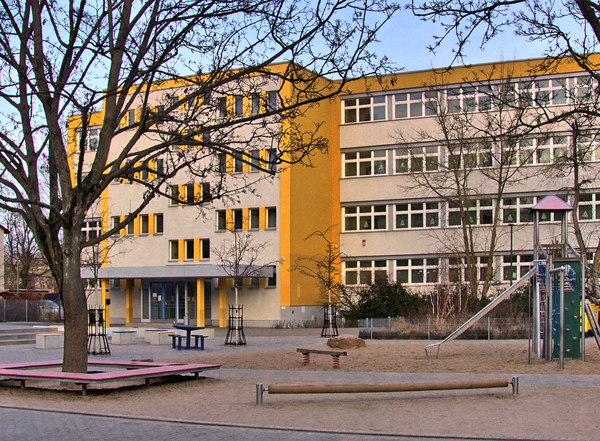
  </a>
  <figcaption>Friedrichsfelder Schule (Grundschule). Lincolnstraße 67, 10315 Berlin. Фото: <a target="_blank" rel="noopener noreferrer" href="https://www.flickr.com/photos/25054024@N00/54636525817/">Silvio Schwartz</a> · <a target="_blank" rel="noopener noreferrer" href="https://creativecommons.org/licenses/by-sa/4.0/">CC BY-SA 4.0</a> · <a target="_blank" rel="noopener noreferrer" href="https://www.google.com/maps/search/?api=1&amp;query=52.5030000,13.5035500">Google Maps</a></figcaption>
</figure>

## Школа для нового города

В ГДР типовым стало не только жильё. Вместе с новыми кварталами нужно было строить школы, причём быстро и сразу с кабинетами физики, химии, мастерскими, столовой и местом для продлёнки. Политехническая школа объединяла десять классов: теоретическое обучение должно было соседствовать с практической работой.

Масштаб был вполне промышленный. По данным [каталога Конференции министров образования Германии, KMK](https://www.kmk.org/fileadmin/Dateien/veroeffentlichungen_beschluesse/1999/1999_01_01-Typenschulbauten-3-Typenbauten.pdf){:target="_blank" rel="noopener noreferrer"}, в ГДР построили около 2500 типовых школ примерно на 1,2 миллиона учеников. Часто рассчитывали на 720 мест: два параллельных класса на каждом из десяти учебных годов, до 36 детей в классе. По обследованию 1988 года больше половины классных комнат страны находились в типовых зданиях.

Единого проекта на всю страну при этом не было. Чаще всего строили «тип Эрфурт», а Берлин разработал собственную серию: длинный компактный корпус с железобетонным каркасом.

Прототип появился в 1965–1966 годах на [Singerstraße 87](https://www.google.com/maps/search/?api=1&query=Singerstra%C3%9Fe+87+10243+Berlin){:target="_blank" rel="noopener noreferrer"} во Friedrichshain. Это была Alex-Wedding-Oberschule, позднее Bernhard-Rose-Schule; сейчас здание числится вторым корпусом Blumen-Grundschule. Проект разработали **Герхард Хёльке и Вольфганг Радке** из VEB Berlin-Projekt, а от адреса первого здания пошло название «тип Singerstraße». Цифры в названиях — это годы: SK 66 указывает на постройку первого здания, SK 68 — на официальную типизацию проекта в 1968 году. Радке потом руководил проектированием крупных объектов центра Восточного Берлина, в том числе комплекса на Karl-Liebknecht-Straße и Markthalle на Alexanderplatz, как пишет [сайт SK68 Berlin](https://www.sk68-berlin.de/architekten/){:target="_blank" rel="noopener noreferrer"}.

Строили серию до 1983 года. С числом построенных экземпляров всё менее однозначно. В [статье Сюзанны Метц о переустройстве такой школы в библиотеку](https://edoc.hu-berlin.de/server/api/core/bitstreams/d73cd714-3509-4118-ad4b-7446a51b9eed/content){:target="_blank" rel="noopener noreferrer"} говорится примерно о 150 берлинских зданиях к началу 1980-х. [Deutsches Architektenblatt](https://www.dabonline.de/nachhaltigkeit/ungehobener-schatz-in-ostberlins-typenschulen-schlummern-potenziale){:target="_blank" rel="noopener noreferrer"} оценивает серию примерно в 180 школ, из которых стоят около 120, и подчёркивает, что точного списка нет. Сенат Берлина в 2019 году [насчитал 101 такое здание](https://pardok.parlament-berlin.de/starweb/adis/citat/VT/18/SchrAnfr/s18-19013.pdf){:target="_blank" rel="noopener noreferrer"} в собственности города: 30 в Лихтенберге, 25 в Панкове, 22 в Трептов-Кёпенике, 15 в Марцан-Хеллерсдорфе и 9 во Фридрихсхайн-Кройцберге; по Mitte данных не дали.

## Причём здесь СССР

7 декабря 1954 года Хрущёв выступил с [речью об индустриализации строительства](https://archis.org/volume/industrialised-building-speech-1954/){:target="_blank" rel="noopener noreferrer"}: сокращать затраты, шире применять сборный железобетон, переносить работу со стройплощадки на завод. Уже в 1955 году ГДР взяла тот же курс, как описывает [историк архитектуры Йёрн Дювель](https://www.owep.de/artikel/1157-architektur-in-ddr-oder-architektur-ddr){:target="_blank" rel="noopener noreferrer"}. Знакомый школьный корпус появился примерно через десять лет после этого поворота.

Советский образец повлиял и на содержание учёбы. С 1958 года в ГДР проводили политехнизацию школы: занятия связывали с работой на предприятиях, мастерскими, школьным садом и техническим черчением. Отсюда и требования к зданию — лаборатории, мастерские, помещения для практики. Сама десятилетняя POS при этом сложилась в ГДР в собственной форме, как отмечает [Федеральное агентство политического образования](https://www.bpb.de/shop/zeitschriften/izpb/deutschland-in-den-50er-jahren-256/10136/kultur-im-wiederaufbau-teil-2/){:target="_blank" rel="noopener noreferrer"}.

## Что именно здесь типовое

Буквы SK относятся к *Skelettbauweise*, каркасной конструкции. Здание держится на железобетонных стойках и балках, а наружные панели образуют только оболочку. Внутренних несущих стен почти нет. Поэтому привычное слово «панелька» описывает внешний вид лишь отчасти: для переустройства важен именно каркас.

Планировка тоже узнаваемая. Классы выстроены в ряд вдоль одного длинного коридора, специализированные помещения — у торцов. Главный вход расположен со стороны классов, а со стороны коридора выступает узкий блок с главной лестницей и санузлами. Его небольшие окна на разных уровнях и создают тот рисунок, который первым бросается в глаза на фотографиях.

Школа была буквально изделием из каталога. В [альбоме 1967 года из строительного архива ГДР](https://bauarchivddr.bbr-server.de/bauarchivddr/archiv/plarchiv/03539-0686/akten-und-mappen-pdf/03539-0686-schulen-3-2-01-zweiz-allgem-pos-skelettbauw-2mp-Berlin-1967.pdf){:target="_blank" rel="noopener noreferrer"} рядом с планами стоят площади, стоимость, ведомость элементов и даже марка монтажного крана. На один корпус приходилось **2424 сборных элемента**, длина здания — почти 66 метров.

Внутри помещался небольшой самостоятельный мир. На плане есть библиотека, кабинет врача, помещения для кружков, две мастерские площадью около 81 и 91 квадратного метра, комната смотрителя и даже *Frauenruheraum*, комната отдыха для женщин. Обычный класс занимал примерно 54–55 квадратных метров. Коридор по проекту служил и местом для перемен.

### Что поменяли в 1978 году

У серии были варианты. В [техническом каталоге KMK, раздел «Typ Berlin SK», страница 63](https://www.kmk.org/fileadmin/veroeffentlichungen_beschluesse/1999/1999_01_01-Typenschulbauten-in-den-neuen-Laendern-komplett.pdf){:target="_blank" rel="noopener noreferrer"}, указаны четыре этажа с подвалом у ранних зданий и пять этажей без подвала у варианта с 1978 года. Высота этажа в обоих случаях 3,3 метра.

За этой разницей стоит переделка проекта в 1976–1977 годах. Как объясняет [альбом 1978 года](https://bauarchivddr.bbr-server.de/bauarchivddr/archiv/plarchiv/03539-0686/akten-und-mappen-pdf/03539-0686-schulen-3-2-01-zweiz-allgem-pos-skelettbauw-2mp-berlin-1978.pdf){:target="_blank" rel="noopener noreferrer"}, подвал подняли из земли и получили пять полноценных этажей. Кабинет химии перенесли на первый этаж, учли помещения продлёнки, разработали вариант с квартирой смотрителя. Так что разные этажность и пропорции ещё не означают другую серию.

А цвет сегодня вообще плохой ориентир. За полвека школы успели утеплить, перекрасить, заменить окна, получить лифты и пристройки. Где-то ленточные окна остались почти без изменений, где-то первоначальный фасад уже приходится угадывать.

## После ГДР: снести, утеплить, приспособить

Судьбы у близнецов оказались разными. Одни продолжают работать школами. Другие снесены. Некоторые получили совсем новую функцию.

Начать стоит с самого прототипа. В 2006–2007 годах архитекторы huber staudt обновили Bernhard-Rose-Schule и соседнюю Blumen-Grundschule. Вдоль длинных фасадов повесили ламели из анодированных алюминиевых профилей разных оттенков, от светлого металла до тёмно-коричневого. При этом сохранили рельефную бетонную облицовку, узкие стальные рамы окон у лестниц и санузлов, мозаики у входов и большой рельеф на торце Blumen-Grundschule, как описывает [BauNetz](https://www.baunetzwissen.de/fassade/objekte/kultur-bildung/sanierung-der-bernhard-rose-schule-und-blumen-grundschule-in-berlin-70598){:target="_blank" rel="noopener noreferrer"}. Первый корпус серии теперь выглядит иначе, но по фасаду по-прежнему видно, где какой класс.

Самая известная смена функции — **районная центральная библиотека Pablo Neruda**, Frankfurter Allee 14A. Бывшую Heinrich-Hertz-Schule перестроили по проекту бюро Peter W. Schmidt, и 11 ноября 2010 года здесь открылась библиотека. Как школьный корпус превратился в публичную библиотеку, подробно рассказывает [статья Метц](https://edoc.hu-berlin.de/server/api/core/bitstreams/d73cd714-3509-4118-ad4b-7446a51b9eed/content){:target="_blank" rel="noopener noreferrer"}.

<figure class="sk68-feature">
  <a target="_blank" rel="noopener noreferrer" href="https://www.google.com/maps/search/?api=1&amp;query=52.5145699,13.4570278" aria-label="Stadtbibliothek Friedrichshain-Kreuzberg Bezirkszentralbibliothek Pablo Neruda — Google Maps">
    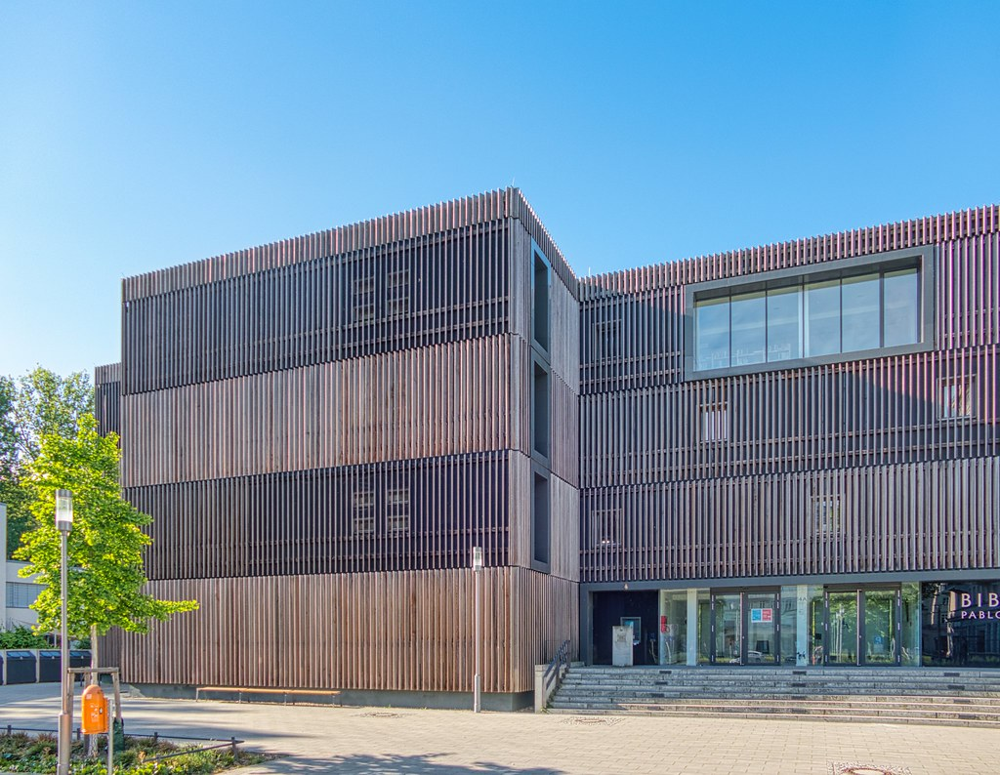
  </a>
  <figcaption>Stadtbibliothek Friedrichshain-Kreuzberg Bezirkszentralbibliothek Pablo Neruda. Frankfurter Allee 14 A, 10247 Berlin. Фото: <a target="_blank" rel="noopener noreferrer" href="https://www.flickr.com/photos/25054024@N00/54377464978/">Silvio Schwartz</a> · <a target="_blank" rel="noopener noreferrer" href="https://creativecommons.org/licenses/by-sa/4.0/">CC BY-SA 4.0</a> · <a target="_blank" rel="noopener noreferrer" href="https://www.google.com/maps/search/?api=1&amp;query=52.5145699,13.4570278">Google Maps</a></figcaption>
</figure>

Другой путь виден на **Grundschule am Teutoburger Platz**, Templiner Straße 1. В 2010–2012 годах её перестроили с оглядкой на стандарт пассивного дома, добавили пятиэтажную пристройку с лифтом и вентиляцию с рекуперацией тепла. [Klatt und Vogler](https://www.kuv-architekten.de/projekte/bildungsbauten/grundschule-am-teutoburger-platz/){:target="_blank" rel="noopener noreferrer"} прямо называют эту работу пилотным проектом санации типа SK Berlin.

<figure class="sk68-feature">
  <a target="_blank" rel="noopener noreferrer" href="https://www.google.com/maps/search/?api=1&amp;query=52.5336353,13.4086508" aria-label="Grundschule am Teutoburger Platz — Google Maps">
    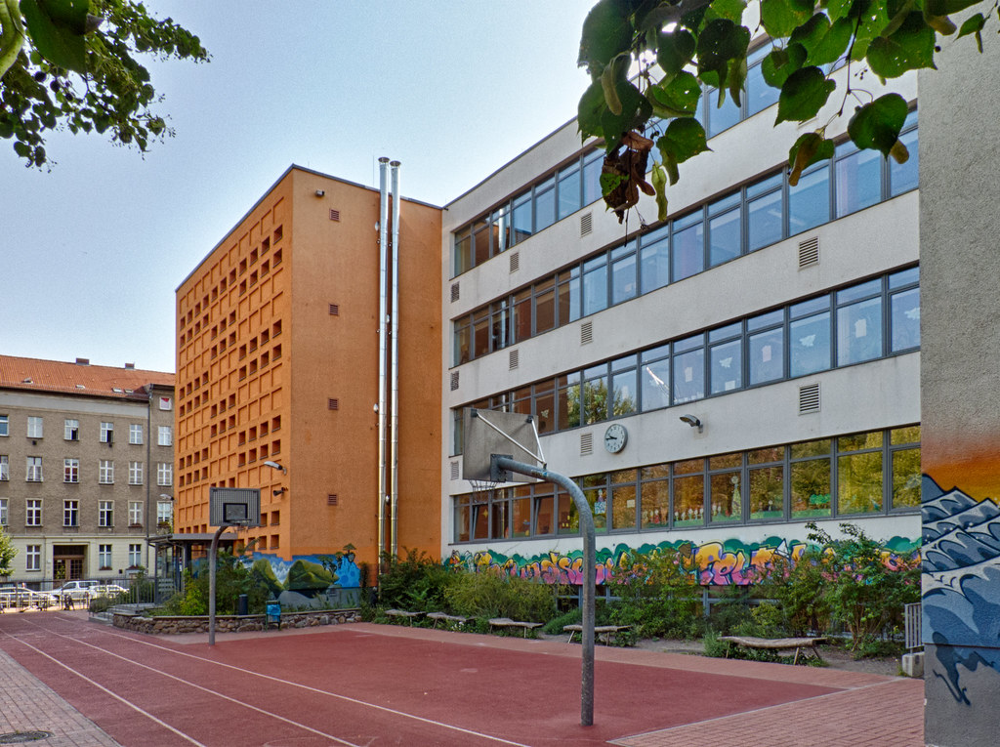
  </a>
  <figcaption>Grundschule am Teutoburger Platz. Templiner Str. 1, 10119 Berlin. Фото: <a target="_blank" rel="noopener noreferrer" href="https://www.flickr.com/photos/25054024@N00/54651469001/">Silvio Schwartz</a> · <a target="_blank" rel="noopener noreferrer" href="https://creativecommons.org/licenses/by-sa/4.0/">CC BY-SA 4.0</a> · <a target="_blank" rel="noopener noreferrer" href="https://www.google.com/maps/search/?api=1&amp;query=52.5336353,13.4086508">Google Maps</a></figcaption>
</figure>

### Почему их почти не надстраивают

Каркас позволяет свободно перекраивать этажи, но не любит дополнительной нагрузки. На **Modersohn-Grundschule**, Niemannstraße 3, число учеников с 2001 по 2011 год почти удвоилось, а места на участке не было. Поэтому в 2010–2011 годах район впервые решился надстроить действующее здание: появился новый этаж с шестью классами под односкатной крышей, проект стоил около 2 миллионов евро. В плоской кровле по ходу работ нашли вредные вещества, которые пришлось убирать. Об этом рассказывает [проектный лист программы Stadtumbau Ost](https://www.live.stadtumbau-berlin.de/ostkreuz-friedrichshain/modersohn-grundschule-aufstockung.pdf){:target="_blank" rel="noopener noreferrer"}.

<figure class="sk68-feature">
  <a target="_blank" rel="noopener noreferrer" href="https://www.google.com/maps/search/?api=1&amp;query=52.5070500,13.4602400" aria-label="Modersohn-Grundschule — Google Maps">
    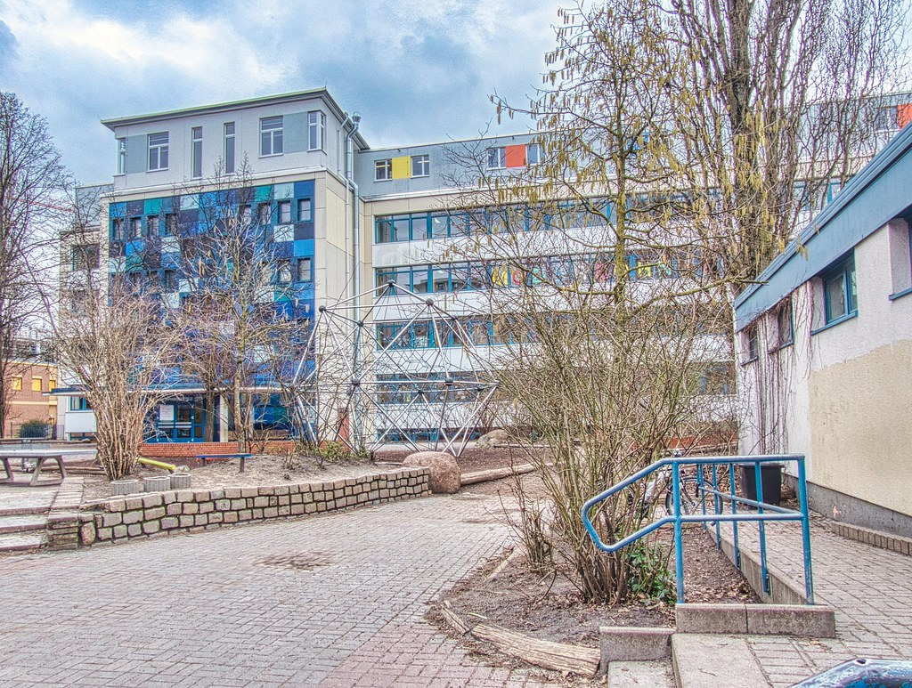
  </a>
  <figcaption>Modersohn-Grundschule. Niemannstraße 3, 10245 Berlin. Фото: <a target="_blank" rel="noopener noreferrer" href="https://www.flickr.com/photos/25054024@N00/54883199108/">Silvio Schwartz</a> · <a target="_blank" rel="noopener noreferrer" href="https://creativecommons.org/licenses/by-sa/4.0/">CC BY-SA 4.0</a> · <a target="_blank" rel="noopener noreferrer" href="https://www.google.com/maps/search/?api=1&amp;query=52.5070500,13.4602400">Google Maps</a></figcaption>
</figure>

Повторять этот опыт город не стал. В [ответе Сената 2019 года](https://pardok.parlament-berlin.de/starweb/adis/citat/VT/18/SchrAnfr/s18-19013.pdf){:target="_blank" rel="noopener noreferrer"} сказано, что у типовых зданий нет никакого запаса несущей способности, а надстройка Modersohn-Grundschule потребовала дополнительного усиления и оказалась неэкономичной. Экономичными Сенат назвал только пристройки. Идея всё равно возвращается: в 2025 году левые в Марцан-Хеллерсдорфе [предложили проверить надстройки и пристройки типовых школ](https://www.berliner-zeitung.de/article/kommt-die-rueckkehr-der-ddr-typenbauten-fuer-schulen-2323912){:target="_blank" rel="noopener noreferrer"}, потому что району не хватает более двух тысяч мест в начальной школе.

### Вместо уроков — репетиции и балет

**Theaterhaus Berlin Mitte** в 2009 году после нескольких временных адресов [обосновался в бывшей школе](https://www.theaterhaus-berlin.com/en/our-profile/){:target="_blank" rel="noopener noreferrer"} между Wallstraße и Neue Jakobstraße, на [Neue Roßstraße 4](https://www.google.com/maps/search/?api=1&query=Neue+Ro%C3%9Fstra%C3%9Fe+4+10179+Berlin){:target="_blank" rel="noopener noreferrer"}. Отдельные классы вдоль коридора оказались удобными репетиционными комнатами для независимых театральных и танцевальных коллективов.

У **Staatliche Ballettschule Berlin**, [Erich-Weinert-Straße 103](https://www.google.com/maps/search/?api=1&query=Staatliche+Ballettschule+Berlin+Erich-Weinert-Stra%C3%9Fe+103){:target="_blank" rel="noopener noreferrer"}, сохранили четырёхэтажный школьный корпус и достроили вокруг него специализированный комплекс. По проекту [gmp](https://www.gmp.de/de/projekte/545/staatliche-ballettschule){:target="_blank" rel="noopener noreferrer"} появились девять балетных залов на двух этажах и новый интернат. Изогнутый многоэтажный холл и переход на уровне третьего этажа связывают старую школу с новыми корпусами.

### Корпус, который снова понадобился

На Alfred-Randt-Straße в Кёпенике в 1982 году открыли два одинаковых корпуса **Müggelschlößchen-Schule**. Позднее один из них, [дом 54](https://www.google.com/maps/search/?api=1&query=Alfred-Randt-Stra%C3%9Fe+54+12559+Berlin){:target="_blank" rel="noopener noreferrer"}, опустел. Его полностью реконструировали по проекту Landherr Architekten und Ingenieure: добавили пристройку с лифтом, столовую, библиотеку и помещения продлёнки, а на крыше установили солнечные панели. В апреле 2024 года начальная школа переехала сюда из соседнего дома 56. [Районная администрация](https://www.berlin.de/ba-treptow-koepenick/aktuelles/pressemitteilungen/2024/pressemitteilung.1433070.php){:target="_blank" rel="noopener noreferrer"} оценила работы примерно в 12 миллионов евро.

## Деревянные фасады, сады на крыше и солнечные панели

**Freie Waldorfschule am Prenzlauer Berg**, [Gürtelstraße 16](https://www.google.com/maps/search/?api=1&query=Freie+Waldorfschule+am+Prenzlauer+Berg+G%C3%BCrtelstra%C3%9Fe+16){:target="_blank" rel="noopener noreferrer"}, в 2016–2018 годах получила новый фасад из заранее изготовленных деревянных элементов по проекту MONO Architekten. Индустриальное здание утеплили похожим индустриальным способом, причём при продолжающихся занятиях: переселить школу было некуда. По [данным Energiesprong](https://www.energiesprong.de/projekte-anbieter/projekte-in-deutschland/freie-waldorfschule-am-prenzlauer-berg-berlin/){:target="_blank" rel="noopener noreferrer"}, расчётная экономия первичной энергии составила около 402 тысяч кВт·ч в год.

Плоская крыша тоже пригодилась. У **Berlin Bilingual School**, [Weinstraße 1](https://www.google.com/maps/search/?api=1&query=Berlin+Bilingual+School+Weinstra%C3%9Fe+1){:target="_blank" rel="noopener noreferrer"}, весной 2021 года озеленили 595 из 812 квадратных метров кровли, как показывает [презентация Берлинского агентства дождевой воды](https://regenwasseragentur.berlin/wp-content/uploads/2025/03/Praesentation-Berlin_Bilingual_School.pdf){:target="_blank" rel="noopener noreferrer"}.

А на **Brodowin-Schule**, [Liebenwalder Straße 20–22](https://www.google.com/maps/search/?api=1&query=Brodowin-Schule+Liebenwalder+Stra%C3%9Fe+20+22+Berlin){:target="_blank" rel="noopener noreferrer"}, в июле 2020 года заработали 106 солнечных модулей. Они должны давать около 25 800 кВт·ч в год, примерно 70% школьного потребления электричества. У школы есть огород и партнёрство с экопоселением Brodowin, куда регулярно ездят младшие классы; это описано в [городском проекте «Климатическая защита в школах»](https://www.berlin.de/sen/uvk/klimaschutz/klimaschutz-in-der-umsetzung/klimaschutz-und-bildung/klimaschutz-an-schulen/schulportraits/brodowin-schule-1036261.php){:target="_blank" rel="noopener noreferrer"}. Школьный сад из политехнической программы никуда не исчез, только задачи у него теперь другие.

## Школа гражданской обороны

У корпуса на [Wiltbergstraße 29G в Buch](https://www.google.com/maps/search/?api=1&query=Wiltbergstra%C3%9Fe+29G+13125+Berlin){:target="_blank" rel="noopener noreferrer"}, который сейчас пустует, была совсем другая специализация. Здесь размещалась районная школа гражданской обороны Берлина, получившая имя **Hermann Gartmann**. В тех же типовых стенах готовили взрослых к действиям в чрезвычайных ситуациях.

[Neues Deutschland 5 февраля 1982 года](https://www.nd-archiv.de/artikel/376217.ehrenname-an-bezirksschule-der-zivil-verteidigung-verliehen-seit-eroeffnung-wurden-36-000-werktaetige-ausgebildet.html){:target="_blank" rel="noopener noreferrer"} сообщала о **36 тысячах работников, прошедших подготовку с момента открытия школы**. Церемонию присвоения имени накануне сняли на 16-миллиметровую плёнку; [фильм есть в каталоге filmportal](https://www.filmportal.de/film/bezirksschule-der-zivilverteidgung-berlin-namensverleihung-hermann-gartmann-4-februar-1982){:target="_blank" rel="noopener noreferrer"}. За одинаковым фасадом обнаруживается целый кусок истории холодной войны.

## Искусство и память рядом с типовым корпусом

### Стекло, бронза и Леонардо

У входа в прототип на Singerstraße 87 стоит трёхметровая стела **«Polytechnisches Wissen» — «Политехнические знания»**. Фридрих Бернхард Хенкель создал её в 1966–1969 годах из бронзы и цветного стекла. На двух квадратных пластинах видны человеческие фигуры, вписанные в круг по образцу идеального человека Леонардо да Винчи. Подробно её разбирает [каталог берлинской скульптуры](https://bildhauerei-in-berlin.de/bildwerk/polytechnisches-wissen-7128/){:target="_blank" rel="noopener noreferrer"}.

### Память о людях, которые прятали Ханса Розенталя

У **Schule am Roederplatz**, [Bernhard-Bästlein-Straße 22](https://www.google.com/maps/search/?api=1&query=Schule+am+Roederplatz+Bernhard-B%C3%A4stlein-Stra%C3%9Fe+22+Berlin){:target="_blank" rel="noopener noreferrer"}, в 2011 году установили памятный знак **Иде Яух, Эмме Харндт и Марии Шёнебек**. Они помогли юному Хансу Розенталю, будущему радио- и телеведущему, скрыться от нацистов. На открытии шестиклассники школы читали тексты и пели «Shalom», рассказывает [каталог памятных мест Лихтенберга](https://www.berlin.de/ba-lichtenberg/ueber-den-bezirk/erinnerungskultur/gedenktafeln-und-mahnmale/artikel.1054817.php){:target="_blank" rel="noopener noreferrer"}.

### Мозаика, пережившая школу

В Buch, на [Karower Chaussee 97](https://www.google.com/maps/search/?api=1&query=Karower+Chaussee+97+13125+Berlin){:target="_blank" rel="noopener noreferrer"}, старый корпус Hufeland-Schule снесли. В 2023 году на его месте [открыли новую начальную школу](https://www.berlin.de/ba-pankow/aktuelles/pressemitteilungen/2023/pressemitteilung.1344775.php){:target="_blank" rel="noopener noreferrer"} на 576 мест примерно за 50 миллионов евро. Классы в ней сгруппированы вокруг общих пространств, и сенатор по образованию назвала её отказом от классической «коридорной школы» — то есть ровно от того, чем был SK Berlin.

От прежней школы сохранили мозаичную стенку **«Lernen und Freizeit» — «Учёба и досуг»**, работу Вернера Петриха и Ханфрида Шульца 1976 года. На время стройки её демонтировали, чтобы потом установить заново на участке. История описана в [журнале kunststadt stadtkunst, выпуск 70, страницы 36–37](https://www.bbk-kulturwerk.de/sites/default/files/2023-06/skks%20Nr%2070-2023_0.pdf#page=38){:target="_blank" rel="noopener noreferrer"}, а в [берлинском реестре памятников](https://denkmaldatenbank.berlin.de/daobj.php?obj_dok_nr=09090052){:target="_blank" rel="noopener noreferrer"} стенка числится самостоятельным объектом. Художественная часть типового комплекса пережила само здание.

## Можно ли учиться по-новому в старой школе

У **Evangelische Schule Berlin Zentrum**, [Wallstraße 32](https://www.google.com/maps/search/?api=1&query=Evangelische+Schule+Berlin+Zentrum+Wallstra%C3%9Fe+32){:target="_blank" rel="noopener noreferrer"}, дело дошло до пересмотра самой планировки. В ноябре 2024 года для двух школьных корпусов выбрали проект кёльнского бюро **BeL** и ландшафтных архитекторов **Rabe**. [Школьный фонд EKBO](https://www.schulstiftung-ekbo.de/werkstattverfahren-umbau-der-evangelischen-schule-berlin-zentrum-gewinner-entwurf-steht-fest/){:target="_blank" rel="noopener noreferrer"} отмечает, что железобетонный каркас с небольшим числом несущих стен даёт свободу для переделки.

Внутренние стены частично уберут, а пространство будут делить складными перегородками и занавесями. Нижние уровни откроют в сторону сада между корпусами. Это пока **проект будущего переустройства**; его подробно разбирает [Deutsches Architektenblatt в октябре 2026 года](https://www.dabonline.de/nachhaltigkeit/ungehobener-schatz-in-ostberlins-typenschulen-schlummern-potenziale){:target="_blank" rel="noopener noreferrer"}. Каркас, придуманный ради серийного строительства, оказался полезен и для школы, где дети не должны весь день сидеть в одном классе.

## На экране

Одинаковые школы часто попадали в кадр. По [подборке SK68 Berlin](https://www.sk68-berlin.de/rezeption/){:target="_blank" rel="noopener noreferrer"}, в Müggelschlößchen-Schule снимали «Солнечную аллею» (*Sonnenallee*, 1999), в Grundschule am Bürgerpark — сцену поднятия флага в экранизации «Бессонных дней» Юрека Беккера (1991), а в Schmetterlings-Grundschule — эпизод сериала *Polizeiruf 110* (2010). Для истории о восточном Берлине трудно найти более узнаваемую декорацию.

Мне в этой истории интереснее всего именно повторение. Сначала замечаешь одинаковые окна. Потом начинаешь видеть различия: где сохранили вход, где вырос новый корпус, где за деревьями почти исчезла целая школа. Один проект становится способом читать несколько десятилетий городской истории.

## Фотографии и адреса

Эту серию много лет исследует и фотографирует **Сильвио Шварц (Silvio Schwartz)**, автор [Instagram berlin_sk68](https://www.instagram.com/berlin_sk68/){:target="_blank" rel="noopener noreferrer"}, [одноимённого Flickr](https://www.flickr.com/photos/25054024@N00/){:target="_blank" rel="noopener noreferrer"} и [сайта SK68 Berlin](https://www.sk68-berlin.de/){:target="_blank" rel="noopener noreferrer"}. По его [рассказу о проекте](https://www.sk68-berlin.de/ueber/){:target="_blank" rel="noopener noreferrer"}, поиски начались примерно в 2016 году, съёмки — в 2017-м. Отправной точкой стала его собственная школа: Oberschule an der Weide в Марцане, где он учился в 1996–2003 годах. Вскоре её закрыли и снесли.

Корпусов в каталоге: 181, фотографий в галерее: 71; у каждой есть ссылки на Google Maps и оригинал снимка. Больше всего зданий в Lichtenberg, Marzahn-Hellersdorf и Pankow; дальше идут Treptow-Köpenick, Mitte и Friedrichshain-Kreuzberg. Есть и соседний Шёнефельд в Бранденбурге — корпус Oberstufenzentrum Dahme-Spreewald. Галерея сгруппирована по районам, а полный список, включая снесённые здания и адреса без фотографий, раскрывается внизу.

Фотографии: Сильвио Шварц, [CC BY-SA 4.0](https://creativecommons.org/licenses/by-sa/4.0/){:target="_blank" rel="noopener noreferrer"}. Снимки уменьшены без кадрирования и распространяются по той же лицензии.

  

    
Brandenburg / Schönefeld · зданий с фотографиями: 1

    

      <figure class="sk68-card" id="sk68-oberstufenzentrum-dahme-spreewald-abteilung-1-schoenefeld">
        

        <a id="sk68-54883223258" target="_blank" rel="noopener noreferrer" href="https://www.google.com/maps/search/?api=1&amp;query=52.3955500,13.5347600" aria-label="Oberstufenzentrum Dahme-Spreewald – Abteilung 1 Schönefeld — Google Maps">
          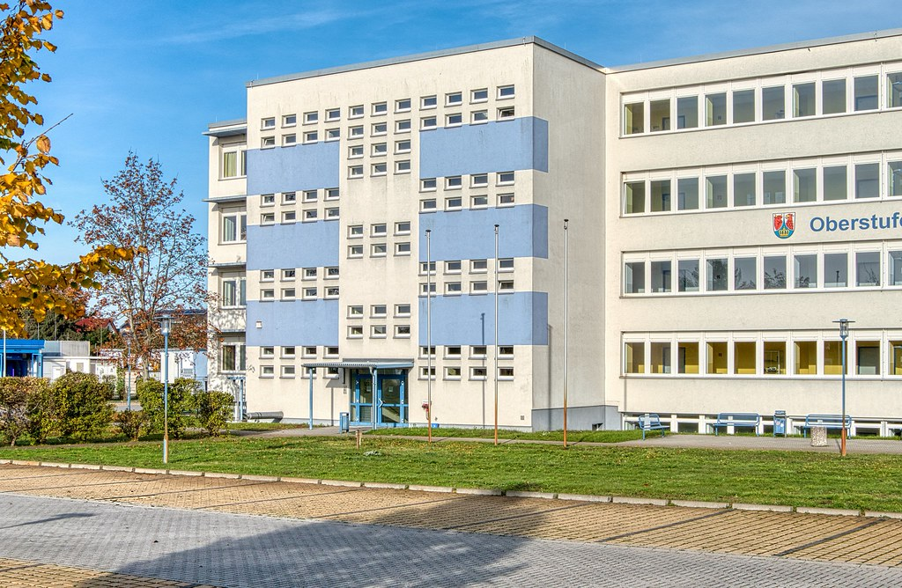
        </a>
        

        <figcaption>
          <h4>Oberstufenzentrum Dahme-Spreewald – Abteilung 1 Schönefeld</h4>
          
Am Seegraben 84, 12529 Schönefeld

          
Год неизвестен · Учебное заведение

          
<a target="_blank" rel="noopener noreferrer" href="https://www.google.com/maps/search/?api=1&amp;query=52.3955500,13.5347600">Google Maps</a> · <a target="_blank" rel="noopener noreferrer" href="https://www.sk68-berlin.de/standort/oberstufenzentrum-dahme-spreewald-abteilung-1-schoenefeld/">О здании</a>

          
Фото: <a target="_blank" rel="noopener noreferrer" href="https://www.flickr.com/photos/25054024@N00/54883223258/">Silvio Schwartz</a> · <a target="_blank" rel="noopener noreferrer" href="https://creativecommons.org/licenses/by-sa/4.0/">CC BY-SA 4.0</a>

        </figcaption>
      </figure>
    

  

  

    
Friedrichshain-Kreuzberg · зданий с фотографиями: 6

    

      <figure class="sk68-card" id="sk68-berlin-bilingual-school">
        

        <a id="sk68-54603714911" target="_blank" rel="noopener noreferrer" href="https://www.google.com/maps/search/?api=1&amp;query=52.5250972,13.4251730" aria-label="Berlin Bilingual School — Google Maps">
          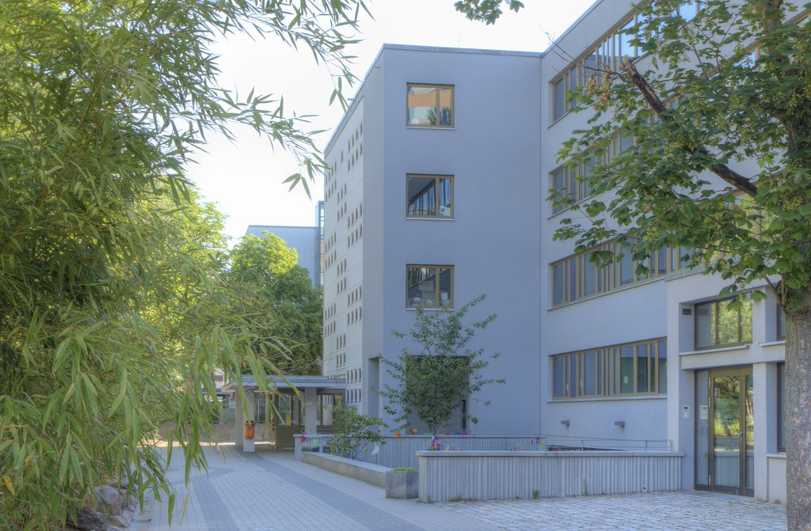
        </a>
        

        <figcaption>
          <h4>Berlin Bilingual School</h4>
          
Weinstraße 1, 10249 Berlin

          
1969 · Учебное заведение

          
В ГДР: 29. POS „Rosa Luxemburg“

          
<a target="_blank" rel="noopener noreferrer" href="https://www.google.com/maps/search/?api=1&amp;query=52.5250972,13.4251730">Google Maps</a> · <a target="_blank" rel="noopener noreferrer" href="https://www.sk68-berlin.de/standort/berlin-bilingual-school/">О здании</a>

          
Фото: <a target="_blank" rel="noopener noreferrer" href="https://www.flickr.com/photos/25054024@N00/54603714911/">Silvio Schwartz</a> · <a target="_blank" rel="noopener noreferrer" href="https://creativecommons.org/licenses/by-sa/4.0/">CC BY-SA 4.0</a>

        </figcaption>
      </figure>
      <figure class="sk68-card" id="sk68-margarethe-von-witzleben-schule">
        

        <a id="sk68-54910003838" target="_blank" rel="noopener noreferrer" href="https://www.google.com/maps/search/?api=1&amp;query=52.5198400,13.4346000" aria-label="Margarethe-von-Witzleben-Schule — Google Maps">
          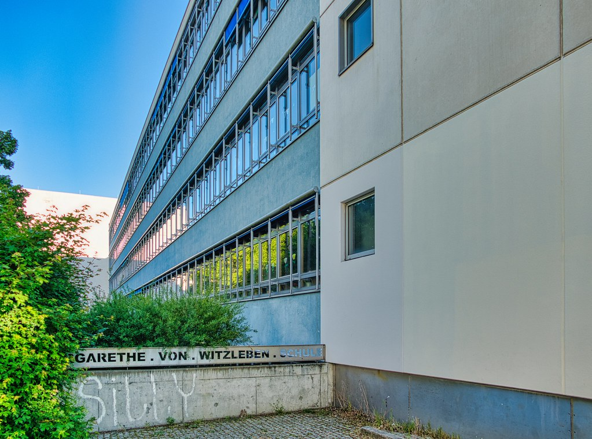
        </a>
        

        <figcaption>
          <h4>Margarethe-von-Witzleben-Schule</h4>
          
Palisadenstraße 76, 10243 Berlin

          
1973 · Учебное заведение

          
В ГДР: 24. Oberschule

          
<a target="_blank" rel="noopener noreferrer" href="https://www.google.com/maps/search/?api=1&amp;query=52.5198400,13.4346000">Google Maps</a> · <a target="_blank" rel="noopener noreferrer" href="https://www.sk68-berlin.de/standort/margarethe-von-witzleben-schule/">О здании</a>

          
Фото: <a target="_blank" rel="noopener noreferrer" href="https://www.flickr.com/photos/25054024@N00/54910003838/">Silvio Schwartz</a> · <a target="_blank" rel="noopener noreferrer" href="https://creativecommons.org/licenses/by-sa/4.0/">CC BY-SA 4.0</a>

        </figcaption>
      </figure>
      <figure class="sk68-card" id="sk68-modersohn-grundschule">
        

        
        

        <figcaption>
          <h4>Modersohn-Grundschule</h4>
          
Niemannstraße 3, 10245 Berlin

          
1969 · Учебное заведение

          
В ГДР: 30. POS „Franz Stenzer“

          
<a target="_blank" rel="noopener noreferrer" href="https://www.google.com/maps/search/?api=1&amp;query=52.5070500,13.4602400">Google Maps</a> · <a target="_blank" rel="noopener noreferrer" href="https://www.sk68-berlin.de/standort/modersohn-grundschule/">О здании</a>

          
Фото: <a target="_blank" rel="noopener noreferrer" href="https://www.flickr.com/photos/25054024@N00/54883199108/">Silvio Schwartz</a> · <a target="_blank" rel="noopener noreferrer" href="https://creativecommons.org/licenses/by-sa/4.0/">CC BY-SA 4.0</a>

        </figcaption>
      </figure>
      <figure class="sk68-card" id="sk68-spartacus-grundschule">
        

        <a id="sk68-54385550746" target="_blank" rel="noopener noreferrer" href="https://www.google.com/maps/search/?api=1&amp;query=52.5210600,13.4358200" aria-label="Spartacus-Grundschule — Google Maps">
          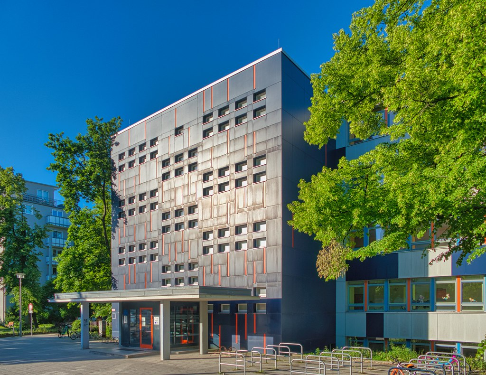
        </a>
        

        <figcaption>
          <h4>Spartacus-Grundschule</h4>
          
Friedenstraße 40, 10249 Berlin

          
1970 · Учебное заведение

          
В ГДР: Lenin-Oberschule

          
<a target="_blank" rel="noopener noreferrer" href="https://www.google.com/maps/search/?api=1&amp;query=52.5210600,13.4358200">Google Maps</a> · <a target="_blank" rel="noopener noreferrer" href="https://www.sk68-berlin.de/standort/spartacus-grundschule/">О здании</a>

          
Фото: <a target="_blank" rel="noopener noreferrer" href="https://www.flickr.com/photos/25054024@N00/54385550746/">Silvio Schwartz</a> · <a target="_blank" rel="noopener noreferrer" href="https://creativecommons.org/licenses/by-sa/4.0/">CC BY-SA 4.0</a>

        </figcaption>
      </figure>
      <figure class="sk68-card" id="sk68-stadtbibliothek-friedrichshain-kreuzberg-bezirkszentralbibliothek-pablo-neruda">
        

        
        

        <figcaption>
          <h4>Stadtbibliothek Friedrichshain-Kreuzberg Bezirkszentralbibliothek Pablo Neruda</h4>
          
Frankfurter Allee 14 A, 10247 Berlin

          
1969 · Другое использование

          
В ГДР: Heinrich-Hertz-Schule

          
<a target="_blank" rel="noopener noreferrer" href="https://www.google.com/maps/search/?api=1&amp;query=52.5145699,13.4570278">Google Maps</a> · <a target="_blank" rel="noopener noreferrer" href="https://www.sk68-berlin.de/standort/stadtbibliothek-friedrichshain-kreuzberg-bezirkszentralbibliothek-pablo-neruda/">О здании</a>

          
Фото: <a target="_blank" rel="noopener noreferrer" href="https://www.flickr.com/photos/25054024@N00/54377464978/">Silvio Schwartz</a> · <a target="_blank" rel="noopener noreferrer" href="https://creativecommons.org/licenses/by-sa/4.0/">CC BY-SA 4.0</a>

        </figcaption>
      </figure>
      <figure class="sk68-card" id="sk68-zille-grundschule">
        

        <a id="sk68-54883351814" target="_blank" rel="noopener noreferrer" href="https://www.google.com/maps/search/?api=1&amp;query=52.5089806,13.4653586" aria-label="Zille-Grundschule — Google Maps">
          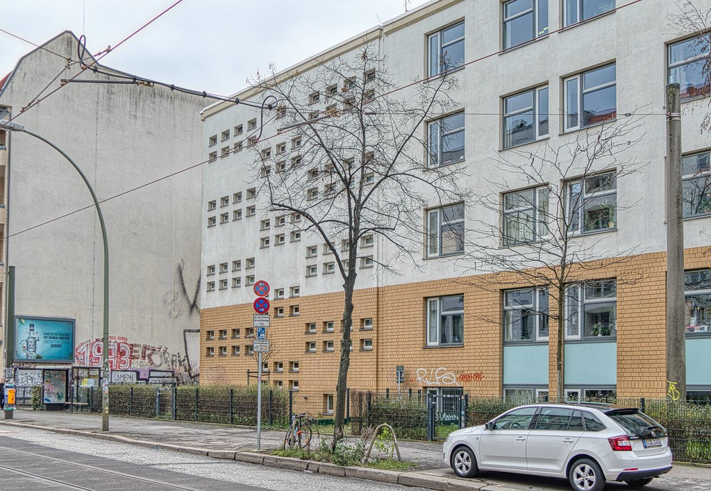
        </a>
        

        <figcaption>
          <h4>Zille-Grundschule</h4>
          
Boxhagener Straße 45–46, 10245 Berlin

          
1977 · Учебное заведение

          
В ГДР: Heinrich-Zille-Oberschule

          
<a target="_blank" rel="noopener noreferrer" href="https://www.google.com/maps/search/?api=1&amp;query=52.5089806,13.4653586">Google Maps</a> · <a target="_blank" rel="noopener noreferrer" href="https://www.sk68-berlin.de/standort/zille-grundschule/">О здании</a>

          
Фото: <a target="_blank" rel="noopener noreferrer" href="https://www.flickr.com/photos/25054024@N00/54883351814/">Silvio Schwartz</a> · <a target="_blank" rel="noopener noreferrer" href="https://creativecommons.org/licenses/by-sa/4.0/">CC BY-SA 4.0</a>

        </figcaption>
      </figure>
    

  

  

    
Lichtenberg · зданий с фотографиями: 12

    

      <figure class="sk68-card" id="sk68-bernhard-grzimek-schule-grundschule">
        

        <a id="sk68-54604045660" target="_blank" rel="noopener noreferrer" href="https://www.google.com/maps/search/?api=1&amp;query=52.4956745,13.5118272" aria-label="Bernhard-Grzimek-Schule (Grundschule) — Google Maps">
          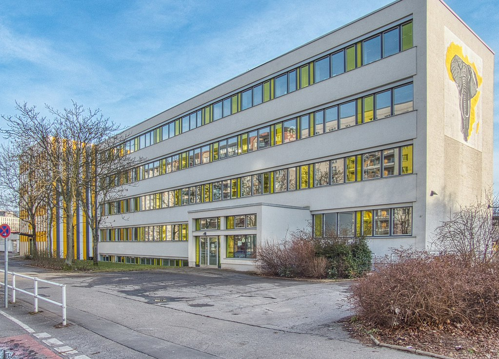
        </a>
        

        <figcaption>
          <h4>Bernhard-Grzimek-Schule (Grundschule)</h4>
          
Sewanstraße 184, 10319 Berlin

          
1976 · Учебное заведение

          
В ГДР: 18. POS „Martin Weise“ [Hans-Loch-Straße 258]

          
<a target="_blank" rel="noopener noreferrer" href="https://www.google.com/maps/search/?api=1&amp;query=52.4956745,13.5118272">Google Maps</a> · <a target="_blank" rel="noopener noreferrer" href="https://www.sk68-berlin.de/standort/bernhard-grzimek-schule-grundschule/">О здании</a>

          
Фото: <a target="_blank" rel="noopener noreferrer" href="https://www.flickr.com/photos/25054024@N00/54604045660/">Silvio Schwartz</a> · <a target="_blank" rel="noopener noreferrer" href="https://creativecommons.org/licenses/by-sa/4.0/">CC BY-SA 4.0</a>

        </figcaption>
      </figure>
      <figure class="sk68-card" id="sk68-brodowin-schule-grundschule">
        

        <a id="sk68-54608502388" target="_blank" rel="noopener noreferrer" href="https://www.google.com/maps/search/?api=1&amp;query=52.5373800,13.5006700" aria-label="Brodowin-Schule (Grundschule) — Google Maps">
          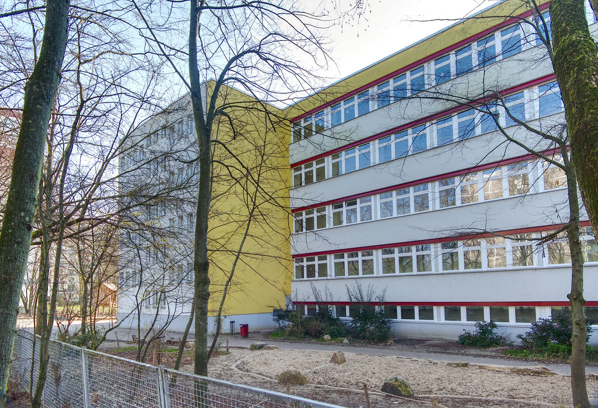
        </a>
        

        <figcaption>
          <h4>Brodowin-Schule (Grundschule)</h4>
          
Liebenwalder Str. 20–22, 13055 Berlin

          
1978 · Учебное заведение

          
В ГДР: 21. POS „Wassili Widorowitsch Orlow“

          
<a target="_blank" rel="noopener noreferrer" href="https://www.google.com/maps/search/?api=1&amp;query=52.5373800,13.5006700">Google Maps</a> · <a target="_blank" rel="noopener noreferrer" href="https://www.sk68-berlin.de/standort/brodowin-schule-grundschule/">О здании</a>

          
Фото: <a target="_blank" rel="noopener noreferrer" href="https://www.flickr.com/photos/25054024@N00/54608502388/">Silvio Schwartz</a> · <a target="_blank" rel="noopener noreferrer" href="https://creativecommons.org/licenses/by-sa/4.0/">CC BY-SA 4.0</a>

        </figcaption>
      </figure>
      <figure class="sk68-card" id="sk68-friedrich-list-schule-osz-bueromanagement-und-wirtschaftssprachen-filiale-fischerstrasse">
        

        <a id="sk68-54637568829" target="_blank" rel="noopener noreferrer" href="https://www.google.com/maps/search/?api=1&amp;query=52.4993700,13.4890300" aria-label="Friedrich-List-Schule (OSZ Büromanagement und Wirtschaftssprachen), Filiale Fischerstraße — Google Maps">
          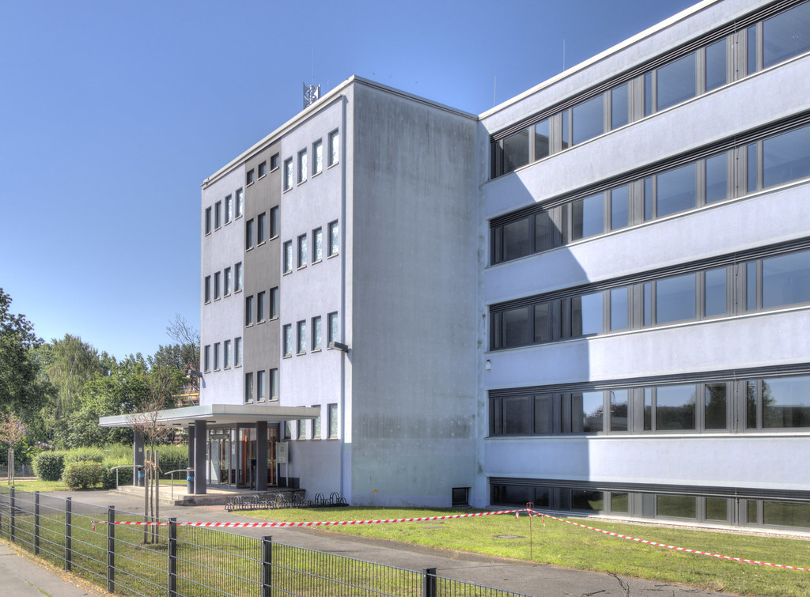
        </a>
        

        <figcaption>
          <h4>Friedrich-List-Schule (OSZ Büromanagement und Wirtschaftssprachen), Filiale Fischerstraße</h4>
          
Fischerstraße 32, 10317 Berlin

          
1970 · Учебное заведение

          
В ГДР: Berufsschule für Bürowirtschaft

          
<a target="_blank" rel="noopener noreferrer" href="https://www.google.com/maps/search/?api=1&amp;query=52.4993700,13.4890300">Google Maps</a> · <a target="_blank" rel="noopener noreferrer" href="https://www.sk68-berlin.de/standort/friedrich-list-schule-osz-bueromanagement-und-wirtschaftssprachen-filiale-fischerstrasse/">О здании</a>

          
Фото: <a target="_blank" rel="noopener noreferrer" href="https://www.flickr.com/photos/25054024@N00/54637568829/">Silvio Schwartz</a> · <a target="_blank" rel="noopener noreferrer" href="https://creativecommons.org/licenses/by-sa/4.0/">CC BY-SA 4.0</a>

        </figcaption>
      </figure>
      <figure class="sk68-card" id="sk68-friedrichsfelder-schule-grundschule">
        

        
        

        <figcaption>
          <h4>Friedrichsfelder Schule (Grundschule)</h4>
          
Lincolnstraße 67, 10315 Berlin

          
1968 · Учебное заведение

          
В ГДР: 16. POS „Julian Marchlewski“

          
<a target="_blank" rel="noopener noreferrer" href="https://www.google.com/maps/search/?api=1&amp;query=52.5030000,13.5035500">Google Maps</a> · <a target="_blank" rel="noopener noreferrer" href="https://www.sk68-berlin.de/standort/friedrichsfelder-schule-grundschule/">О здании</a>

          
Фото: <a target="_blank" rel="noopener noreferrer" href="https://www.flickr.com/photos/25054024@N00/54636525817/">Silvio Schwartz</a> · <a target="_blank" rel="noopener noreferrer" href="https://creativecommons.org/licenses/by-sa/4.0/">CC BY-SA 4.0</a>

        </figcaption>
      </figure>
      <figure class="sk68-card" id="sk68-hans-rosenthal-grundschule">
        

        <a id="sk68-55429945157" target="_blank" rel="noopener noreferrer" href="https://www.google.com/maps/search/?api=1&amp;query=52.5318300,13.4799800" aria-label="Hans-Rosenthal-Grundschule — Google Maps">
          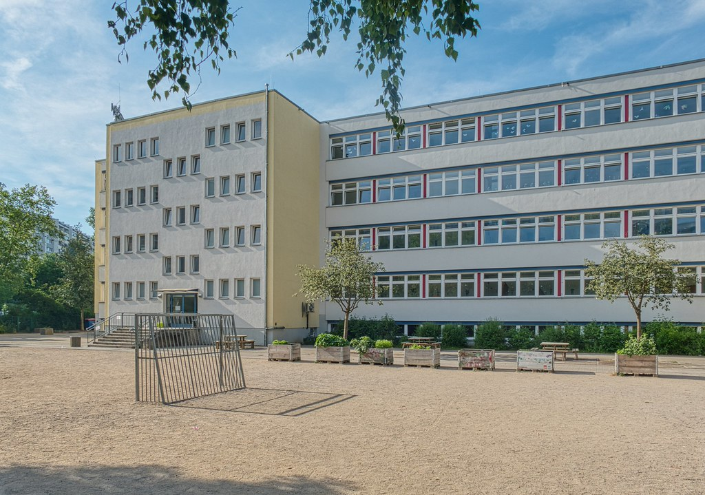
        </a>
        

        <figcaption>
          <h4>Hans-Rosenthal-Grundschule</h4>
          
Bernhard-Bästlein-Straße 56, 10367 Berlin

          
1973 · Учебное заведение

          
В ГДР: Willi-Sänger-Sprachheilschule (предположительно)

          
<a target="_blank" rel="noopener noreferrer" href="https://www.google.com/maps/search/?api=1&amp;query=52.5318300,13.4799800">Google Maps</a> · <a target="_blank" rel="noopener noreferrer" href="https://www.sk68-berlin.de/standort/hans-rosenthal-grundschule/">О здании</a>

          
Фото: <a target="_blank" rel="noopener noreferrer" href="https://www.flickr.com/photos/25054024@N00/55429945157/">Silvio Schwartz</a> · <a target="_blank" rel="noopener noreferrer" href="https://creativecommons.org/licenses/by-sa/4.0/">CC BY-SA 4.0</a>

        </figcaption>
      </figure>
      <figure class="sk68-card" id="sk68-hein-moeller-schule-osz-energietechnik-ii-haus-a">
        

        <a id="sk68-54878521767" target="_blank" rel="noopener noreferrer" href="https://www.google.com/maps/search/?api=1&amp;query=52.5234098,13.5127500" aria-label="Hein-Moeller-Schule (OSZ Energietechnik II) (Haus A) — Google Maps">
          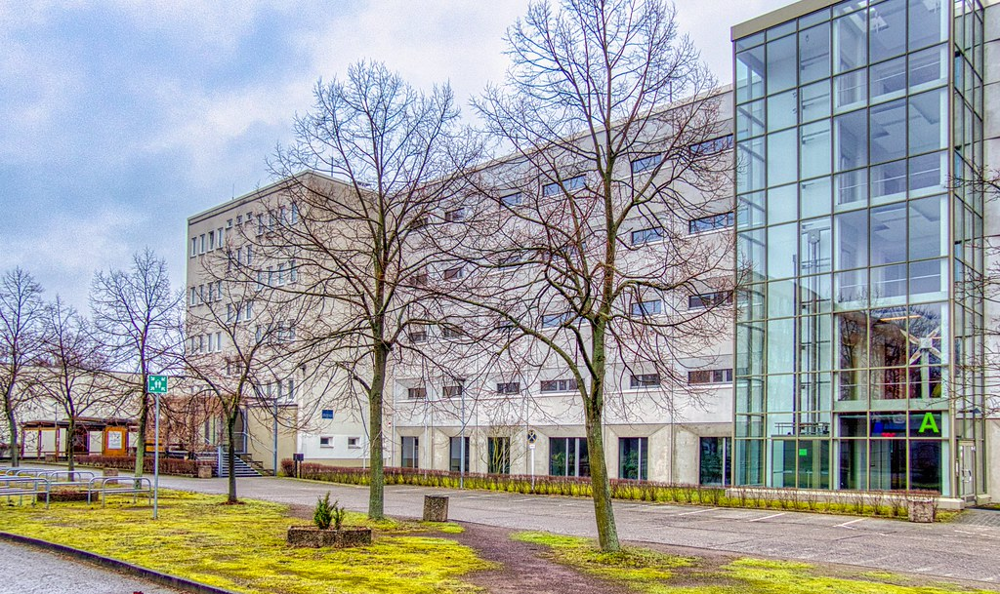
        </a>
        

        <figcaption>
          <h4>Hein-Moeller-Schule (OSZ Energietechnik II) (Haus A)</h4>
          
Allee der Kosmonauten 18, 10315 Berlin

          
1980 · Учебное заведение

          
В ГДР: Hochschule für Ökonomie der DDR Berufsschule „Richard Schenk“

          
<a target="_blank" rel="noopener noreferrer" href="https://www.google.com/maps/search/?api=1&amp;query=52.5234098,13.5127500">Google Maps</a> · <a target="_blank" rel="noopener noreferrer" href="https://www.sk68-berlin.de/standort/hein-moeller-schule-osz-energietechnik-ii-haus-a/">О здании</a>

          
Фото: <a target="_blank" rel="noopener noreferrer" href="https://www.flickr.com/photos/25054024@N00/54878521767/">Silvio Schwartz</a> · <a target="_blank" rel="noopener noreferrer" href="https://creativecommons.org/licenses/by-sa/4.0/">CC BY-SA 4.0</a>

        </figcaption>
      </figure>
      <figure class="sk68-card" id="sk68-hein-moeller-schule-osz-energietechnik-ii-haus-b">
        

        <a id="sk68-54879639764" target="_blank" rel="noopener noreferrer" href="https://www.google.com/maps/search/?api=1&amp;query=52.5230800,13.5130700" aria-label="Hein-Moeller-Schule (OSZ Energietechnik II) (Haus B) — Google Maps">
          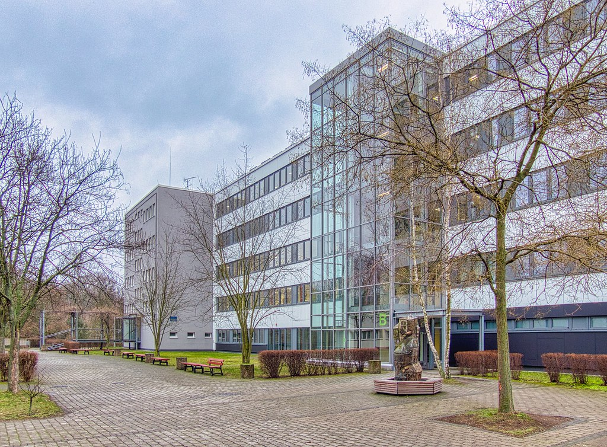
        </a>
        

        <figcaption>
          <h4>Hein-Moeller-Schule (OSZ Energietechnik II) (Haus B)</h4>
          
Allee der Kosmonauten 18, 10315 Berlin

          
1980 · Учебное заведение

          
В ГДР: Hochschule für Ökonomie der DDR Volkshochschule Marzahn

          
<a target="_blank" rel="noopener noreferrer" href="https://www.google.com/maps/search/?api=1&amp;query=52.5230800,13.5130700">Google Maps</a> · <a target="_blank" rel="noopener noreferrer" href="https://www.sk68-berlin.de/standort/hein-moeller-schule-osz-energietechnik-ii-haus-b/">О здании</a>

          
Фото: <a target="_blank" rel="noopener noreferrer" href="https://www.flickr.com/photos/25054024@N00/54879639764/">Silvio Schwartz</a> · <a target="_blank" rel="noopener noreferrer" href="https://creativecommons.org/licenses/by-sa/4.0/">CC BY-SA 4.0</a>

        </figcaption>
      </figure>
      <figure class="sk68-card" id="sk68-schule-am-faulen-see-grundschule">
        

        <a id="sk68-54883328790" target="_blank" rel="noopener noreferrer" href="https://www.google.com/maps/search/?api=1&amp;query=52.5521000,13.4983700" aria-label="Schule Am Faulen See (Grundschule) — Google Maps">
          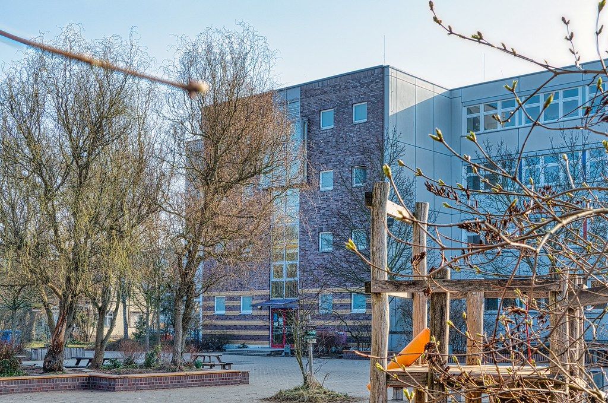
        </a>
        

        <figcaption>
          <h4>Schule Am Faulen See (Grundschule)</h4>
          
Degnerstraße 71, 13053 Berlin

          
1974 · Учебное заведение

          
В ГДР: Juri-Gagarin-Oberschule

          
<a target="_blank" rel="noopener noreferrer" href="https://www.google.com/maps/search/?api=1&amp;query=52.5521000,13.4983700">Google Maps</a> · <a target="_blank" rel="noopener noreferrer" href="https://www.sk68-berlin.de/standort/schule-am-faulen-see-grundschule/">О здании</a>

          
Фото: <a target="_blank" rel="noopener noreferrer" href="https://www.flickr.com/photos/25054024@N00/54883328790/">Silvio Schwartz</a> · <a target="_blank" rel="noopener noreferrer" href="https://creativecommons.org/licenses/by-sa/4.0/">CC BY-SA 4.0</a>

        </figcaption>
      </figure>
      <figure class="sk68-card" id="sk68-schule-am-roederplatz-grundschule">
        

        <a id="sk68-55348964734" target="_blank" rel="noopener noreferrer" href="https://www.google.com/maps/search/?api=1&amp;query=52.5289900,13.4821400" aria-label="Schule am Roederplatz (Grundschule) — Google Maps">
          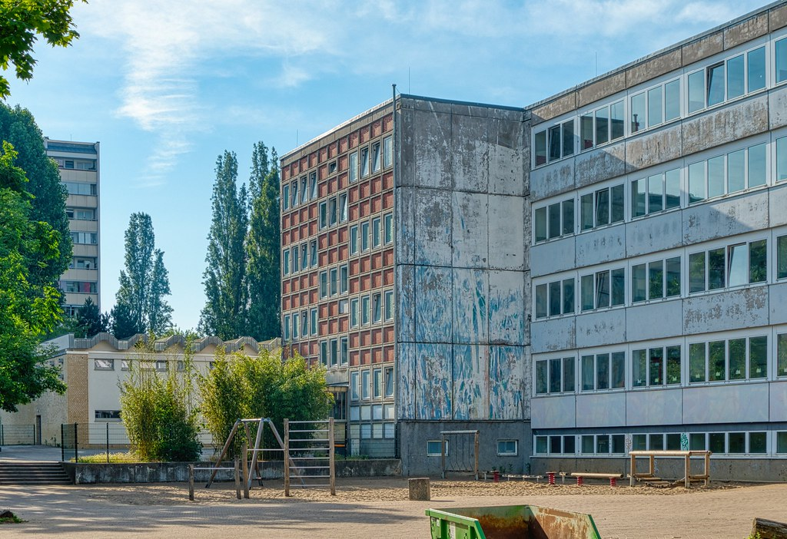
        </a>
        

        <figcaption>
          <h4>Schule am Roederplatz (Grundschule)</h4>
          
Bernhard-Bästlein-Straße 22, 10367 Berlin

          
1973 · Учебное заведение

          
В ГДР: Ilja-Ehrenburg-Oberschule

          
<a target="_blank" rel="noopener noreferrer" href="https://www.google.com/maps/search/?api=1&amp;query=52.5289900,13.4821400">Google Maps</a> · <a target="_blank" rel="noopener noreferrer" href="https://www.sk68-berlin.de/standort/schule-am-roederplatz-grundschule/">О здании</a>

          
Фото: <a target="_blank" rel="noopener noreferrer" href="https://www.flickr.com/photos/25054024@N00/55348964734/">Silvio Schwartz</a> · <a target="_blank" rel="noopener noreferrer" href="https://creativecommons.org/licenses/by-sa/4.0/">CC BY-SA 4.0</a>

        </figcaption>
      </figure>
      <figure class="sk68-card" id="sk68-schule-am-tierpark-integrierte-sekundarschule">
        

        <a id="sk68-54636559802" target="_blank" rel="noopener noreferrer" href="https://www.google.com/maps/search/?api=1&amp;query=52.4963000,13.5149300" aria-label="Schule am Tierpark (Integrierte Sekundarschule) — Google Maps">
          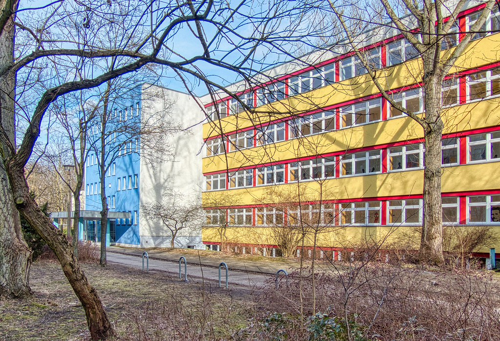
        </a>
        

        <figcaption>
          <h4>Schule am Tierpark (Integrierte Sekundarschule)</h4>
          
Sewanstraße 223, 10319 Berlin

          
1969 · Учебное заведение

          
В ГДР: 19. POS „Robert Uhrig“

          
<a target="_blank" rel="noopener noreferrer" href="https://www.google.com/maps/search/?api=1&amp;query=52.4963000,13.5149300">Google Maps</a> · <a target="_blank" rel="noopener noreferrer" href="https://www.sk68-berlin.de/standort/schule-am-tierpark-integrierte-sekundarschule/">О здании</a>

          
Фото: <a target="_blank" rel="noopener noreferrer" href="https://www.flickr.com/photos/25054024@N00/54636559802/">Silvio Schwartz</a> · <a target="_blank" rel="noopener noreferrer" href="https://creativecommons.org/licenses/by-sa/4.0/">CC BY-SA 4.0</a>

        </figcaption>
      </figure>
      <figure class="sk68-card" id="sk68-schule-auf-dem-lichten-berg-grundschule">
        

        <a id="sk68-54910044638" target="_blank" rel="noopener noreferrer" href="https://www.google.com/maps/search/?api=1&amp;query=52.5168600,13.4942100" aria-label="Schule auf dem lichten Berg (Grundschule) — Google Maps">
          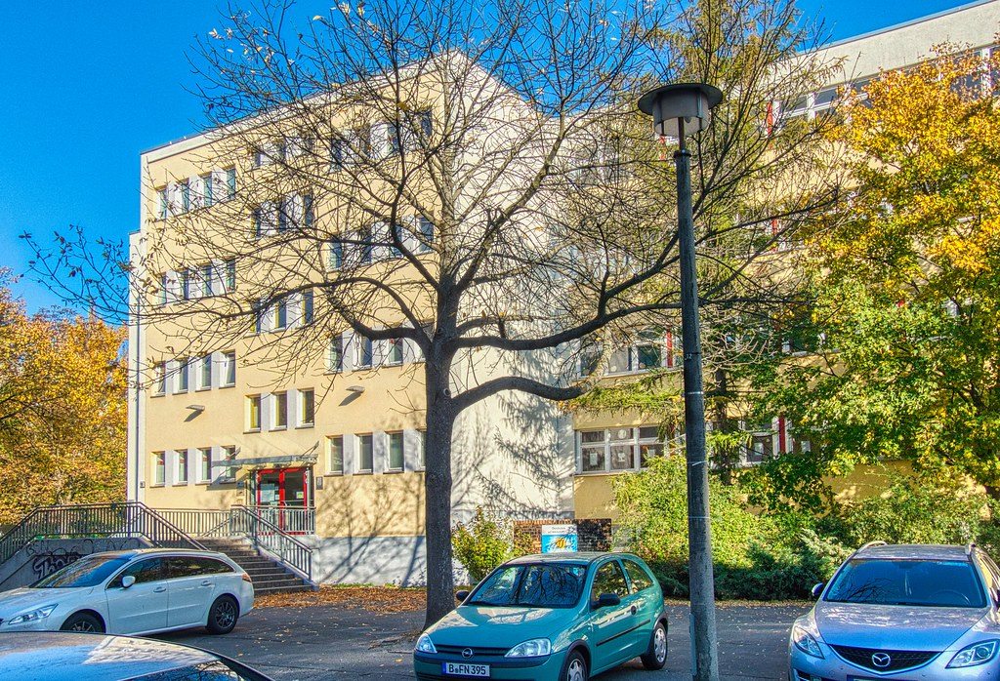
        </a>
        

        <figcaption>
          <h4>Schule auf dem lichten Berg (Grundschule)</h4>
          
Atzpodienstraße 19, 10365 Berlin

          
1976 · Учебное заведение

          
В ГДР: Robert-Korb-Oberschule

          
<a target="_blank" rel="noopener noreferrer" href="https://www.google.com/maps/search/?api=1&amp;query=52.5168600,13.4942100">Google Maps</a> · <a target="_blank" rel="noopener noreferrer" href="https://www.sk68-berlin.de/standort/schule-auf-dem-lichten-berg-grundschule/">О здании</a>

          
Фото: <a target="_blank" rel="noopener noreferrer" href="https://www.flickr.com/photos/25054024@N00/54910044638/">Silvio Schwartz</a> · <a target="_blank" rel="noopener noreferrer" href="https://creativecommons.org/licenses/by-sa/4.0/">CC BY-SA 4.0</a>

        </figcaption>
      </figure>
      <figure class="sk68-card" id="sk68-sonnenuhr-schule-grundschule">
        

        <a id="sk68-54883064376" target="_blank" rel="noopener noreferrer" href="https://www.google.com/maps/search/?api=1&amp;query=52.5292273,13.4670848" aria-label="Sonnenuhr-Schule (Grundschule) — Google Maps">
          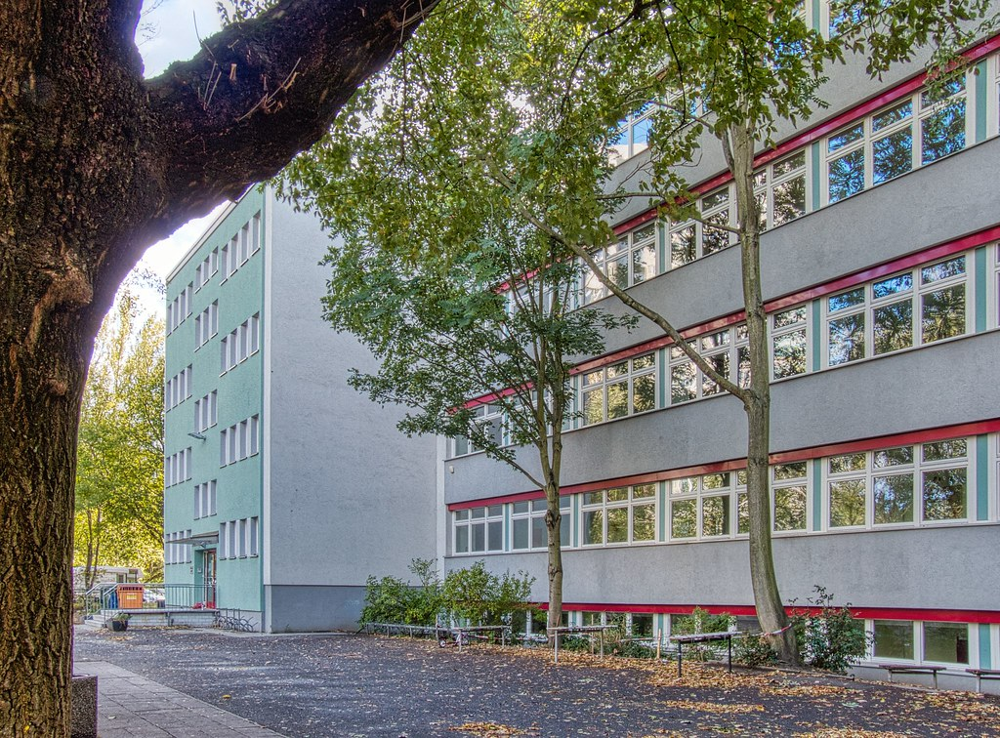
        </a>
        

        <figcaption>
          <h4>Sonnenuhr-Schule (Grundschule)</h4>
          
Franz-Jacob-Straße 33, 10369 Berlin

          
1975 · Учебное заведение

          
В ГДР: Oberschule „Otto Winzer“

          
<a target="_blank" rel="noopener noreferrer" href="https://www.google.com/maps/search/?api=1&amp;query=52.5292273,13.4670848">Google Maps</a> · <a target="_blank" rel="noopener noreferrer" href="https://www.sk68-berlin.de/standort/sonnenuhr-schule-grundschule/">О здании</a>

          
Фото: <a target="_blank" rel="noopener noreferrer" href="https://www.flickr.com/photos/25054024@N00/54883064376/">Silvio Schwartz</a> · <a target="_blank" rel="noopener noreferrer" href="https://creativecommons.org/licenses/by-sa/4.0/">CC BY-SA 4.0</a>

        </figcaption>
      </figure>
    

  

  

    
Marzahn-Hellersdorf · зданий с фотографиями: 11

    

      <figure class="sk68-card" id="sk68-bildungsinstitut-brueckner">
        

        <a id="sk68-54602899987" target="_blank" rel="noopener noreferrer" href="https://www.google.com/maps/search/?api=1&amp;query=52.5463500,13.5599300" aria-label="Bildungsinstitut Brückner — Google Maps">
          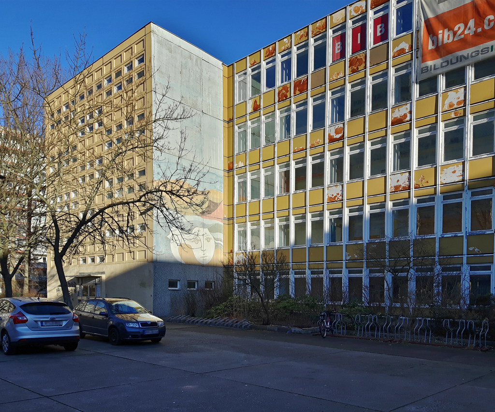
        </a>
        

        <figcaption>
          <h4>Bildungsinstitut Brückner</h4>
          
Landsberger Allee 467a, 12679 Berlin

          
1982 · Снесено

          
В ГДР: 30. POS „Alexander Abusch“ [Leninallee 467a]

          
<a target="_blank" rel="noopener noreferrer" href="https://www.google.com/maps/search/?api=1&amp;query=52.5463500,13.5599300">Google Maps</a> · <a target="_blank" rel="noopener noreferrer" href="https://www.sk68-berlin.de/standort/bildungsinstitut-brueckner/">О здании</a>

          
Фото: <a target="_blank" rel="noopener noreferrer" href="https://www.flickr.com/photos/25054024@N00/54602899987/">Silvio Schwartz</a> · <a target="_blank" rel="noopener noreferrer" href="https://creativecommons.org/licenses/by-sa/4.0/">CC BY-SA 4.0</a>

        </figcaption>
      </figure>
      <figure class="sk68-card" id="sk68-div-grone-bildungszentren-abbv-gmbh-reistrommel-e-v-cafe-partyraumvermietung">
        

        <a id="sk68-54628243217" target="_blank" rel="noopener noreferrer" href="https://www.google.com/maps/search/?api=1&amp;query=52.5288500,13.5312300" aria-label="Div. (Grone-Bildungszentren; ABBV GmbH; Reistrommel e.V.; Café, Partyraumvermietung) — Google Maps">
          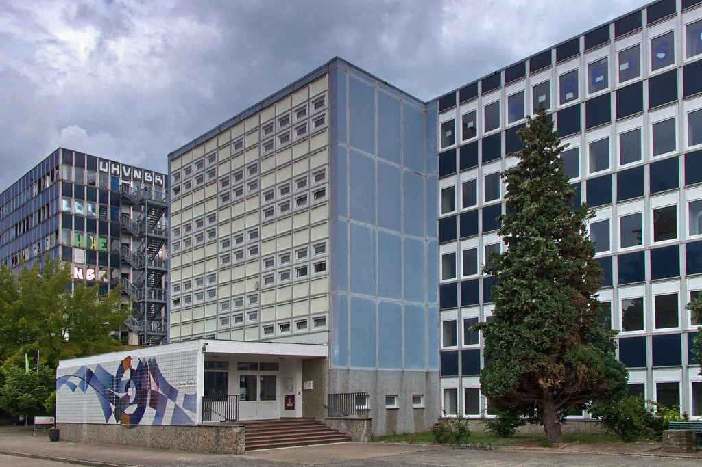
        </a>
        

        <figcaption>
          <h4>Div. (Grone-Bildungszentren; ABBV GmbH; Reistrommel e.V.; Café, Partyraumvermietung)</h4>
          
Coswiger Str. 5, 12681 Berlin

          
Год неизвестен · Другое использование

          
<a target="_blank" rel="noopener noreferrer" href="https://www.google.com/maps/search/?api=1&amp;query=52.5288500,13.5312300">Google Maps</a> · <a target="_blank" rel="noopener noreferrer" href="https://www.sk68-berlin.de/standort/div-grone-bildungszentren-abbv-gmbh-reistrommel-e-v-cafe-partyraumvermietung/">О здании</a>

          
Фото: <a target="_blank" rel="noopener noreferrer" href="https://www.flickr.com/photos/25054024@N00/54628243217/">Silvio Schwartz</a> · <a target="_blank" rel="noopener noreferrer" href="https://creativecommons.org/licenses/by-sa/4.0/">CC BY-SA 4.0</a>

        </figcaption>
      </figure>
      <figure class="sk68-card" id="sk68-georg-klingenberg-schule">
        

        <a id="sk68-54651425486" target="_blank" rel="noopener noreferrer" href="https://www.google.com/maps/search/?api=1&amp;query=52.4903507,13.5579554" aria-label="Georg-Klingenberg-Schule — Google Maps">
          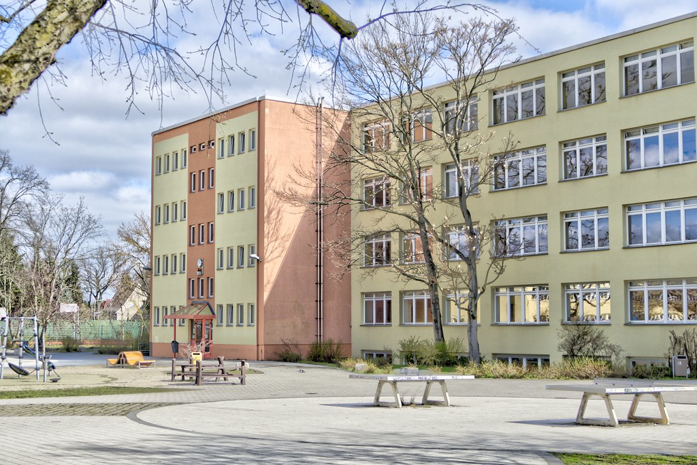
        </a>
        

        <figcaption>
          <h4>Georg-Klingenberg-Schule</h4>
          
Alberichstraße 24, 12683 Berlin

          
1974 · Учебное заведение

          
В ГДР: 20. POS „Carlos Fonseca“

          
<a target="_blank" rel="noopener noreferrer" href="https://www.google.com/maps/search/?api=1&amp;query=52.4903507,13.5579554">Google Maps</a> · <a target="_blank" rel="noopener noreferrer" href="https://www.sk68-berlin.de/standort/georg-klingenberg-schule/">О здании</a>

          
Фото: <a target="_blank" rel="noopener noreferrer" href="https://www.flickr.com/photos/25054024@N00/54651425486/">Silvio Schwartz</a> · <a target="_blank" rel="noopener noreferrer" href="https://creativecommons.org/licenses/by-sa/4.0/">CC BY-SA 4.0</a>

        </figcaption>
      </figure>
      <figure class="sk68-card" id="sk68-gretel-bergmann-gemeinschaftsschule-haus-1">
        

        <a id="sk68-54608611785" target="_blank" rel="noopener noreferrer" href="https://www.google.com/maps/search/?api=1&amp;query=52.5584331,13.5619828" aria-label="Gretel-Bergmann-Gemeinschaftsschule (Haus 1) — Google Maps">
          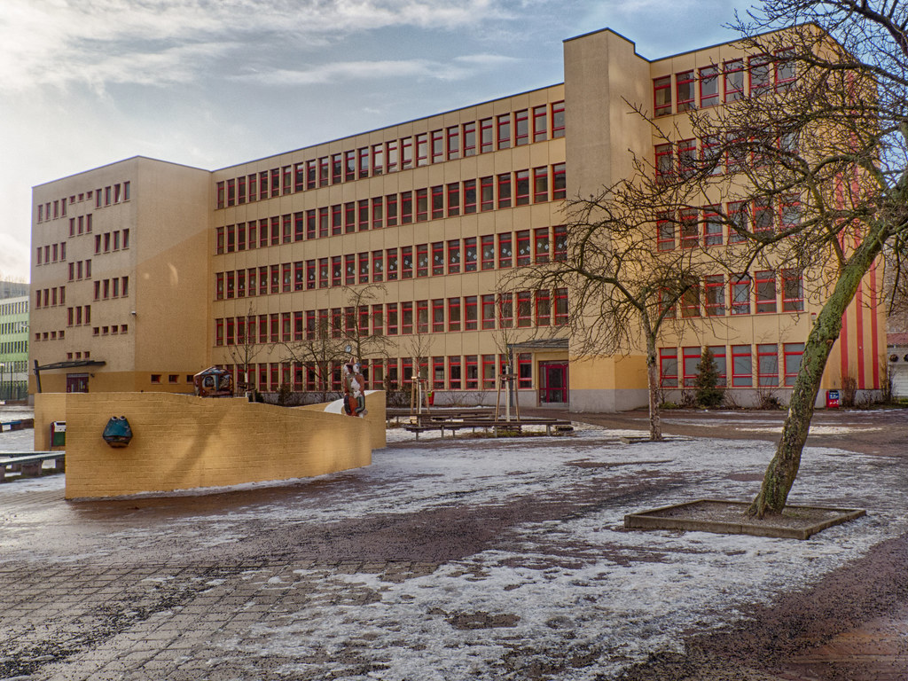
        </a>
        

        <figcaption>
          <h4>Gretel-Bergmann-Gemeinschaftsschule (Haus 1)</h4>
          
Schleusinger Str. 17, 12687 Berlin

          
1983 · Учебное заведение

          
В ГДР: 37. POS „Adolf Hennecke“

          
<a target="_blank" rel="noopener noreferrer" href="https://www.google.com/maps/search/?api=1&amp;query=52.5584331,13.5619828">Google Maps</a> · <a target="_blank" rel="noopener noreferrer" href="https://www.sk68-berlin.de/standort/gretel-bergmann-gemeinschaftsschule-haus-1/">О здании</a>

          
Фото: <a target="_blank" rel="noopener noreferrer" href="https://www.flickr.com/photos/25054024@N00/54608611785/">Silvio Schwartz</a> · <a target="_blank" rel="noopener noreferrer" href="https://creativecommons.org/licenses/by-sa/4.0/">CC BY-SA 4.0</a>

        </figcaption>
      </figure>
      <figure class="sk68-card" id="sk68-grundschule-am-buergerpark">
        

        <a id="sk68-54650593017" target="_blank" rel="noopener noreferrer" href="https://www.google.com/maps/search/?api=1&amp;query=52.5508561,13.5650844" aria-label="Grundschule am Bürgerpark — Google Maps">
          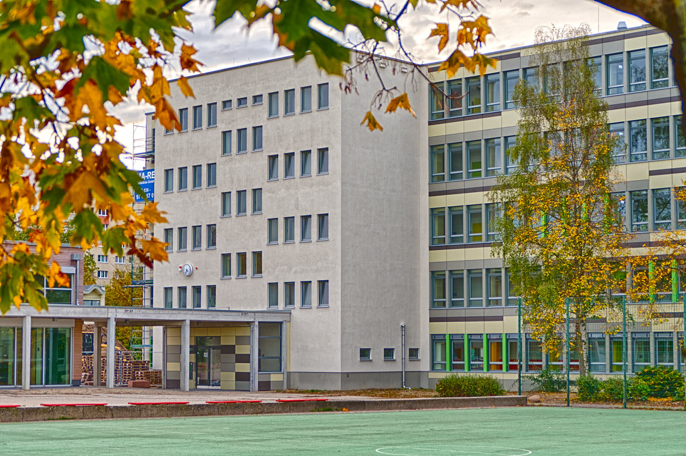
        </a>
        

        <figcaption>
          <h4>Grundschule am Bürgerpark</h4>
          
Jan-Petersen-Straße 18b, 12679 Berlin

          
1982 · Учебное заведение

          
В ГДР: 31. POS „Michail Scholochow“ [Rudolf-Leonhardt-Str. 4]

          
<a target="_blank" rel="noopener noreferrer" href="https://www.google.com/maps/search/?api=1&amp;query=52.5508561,13.5650844">Google Maps</a> · <a target="_blank" rel="noopener noreferrer" href="https://www.sk68-berlin.de/standort/grundschule-am-buergerpark/">О здании</a>

          
Фото: <a target="_blank" rel="noopener noreferrer" href="https://www.flickr.com/photos/25054024@N00/54650593017/">Silvio Schwartz</a> · <a target="_blank" rel="noopener noreferrer" href="https://creativecommons.org/licenses/by-sa/4.0/">CC BY-SA 4.0</a>

        </figcaption>
      </figure>
      <figure class="sk68-card" id="sk68-grundschule-an-der-geissenweide">
        

        <a id="sk68-54765786644" target="_blank" rel="noopener noreferrer" href="https://www.google.com/maps/search/?api=1&amp;query=52.5377022,13.5522902" aria-label="Grundschule an der Geißenweide — Google Maps">
          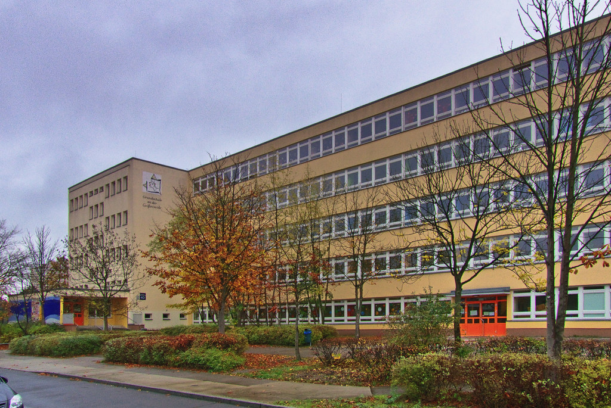
        </a>
        

        <figcaption>
          <h4>Grundschule an der Geißenweide</h4>
          
Amanlisweg 42, 12685 Berlin

          
1979 · Учебное заведение

          
В ГДР: 8. POS „Paul Schwenk“

          
<a target="_blank" rel="noopener noreferrer" href="https://www.google.com/maps/search/?api=1&amp;query=52.5377022,13.5522902">Google Maps</a> · <a target="_blank" rel="noopener noreferrer" href="https://www.sk68-berlin.de/standort/grundschule-an-der-geissenweide/">О здании</a>

          
Фото: <a target="_blank" rel="noopener noreferrer" href="https://www.flickr.com/photos/25054024@N00/54765786644/">Silvio Schwartz</a> · <a target="_blank" rel="noopener noreferrer" href="https://creativecommons.org/licenses/by-sa/4.0/">CC BY-SA 4.0</a>

        </figcaption>
      </figure>
      <figure class="sk68-card" id="sk68-grundschule-unter-dem-regenbogen">
        

        <a id="sk68-54765610236" target="_blank" rel="noopener noreferrer" href="https://www.google.com/maps/search/?api=1&amp;query=52.5297400,13.5430000" aria-label="Grundschule unter dem Regenbogen — Google Maps">
          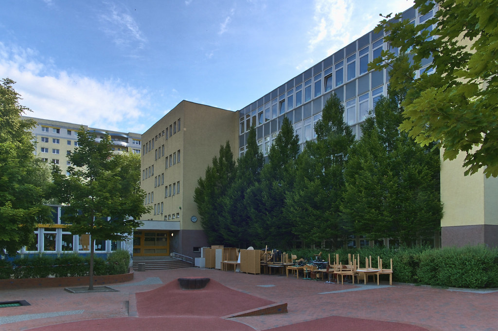
        </a>
        

        <figcaption>
          <h4>Grundschule unter dem Regenbogen</h4>
          
Murtzaner Ring 35, 12681 Berlin

          
1978 · Учебное заведение

          
В ГДР: 4. POS „Herbert Tschäpe“

          
<a target="_blank" rel="noopener noreferrer" href="https://www.google.com/maps/search/?api=1&amp;query=52.5297400,13.5430000">Google Maps</a> · <a target="_blank" rel="noopener noreferrer" href="https://www.sk68-berlin.de/standort/grundschule-unter-dem-regenbogen/">О здании</a>

          
Фото: <a target="_blank" rel="noopener noreferrer" href="https://www.flickr.com/photos/25054024@N00/54765610236/">Silvio Schwartz</a> · <a target="_blank" rel="noopener noreferrer" href="https://creativecommons.org/licenses/by-sa/4.0/">CC BY-SA 4.0</a>

        </figcaption>
      </figure>
      <figure class="sk68-card" id="sk68-grundschule-unter-dem-regenbogen-2">
        

        <a id="sk68-54788774234" target="_blank" rel="noopener noreferrer" href="https://www.google.com/maps/search/?api=1&amp;query=52.5297173,13.5426223" aria-label="Grundschule unter dem Regenbogen — Google Maps">
          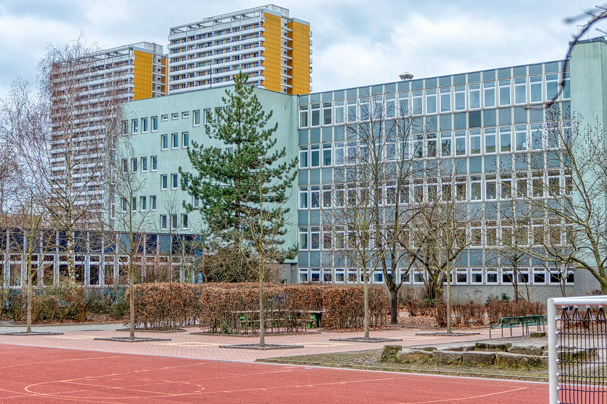
        </a>
        

        <figcaption>
          <h4>Grundschule unter dem Regenbogen</h4>
          
Murtzaner Ring 37, 12681 Berlin

          
1978 · Учебное заведение

          
В ГДР: 5. POS „Wolfgang Langhoff“

          
<a target="_blank" rel="noopener noreferrer" href="https://www.google.com/maps/search/?api=1&amp;query=52.5297173,13.5426223">Google Maps</a> · <a target="_blank" rel="noopener noreferrer" href="https://www.sk68-berlin.de/standort/grundschule-unter-dem-regenbogen-2/">О здании</a>

          
Фото: <a target="_blank" rel="noopener noreferrer" href="https://www.flickr.com/photos/25054024@N00/54788774234/">Silvio Schwartz</a> · <a target="_blank" rel="noopener noreferrer" href="https://creativecommons.org/licenses/by-sa/4.0/">CC BY-SA 4.0</a>

        </figcaption>
      </figure>
      <figure class="sk68-card" id="sk68-oberschule-am-elsengrund">
        

        <a id="sk68-54883214418" target="_blank" rel="noopener noreferrer" href="https://www.google.com/maps/search/?api=1&amp;query=52.5007100,13.6103600" aria-label="Oberschule am Elsengrund — Google Maps">
          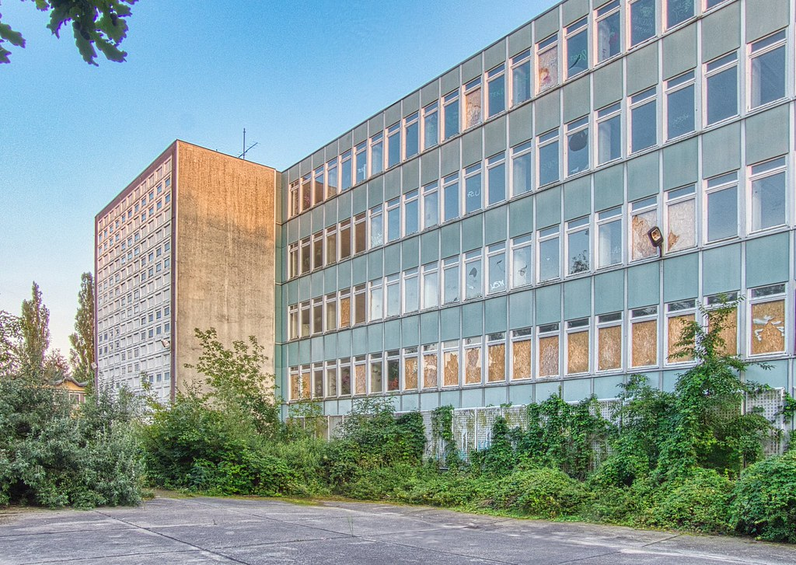
        </a>
        

        <figcaption>
          <h4>Oberschule am Elsengrund</h4>
          
Elsenstraße 9, 12623 Berlin

          
1983 · Снесено

          
В ГДР: 23. POS „Walja Kotik“

          
<a target="_blank" rel="noopener noreferrer" href="https://www.google.com/maps/search/?api=1&amp;query=52.5007100,13.6103600">Google Maps</a> · <a target="_blank" rel="noopener noreferrer" href="https://www.sk68-berlin.de/standort/oberschule-am-elsengrund/">О здании</a>

          
Фото: <a target="_blank" rel="noopener noreferrer" href="https://www.flickr.com/photos/25054024@N00/54883214418/">Silvio Schwartz</a> · <a target="_blank" rel="noopener noreferrer" href="https://creativecommons.org/licenses/by-sa/4.0/">CC BY-SA 4.0</a>

        </figcaption>
      </figure>
      <figure class="sk68-card" id="sk68-peter-pan-grundschule">
        

        <a id="sk68-54883302570" target="_blank" rel="noopener noreferrer" href="https://www.google.com/maps/search/?api=1&amp;query=52.5481558,13.5516721" aria-label="Peter-Pan-Grundschule — Google Maps">
          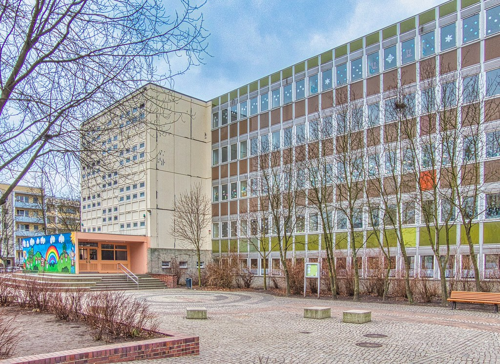
        </a>
        

        <figcaption>
          <h4>Peter-Pan-Grundschule</h4>
          
Stolzenhagener Str. 9, 12679 Berlin

          
1980 · Учебное заведение

          
В ГДР: 23. POS

          
<a target="_blank" rel="noopener noreferrer" href="https://www.google.com/maps/search/?api=1&amp;query=52.5481558,13.5516721">Google Maps</a> · <a target="_blank" rel="noopener noreferrer" href="https://www.sk68-berlin.de/standort/peter-pan-grundschule/">О здании</a>

          
Фото: <a target="_blank" rel="noopener noreferrer" href="https://www.flickr.com/photos/25054024@N00/54883302570/">Silvio Schwartz</a> · <a target="_blank" rel="noopener noreferrer" href="https://creativecommons.org/licenses/by-sa/4.0/">CC BY-SA 4.0</a>

        </figcaption>
      </figure>
      <figure class="sk68-card" id="sk68-tagore-gymnasium-haus-1">
        

        <a id="sk68-54883380375" target="_blank" rel="noopener noreferrer" href="https://www.google.com/maps/search/?api=1&amp;query=52.5531523,13.5564744" aria-label="Tagore-Gymnasium (Haus 1) — Google Maps">
          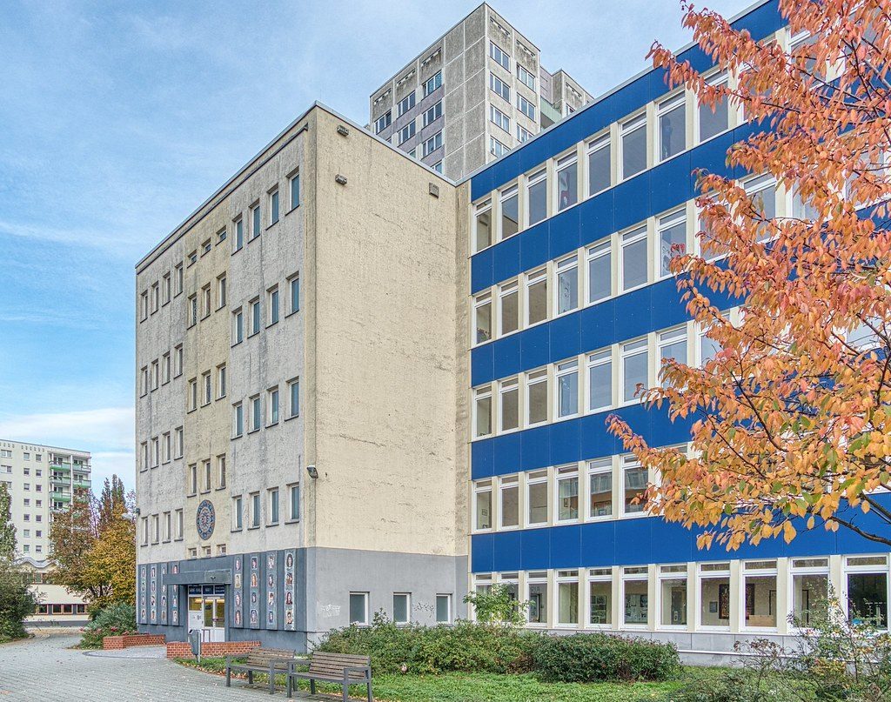
        </a>
        

        <figcaption>
          <h4>Tagore-Gymnasium (Haus 1)</h4>
          
Sella-Hasse-Straße 25, 12687 Berlin

          
1981 · Учебное заведение

          
В ГДР: 29. POS „Paul Dessau“

          
<a target="_blank" rel="noopener noreferrer" href="https://www.google.com/maps/search/?api=1&amp;query=52.5531523,13.5564744">Google Maps</a> · <a target="_blank" rel="noopener noreferrer" href="https://www.sk68-berlin.de/standort/tagore-gymnasium-haus-1/">О здании</a>

          
Фото: <a target="_blank" rel="noopener noreferrer" href="https://www.flickr.com/photos/25054024@N00/54883380375/">Silvio Schwartz</a> · <a target="_blank" rel="noopener noreferrer" href="https://creativecommons.org/licenses/by-sa/4.0/">CC BY-SA 4.0</a>

        </figcaption>
      </figure>
    

  

  

    
Mitte · зданий с фотографиями: 4

    

      <figure class="sk68-card" id="sk68-evangelische-schule-berlin-mitte-gemeinschaftsschule">
        

        <a id="sk68-54910020955" target="_blank" rel="noopener noreferrer" href="https://www.google.com/maps/search/?api=1&amp;query=52.5225990,13.4052410" aria-label="Evangelische Schule Berlin Mitte (Gemeinschaftsschule) — Google Maps">
          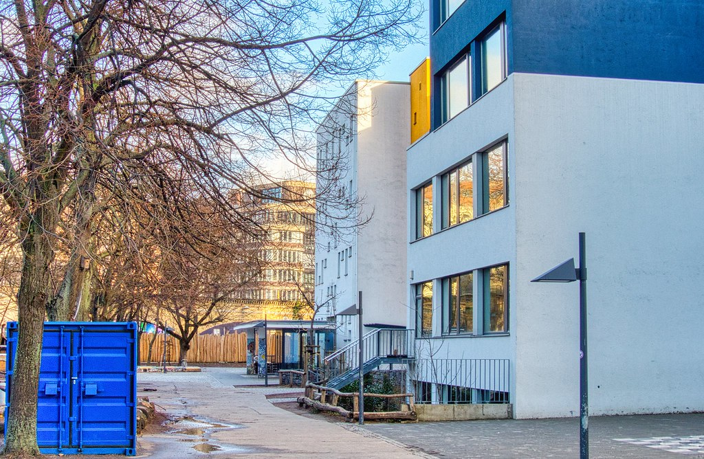
        </a>
        

        <figcaption>
          <h4>Evangelische Schule Berlin Mitte (Gemeinschaftsschule)</h4>
          
Rochstraße 7, 10178 Berlin

          
1969 · Учебное заведение

          
В ГДР: 12. POS Gustl Sandtner

          
<a target="_blank" rel="noopener noreferrer" href="https://www.google.com/maps/search/?api=1&amp;query=52.5225990,13.4052410">Google Maps</a> · <a target="_blank" rel="noopener noreferrer" href="https://www.sk68-berlin.de/standort/evangelische-schule-berlin-mitte-gemeinschaftsschule/">О здании</a>

          
Фото: <a target="_blank" rel="noopener noreferrer" href="https://www.flickr.com/photos/25054024@N00/54910020955/">Silvio Schwartz</a> · <a target="_blank" rel="noopener noreferrer" href="https://creativecommons.org/licenses/by-sa/4.0/">CC BY-SA 4.0</a>

        </figcaption>
      </figure>
      <figure class="sk68-card" id="sk68-evangelische-schule-berlin-zentrum-gemeinschaftsschule">
        

        <a id="sk68-54909992255" target="_blank" rel="noopener noreferrer" href="https://www.google.com/maps/search/?api=1&amp;query=52.5121600,13.4104500" aria-label="Evangelische Schule Berlin Zentrum (Gemeinschaftsschule) — Google Maps">
          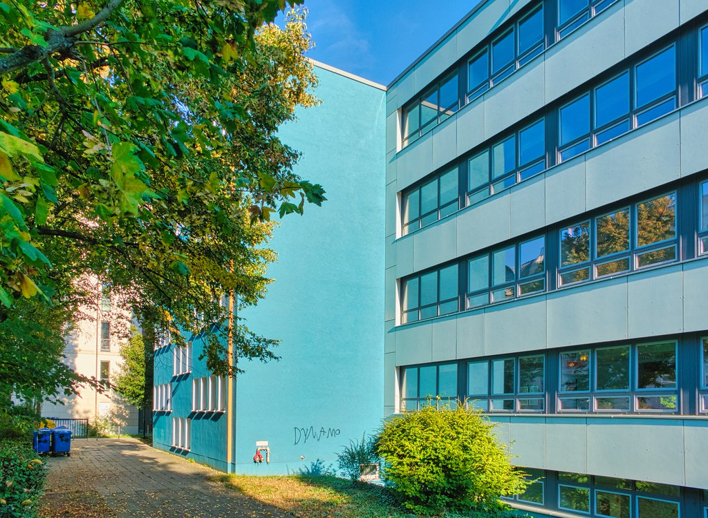
        </a>
        

        <figcaption>
          <h4>Evangelische Schule Berlin Zentrum (Gemeinschaftsschule)</h4>
          
Wallstraße 32, 10179 Berlin

          
1967 · Учебное заведение

          
В ГДР: 15. POS Ernst Fürstenberg

          
<a target="_blank" rel="noopener noreferrer" href="https://www.google.com/maps/search/?api=1&amp;query=52.5121600,13.4104500">Google Maps</a> · <a target="_blank" rel="noopener noreferrer" href="https://www.sk68-berlin.de/standort/evangelische-schule-berlin-zentrum-gemeinschaftsschule/">О здании</a>

          
Фото: <a target="_blank" rel="noopener noreferrer" href="https://www.flickr.com/photos/25054024@N00/54909992255/">Silvio Schwartz</a> · <a target="_blank" rel="noopener noreferrer" href="https://creativecommons.org/licenses/by-sa/4.0/">CC BY-SA 4.0</a>

        </figcaption>
      </figure>
      <figure class="sk68-card" id="sk68-evangelische-schule-berlin-zentrum-gemeinschaftsschule-haus-2">
        

        <a id="sk68-54376316842" target="_blank" rel="noopener noreferrer" href="https://www.google.com/maps/search/?api=1&amp;query=52.5112813,13.4095208" aria-label="Evangelische Schule Berlin Zentrum (Gemeinschaftsschule) (Haus 2) — Google Maps">
          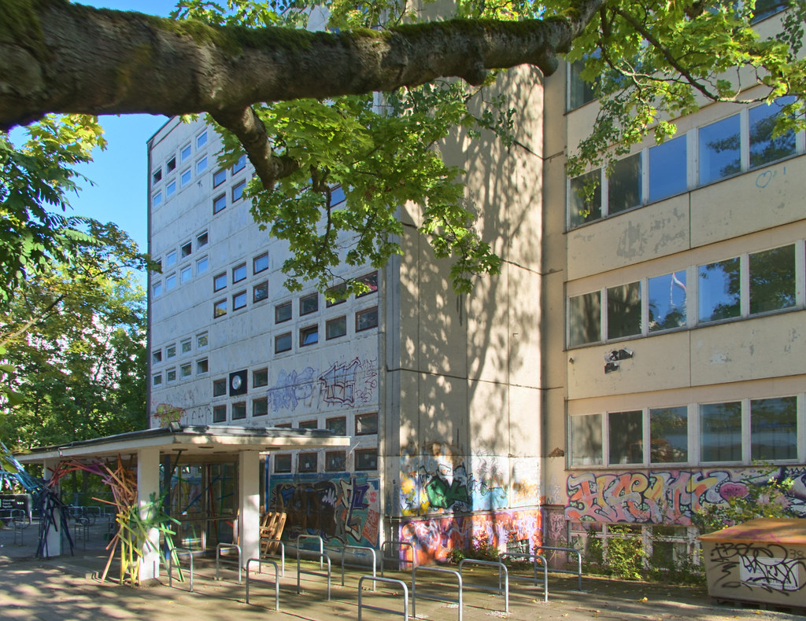
        </a>
        

        <figcaption>
          <h4>Evangelische Schule Berlin Zentrum (Gemeinschaftsschule) (Haus 2)</h4>
          
Wallstraße 32, 10179 Berlin

          
Год неизвестен · Учебное заведение

          
В ГДР: 14. POS „Willi Bredel“

          
<a target="_blank" rel="noopener noreferrer" href="https://www.google.com/maps/search/?api=1&amp;query=52.5112813,13.4095208">Google Maps</a> · <a target="_blank" rel="noopener noreferrer" href="https://www.sk68-berlin.de/standort/evangelische-schule-berlin-zentrum-gemeinschaftsschule-haus-2/">О здании</a>

          
Фото: <a target="_blank" rel="noopener noreferrer" href="https://www.flickr.com/photos/25054024@N00/54376316842/">Silvio Schwartz</a> · <a target="_blank" rel="noopener noreferrer" href="https://creativecommons.org/licenses/by-sa/4.0/">CC BY-SA 4.0</a>

        </figcaption>
      </figure>
      <figure class="sk68-card" id="sk68-grundschule-am-koppenplatz-standort-bergstrasse">
        

        <a id="sk68-54650606507" target="_blank" rel="noopener noreferrer" href="https://www.google.com/maps/search/?api=1&amp;query=52.5297627,13.3954797" aria-label="Grundschule am Koppenplatz, Standort Bergstraße — Google Maps">
          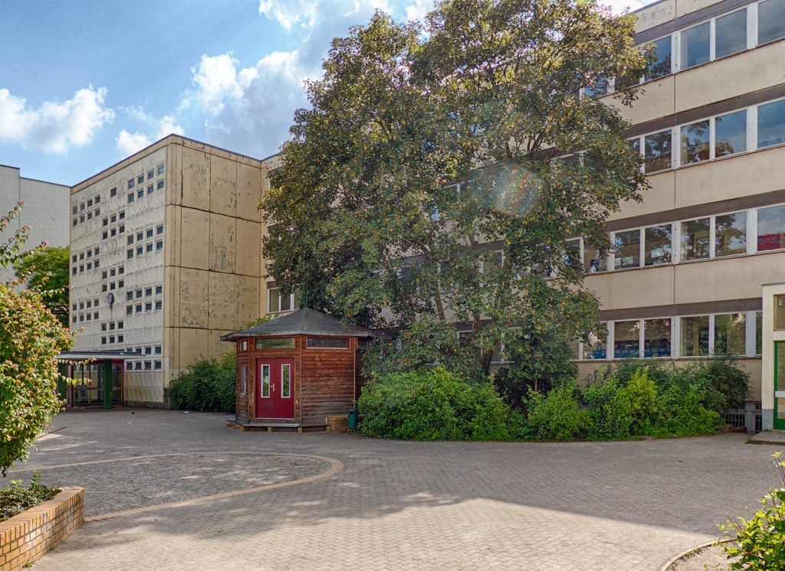
        </a>
        

        <figcaption>
          <h4>Grundschule am Koppenplatz, Standort Bergstraße</h4>
          
Bergstraße 3–5, 10115 Berlin

          
1968 · Учебное заведение

          
В ГДР: Friedrich-Wolf-Oberschule

          
<a target="_blank" rel="noopener noreferrer" href="https://www.google.com/maps/search/?api=1&amp;query=52.5297627,13.3954797">Google Maps</a> · <a target="_blank" rel="noopener noreferrer" href="https://www.sk68-berlin.de/standort/grundschule-am-koppenplatz-standort-bergstrasse/">О здании</a>

          
Фото: <a target="_blank" rel="noopener noreferrer" href="https://www.flickr.com/photos/25054024@N00/54650606507/">Silvio Schwartz</a> · <a target="_blank" rel="noopener noreferrer" href="https://creativecommons.org/licenses/by-sa/4.0/">CC BY-SA 4.0</a>

        </figcaption>
      </figure>
    

  

  

    
Pankow · зданий с фотографиями: 22

    

      <figure class="sk68-card" id="sk68-51-schule-grundschule">
        

        <a id="sk68-54905489095" target="_blank" rel="noopener noreferrer" href="https://www.google.com/maps/search/?api=1&amp;query=52.5828372,13.4176170" aria-label="51. Schule (Grundschule) — Google Maps">
          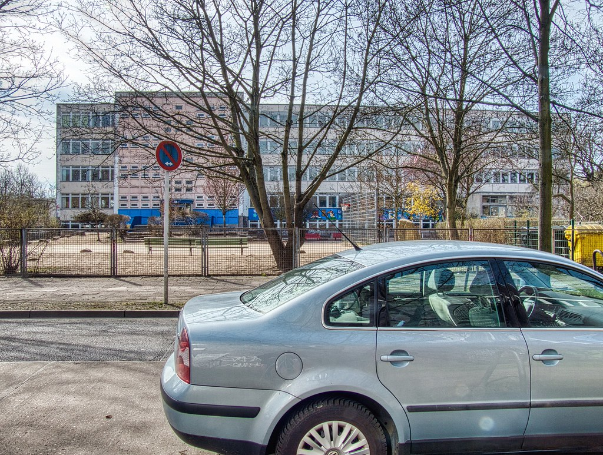
        </a>
        

        <figcaption>
          <h4>51. Schule (Grundschule)</h4>
          
Lindenberger Str. 12, 13156 Berlin

          
1973 · Учебное заведение

          
В ГДР: Georg-Handke-Sprachheilschule

          
<a target="_blank" rel="noopener noreferrer" href="https://www.google.com/maps/search/?api=1&amp;query=52.5828372,13.4176170">Google Maps</a> · <a target="_blank" rel="noopener noreferrer" href="https://www.sk68-berlin.de/standort/51-schule-grundschule/">О здании</a>

          
Фото: <a target="_blank" rel="noopener noreferrer" href="https://www.flickr.com/photos/25054024@N00/54905489095/">Silvio Schwartz</a> · <a target="_blank" rel="noopener noreferrer" href="https://creativecommons.org/licenses/by-sa/4.0/">CC BY-SA 4.0</a>

        </figcaption>
      </figure>
      <figure class="sk68-card" id="sk68-boetzow-grundschule">
        

        <a id="sk68-54909973073" target="_blank" rel="noopener noreferrer" href="https://www.google.com/maps/search/?api=1&amp;query=52.5348790,13.4394933" aria-label="Bötzow-Grundschule — Google Maps">
          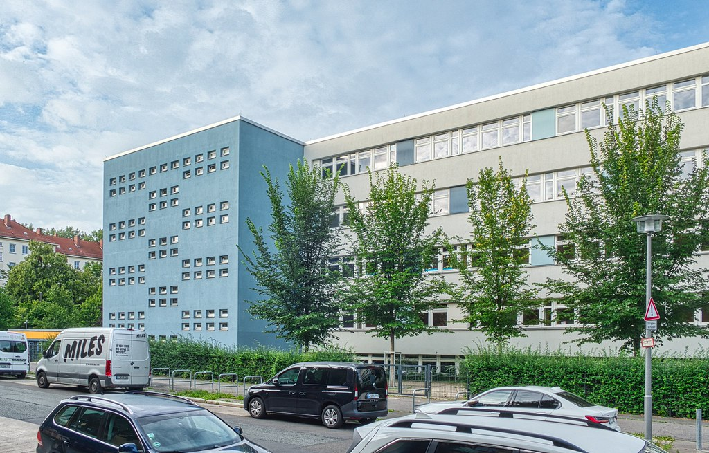
        </a>
        

        <figcaption>
          <h4>Bötzow-Grundschule</h4>
          
John-Schehr-Straße 38, 10407 Berlin

          
1975 · Учебное заведение

          
В ГДР: Käthe-Kollwitz-Schule

          
<a target="_blank" rel="noopener noreferrer" href="https://www.google.com/maps/search/?api=1&amp;query=52.5348790,13.4394933">Google Maps</a> · <a target="_blank" rel="noopener noreferrer" href="https://www.sk68-berlin.de/standort/boetzow-grundschule/">О здании</a>

          
Фото: <a target="_blank" rel="noopener noreferrer" href="https://www.flickr.com/photos/25054024@N00/54909973073/">Silvio Schwartz</a> · <a target="_blank" rel="noopener noreferrer" href="https://creativecommons.org/licenses/by-sa/4.0/">CC BY-SA 4.0</a>

        </figcaption>
      </figure>
      <figure class="sk68-card" id="sk68-grundschule-wilhelmsruh">
        

        <a id="sk68-54788996035" target="_blank" rel="noopener noreferrer" href="https://www.google.com/maps/search/?api=1&amp;query=52.5903000,13.3642100" aria-label="Grundschule Wilhelmsruh — Google Maps">
          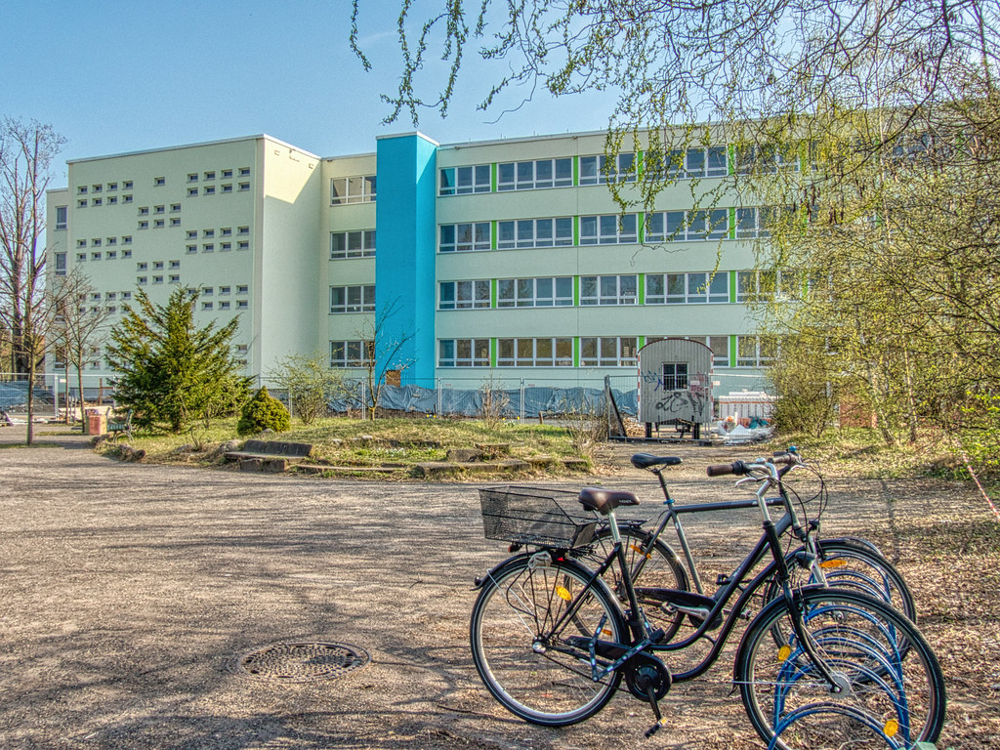
        </a>
        

        <figcaption>
          <h4>Grundschule Wilhelmsruh</h4>
          
Lessingstraße 44, 13158 Berlin

          
1971 · Учебное заведение

          
В ГДР: 22. POS Wilhelmsruh – „Schule der Solidarität“

          
<a target="_blank" rel="noopener noreferrer" href="https://www.google.com/maps/search/?api=1&amp;query=52.5903000,13.3642100">Google Maps</a> · <a target="_blank" rel="noopener noreferrer" href="https://www.sk68-berlin.de/standort/grundschule-wilhelmsruh/">О здании</a>

          
Фото: <a target="_blank" rel="noopener noreferrer" href="https://www.flickr.com/photos/25054024@N00/54788996035/">Silvio Schwartz</a> · <a target="_blank" rel="noopener noreferrer" href="https://creativecommons.org/licenses/by-sa/4.0/">CC BY-SA 4.0</a>

        </figcaption>
      </figure>
      <figure class="sk68-card" id="sk68-grundschule-am-teutoburger-platz">
        

        
        

        <figcaption>
          <h4>Grundschule am Teutoburger Platz</h4>
          
Templiner Str. 1, 10119 Berlin

          
1976 · Учебное заведение

          
В ГДР: Fritz-Heckert-Oberschule

          
<a target="_blank" rel="noopener noreferrer" href="https://www.google.com/maps/search/?api=1&amp;query=52.5336353,13.4086508">Google Maps</a> · <a target="_blank" rel="noopener noreferrer" href="https://www.sk68-berlin.de/standort/grundschule-am-teutoburger-platz/">О здании</a>

          
Фото: <a target="_blank" rel="noopener noreferrer" href="https://www.flickr.com/photos/25054024@N00/54651469001/">Silvio Schwartz</a> · <a target="_blank" rel="noopener noreferrer" href="https://creativecommons.org/licenses/by-sa/4.0/">CC BY-SA 4.0</a>

        </figcaption>
      </figure>
      <figure class="sk68-card" id="sk68-grundschule-am-weissen-see">
        

        <a id="sk68-54788741538" target="_blank" rel="noopener noreferrer" href="https://www.google.com/maps/search/?api=1&amp;query=52.5540200,13.4766700" aria-label="Grundschule am Weißen See — Google Maps">
          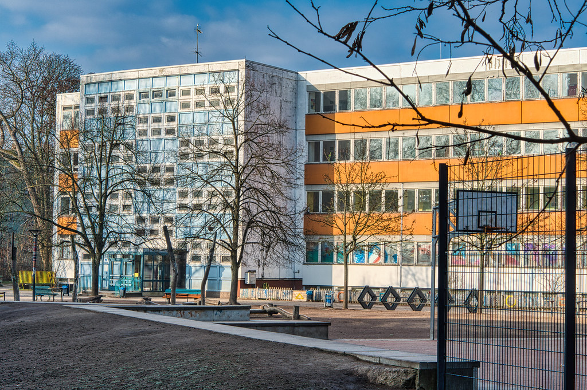
        </a>
        

        <figcaption>
          <h4>Grundschule am Weißen See</h4>
          
Falkenberger Straße 31, 13088 Berlin

          
1976 · Учебное заведение

          
В ГДР: Josip-Broz-Tito-Oberschule [Buschallee 86]

          
<a target="_blank" rel="noopener noreferrer" href="https://www.google.com/maps/search/?api=1&amp;query=52.5540200,13.4766700">Google Maps</a> · <a target="_blank" rel="noopener noreferrer" href="https://www.sk68-berlin.de/standort/grundschule-am-weissen-see/">О здании</a>

          
Фото: <a target="_blank" rel="noopener noreferrer" href="https://www.flickr.com/photos/25054024@N00/54788741538/">Silvio Schwartz</a> · <a target="_blank" rel="noopener noreferrer" href="https://creativecommons.org/licenses/by-sa/4.0/">CC BY-SA 4.0</a>

        </figcaption>
      </figure>
      <figure class="sk68-card" id="sk68-grundschule-im-blumenviertel">
        

        <a id="sk68-54765844088" target="_blank" rel="noopener noreferrer" href="https://www.google.com/maps/search/?api=1&amp;query=52.5351410,13.4580741" aria-label="Grundschule im Blumenviertel — Google Maps">
          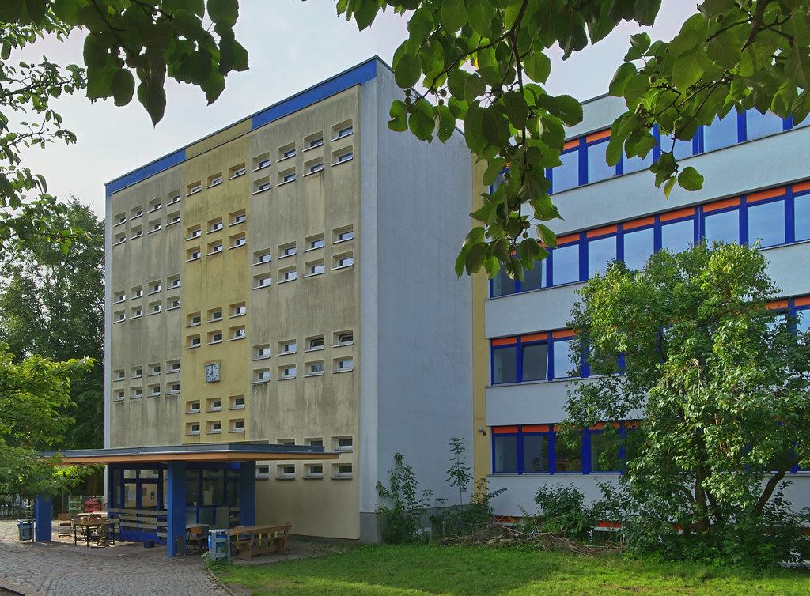
        </a>
        

        <figcaption>
          <h4>Grundschule im Blumenviertel</h4>
          
Syringenpl. 30, 10407 Berlin

          
1971 · Учебное заведение

          
В ГДР: Hermann-Schlimme-Oberschule

          
<a target="_blank" rel="noopener noreferrer" href="https://www.google.com/maps/search/?api=1&amp;query=52.5351410,13.4580741">Google Maps</a> · <a target="_blank" rel="noopener noreferrer" href="https://www.sk68-berlin.de/standort/grundschule-im-blumenviertel/">О здании</a>

          
Фото: <a target="_blank" rel="noopener noreferrer" href="https://www.flickr.com/photos/25054024@N00/54765844088/">Silvio Schwartz</a> · <a target="_blank" rel="noopener noreferrer" href="https://creativecommons.org/licenses/by-sa/4.0/">CC BY-SA 4.0</a>

        </figcaption>
      </figure>
      <figure class="sk68-card" id="sk68-grundschule-im-moselviertel">
        

        <a id="sk68-54788753049" target="_blank" rel="noopener noreferrer" href="https://www.google.com/maps/search/?api=1&amp;query=Brodenbacher%20Weg%2031,%2013088%20Berlin" aria-label="Grundschule im Moselviertel — Google Maps">
          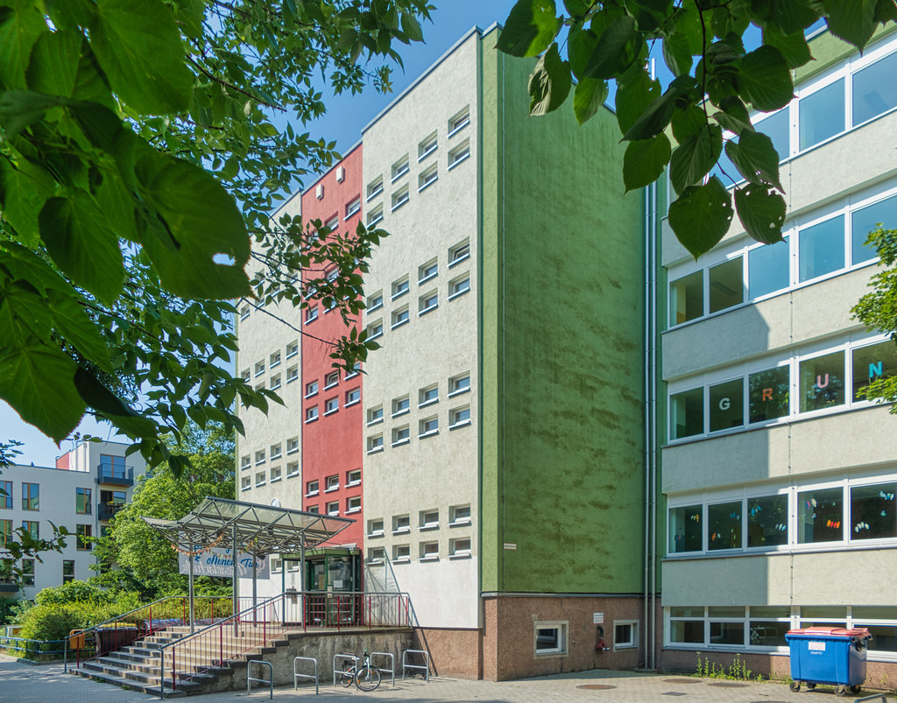
        </a>
        

        <figcaption>
          <h4>Grundschule im Moselviertel</h4>
          
Brodenbacher Weg 31, 13088 Berlin

          
1974 · Учебное заведение

          
В ГДР: Fritz-Lesch-Oberschule

          
<a target="_blank" rel="noopener noreferrer" href="https://www.google.com/maps/search/?api=1&amp;query=Brodenbacher%20Weg%2031,%2013088%20Berlin">Google Maps</a> · <a target="_blank" rel="noopener noreferrer" href="https://www.sk68-berlin.de/standort/grundschule-im-moselviertel/">О здании</a>

          
Фото: <a target="_blank" rel="noopener noreferrer" href="https://www.flickr.com/photos/25054024@N00/54788753049/">Silvio Schwartz</a> · <a target="_blank" rel="noopener noreferrer" href="https://creativecommons.org/licenses/by-sa/4.0/">CC BY-SA 4.0</a>

        </figcaption>
      </figure>
      <figure class="sk68-card" id="sk68-grundschule-unter-den-baeumen">
        

        <a id="sk68-54758457450" target="_blank" rel="noopener noreferrer" href="https://www.google.com/maps/search/?api=1&amp;query=52.5921900,13.4543800" aria-label="Grundschule unter den Bäumen — Google Maps">
          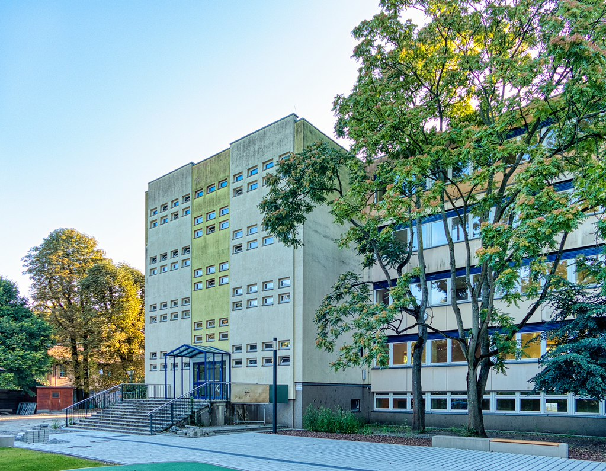
        </a>
        

        <figcaption>
          <h4>Grundschule unter den Bäumen</h4>
          
Alt-Blankenburg 26, 13129 Berlin

          
1975 · Учебное заведение

          
В ГДР: 12. POS „Walter Siemund“ Weißensee

          
<a target="_blank" rel="noopener noreferrer" href="https://www.google.com/maps/search/?api=1&amp;query=52.5921900,13.4543800">Google Maps</a> · <a target="_blank" rel="noopener noreferrer" href="https://www.sk68-berlin.de/standort/grundschule-unter-den-baeumen/">О здании</a>

          
Фото: <a target="_blank" rel="noopener noreferrer" href="https://www.flickr.com/photos/25054024@N00/54758457450/">Silvio Schwartz</a> · <a target="_blank" rel="noopener noreferrer" href="https://creativecommons.org/licenses/by-sa/4.0/">CC BY-SA 4.0</a>

        </figcaption>
      </figure>
      <figure class="sk68-card" id="sk68-gustave-eiffel-oberschule-haus-1">
        

        <a id="sk68-54788990558" target="_blank" rel="noopener noreferrer" href="https://www.google.com/maps/search/?api=1&amp;query=52.5406620,13.4484400" aria-label="Gustave-Eiffel-Oberschule (Haus 1) — Google Maps">
          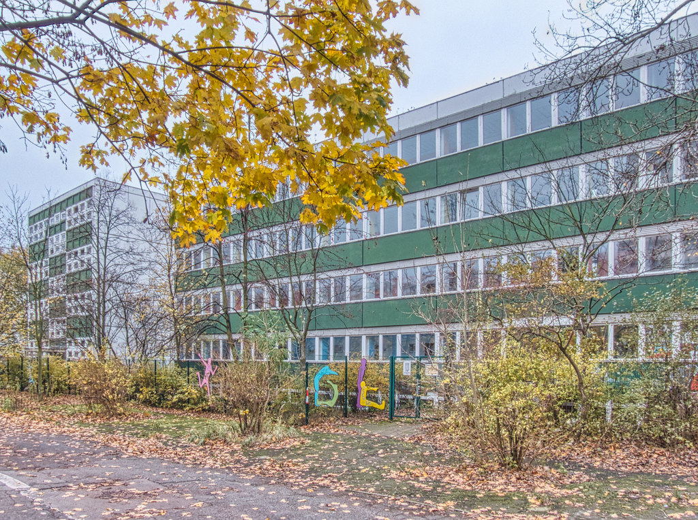
        </a>
        

        <figcaption>
          <h4>Gustave-Eiffel-Oberschule (Haus 1)</h4>
          
Hanns-Eisler-Straße 78, 10409 Berlin

          
1976 · Учебное заведение

          
В ГДР: 41. POS „Hanns Eisler“

          
<a target="_blank" rel="noopener noreferrer" href="https://www.google.com/maps/search/?api=1&amp;query=52.5406620,13.4484400">Google Maps</a> · <a target="_blank" rel="noopener noreferrer" href="https://www.sk68-berlin.de/standort/gustave-eiffel-oberschule-haus-1/">О здании</a>

          
Фото: <a target="_blank" rel="noopener noreferrer" href="https://www.flickr.com/photos/25054024@N00/54788990558/">Silvio Schwartz</a> · <a target="_blank" rel="noopener noreferrer" href="https://creativecommons.org/licenses/by-sa/4.0/">CC BY-SA 4.0</a>

        </figcaption>
      </figure>
      <figure class="sk68-card" id="sk68-gustave-eiffel-oberschule-haus-2">
        

        <a id="sk68-54789066615" target="_blank" rel="noopener noreferrer" href="https://www.google.com/maps/search/?api=1&amp;query=52.5406620,13.4484400" aria-label="Gustave-Eiffel-Oberschule (Haus 2) — Google Maps">
          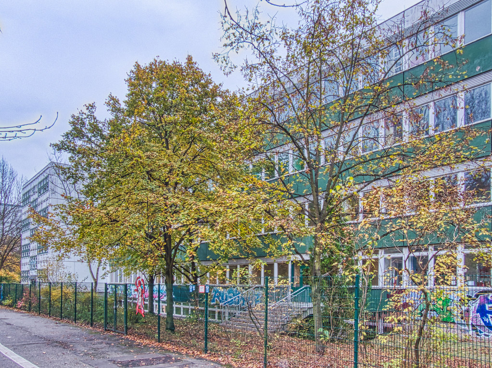
        </a>
        

        <figcaption>
          <h4>Gustave-Eiffel-Oberschule (Haus 2)</h4>
          
Hanns-Eisler-Straße 80, 10409 Berlin

          
1976 · Учебное заведение

          
В ГДР: 40. POS „Klara Schabbel“

          
<a target="_blank" rel="noopener noreferrer" href="https://www.google.com/maps/search/?api=1&amp;query=52.5406620,13.4484400">Google Maps</a> · <a target="_blank" rel="noopener noreferrer" href="https://www.sk68-berlin.de/standort/gustave-eiffel-oberschule-haus-2/">О здании</a>

          
Фото: <a target="_blank" rel="noopener noreferrer" href="https://www.flickr.com/photos/25054024@N00/54789066615/">Silvio Schwartz</a> · <a target="_blank" rel="noopener noreferrer" href="https://creativecommons.org/licenses/by-sa/4.0/">CC BY-SA 4.0</a>

        </figcaption>
      </figure>
      <figure class="sk68-card" id="sk68-gymnasium-am-europasportpark-haus-1">
        

        <a id="sk68-54879326906" target="_blank" rel="noopener noreferrer" href="https://www.google.com/maps/search/?api=1&amp;query=52.5334456,13.4480786" aria-label="Gymnasium am Europasportpark (Haus 1) — Google Maps">
          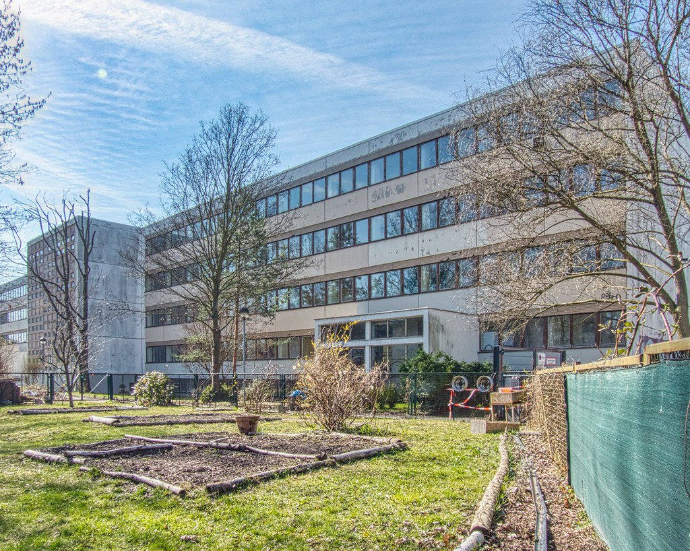
        </a>
        

        <figcaption>
          <h4>Gymnasium am Europasportpark (Haus 1)</h4>
          
Conrad-Blenkle-Straße 34, 10407 Berlin

          
1973 · Учебное заведение

          
В ГДР: Kinder- und Jugendsportschule Berlin Ehrenname „Ernst Grube“

          
<a target="_blank" rel="noopener noreferrer" href="https://www.google.com/maps/search/?api=1&amp;query=52.5334456,13.4480786">Google Maps</a> · <a target="_blank" rel="noopener noreferrer" href="https://www.sk68-berlin.de/standort/gymnasium-am-europasportpark-haus-1/">О здании</a>

          
Фото: <a target="_blank" rel="noopener noreferrer" href="https://www.flickr.com/photos/25054024@N00/54879326906/">Silvio Schwartz</a> · <a target="_blank" rel="noopener noreferrer" href="https://creativecommons.org/licenses/by-sa/4.0/">CC BY-SA 4.0</a>

        </figcaption>
      </figure>
      <figure class="sk68-card" id="sk68-hagenbeck-schule">
        

        <a id="sk68-54377597860" target="_blank" rel="noopener noreferrer" href="https://www.google.com/maps/search/?api=1&amp;query=52.5587800,13.4472900" aria-label="Hagenbeck-Schule — Google Maps">
          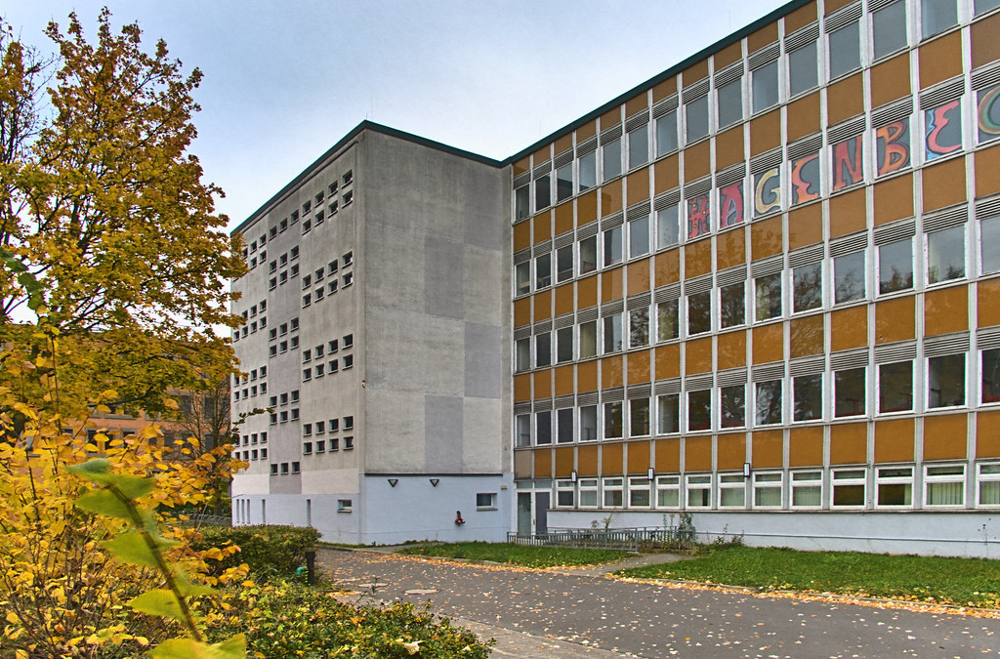
        </a>
        

        <figcaption>
          <h4>Hagenbeck-Schule</h4>
          
Gustav-Adolf-Straße 60, 13086 Berlin

          
1977 · Учебное заведение

          
В ГДР: Berta-Lask-Oberschule

          
<a target="_blank" rel="noopener noreferrer" href="https://www.google.com/maps/search/?api=1&amp;query=52.5587800,13.4472900">Google Maps</a> · <a target="_blank" rel="noopener noreferrer" href="https://www.sk68-berlin.de/standort/hagenbeck-schule/">О здании</a>

          
Фото: <a target="_blank" rel="noopener noreferrer" href="https://www.flickr.com/photos/25054024@N00/54377597860/">Silvio Schwartz</a> · <a target="_blank" rel="noopener noreferrer" href="https://creativecommons.org/licenses/by-sa/4.0/">CC BY-SA 4.0</a>

        </figcaption>
      </figure>
      <figure class="sk68-card" id="sk68-hasengrund-schule-grundschule-ausweichquartier">
        

        <a id="sk68-54765814058" target="_blank" rel="noopener noreferrer" href="https://www.google.com/maps/search/?api=1&amp;query=52.5779897,13.3944101" aria-label="Hasengrund-Schule (Grundschule) (Ausweichquartier) — Google Maps">
          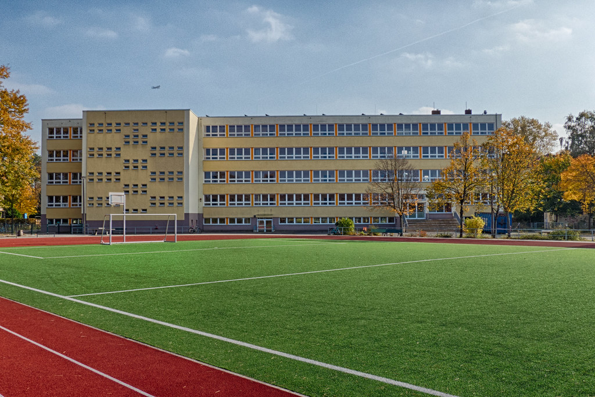
        </a>
        

        <figcaption>
          <h4>Hasengrund-Schule (Grundschule) (Ausweichquartier)</h4>
          
Hermann-Hesse-Straße 48/52, 13156 Berlin

          
1978 · Учебное заведение

          
В ГДР: Sozialpädagogisches Heilzentrum (?) 2. Hilfsschule [Kurt-Fischer-Straße 48/52]

          
<a target="_blank" rel="noopener noreferrer" href="https://www.google.com/maps/search/?api=1&amp;query=52.5779897,13.3944101">Google Maps</a> · <a target="_blank" rel="noopener noreferrer" href="https://www.sk68-berlin.de/standort/hasengrund-schule-grundschule-ausweichquartier/">О здании</a>

          
Фото: <a target="_blank" rel="noopener noreferrer" href="https://www.flickr.com/photos/25054024@N00/54765814058/">Silvio Schwartz</a> · <a target="_blank" rel="noopener noreferrer" href="https://creativecommons.org/licenses/by-sa/4.0/">CC BY-SA 4.0</a>

        </figcaption>
      </figure>
      <figure class="sk68-card" id="sk68-helene-haeusler-schule">
        

        <a id="sk68-54879693960" target="_blank" rel="noopener noreferrer" href="https://www.google.com/maps/search/?api=1&amp;query=52.5267000,13.4200200" aria-label="Helene-Haeusler-Schule — Google Maps">
          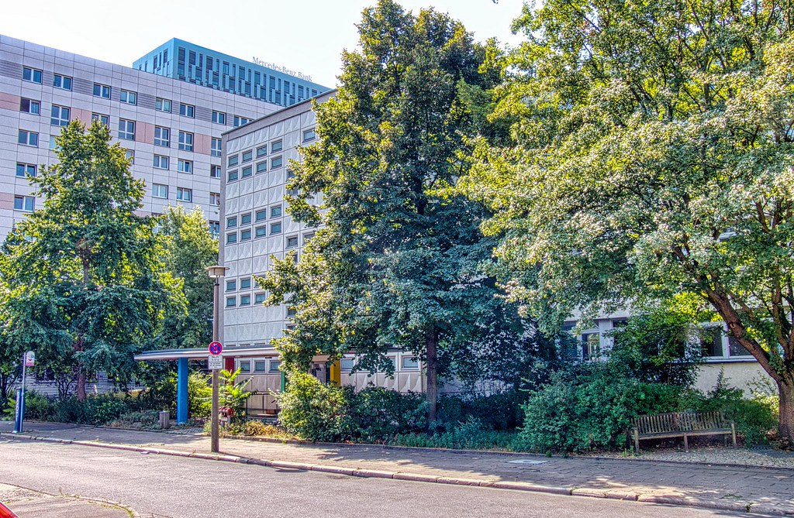
        </a>
        

        <figcaption>
          <h4>Helene-Haeusler-Schule</h4>
          
Mendelssohnstraße 10, 10405 Berlin

          
1970 · Учебное заведение

          
В ГДР: 10. POS „Hermann Matern“

          
<a target="_blank" rel="noopener noreferrer" href="https://www.google.com/maps/search/?api=1&amp;query=52.5267000,13.4200200">Google Maps</a> · <a target="_blank" rel="noopener noreferrer" href="https://www.sk68-berlin.de/standort/helene-haeusler-schule/">О здании</a>

          
Фото: <a target="_blank" rel="noopener noreferrer" href="https://www.flickr.com/photos/25054024@N00/54879693960/">Silvio Schwartz</a> · <a target="_blank" rel="noopener noreferrer" href="https://creativecommons.org/licenses/by-sa/4.0/">CC BY-SA 4.0</a>

        </figcaption>
      </figure>
      <figure class="sk68-card" id="sk68-hufeland-schule-integrierte-sekundarschule">
        

        <a id="sk68-54879412121" target="_blank" rel="noopener noreferrer" href="https://www.google.com/maps/search/?api=1&amp;query=52.6328700,13.4930700" aria-label="Hufeland-Schule (Integrierte Sekundarschule) — Google Maps">
          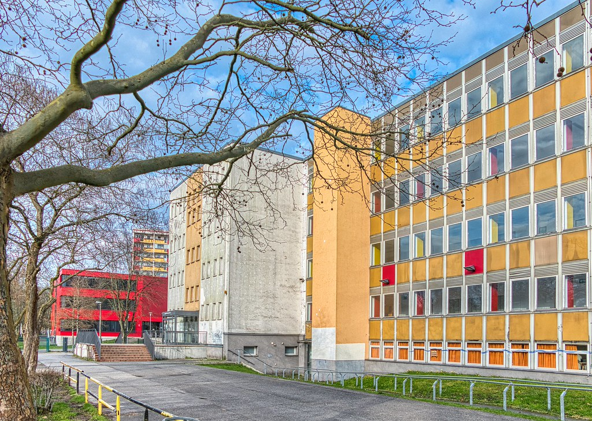
        </a>
        

        <figcaption>
          <h4>Hufeland-Schule (Integrierte Sekundarschule)</h4>
          
Walter-Friedrich-Straße 18, 13125 Berlin

          
1977 · Учебное заведение

          
В ГДР: Karl-Marx-Oberschule

          
<a target="_blank" rel="noopener noreferrer" href="https://www.google.com/maps/search/?api=1&amp;query=52.6328700,13.4930700">Google Maps</a> · <a target="_blank" rel="noopener noreferrer" href="https://www.sk68-berlin.de/standort/hufeland-schule-integrierte-sekundarschule/">О здании</a>

          
Фото: <a target="_blank" rel="noopener noreferrer" href="https://www.flickr.com/photos/25054024@N00/54879412121/">Silvio Schwartz</a> · <a target="_blank" rel="noopener noreferrer" href="https://creativecommons.org/licenses/by-sa/4.0/">CC BY-SA 4.0</a>

        </figcaption>
      </figure>
      <figure class="sk68-card" id="sk68-janusz-korczak-schule-integrierte-sekundarschule">
        

        <a id="sk68-55161603588" target="_blank" rel="noopener noreferrer" href="https://www.google.com/maps/search/?api=1&amp;query=52.5630241,13.4076108" aria-label="Janusz-Korczak-Schule (Integrierte Sekundarschule) — Google Maps">
          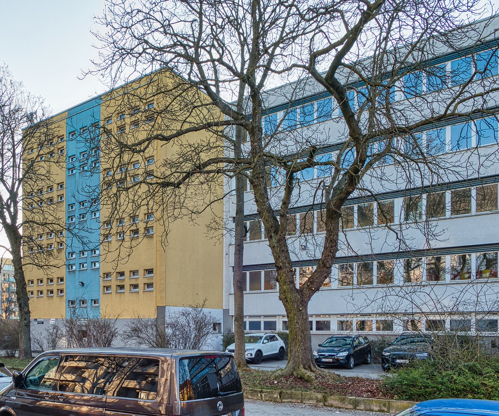
        </a>
        

        <figcaption>
          <h4>Janusz-Korczak-Schule (Integrierte Sekundarschule)</h4>
          
Dolomitenstr. 94, 13187 Berlin

          
1973 · Учебное заведение

          
В ГДР: 24. POS „Janusz Korczak“ Pankow

          
<a target="_blank" rel="noopener noreferrer" href="https://www.google.com/maps/search/?api=1&amp;query=52.5630241,13.4076108">Google Maps</a> · <a target="_blank" rel="noopener noreferrer" href="https://www.sk68-berlin.de/standort/janusz-korczak-schule-integrierte-sekundarschule/">О здании</a>

          
Фото: <a target="_blank" rel="noopener noreferrer" href="https://www.flickr.com/photos/25054024@N00/55161603588/">Silvio Schwartz</a> · <a target="_blank" rel="noopener noreferrer" href="https://creativecommons.org/licenses/by-sa/4.0/">CC BY-SA 4.0</a>

        </figcaption>
      </figure>
      <figure class="sk68-card" id="sk68-konrad-duden-schule-integrierte-sekundarschule">
        

        
        

        <figcaption>
          <h4>Konrad-Duden-Schule (Integrierte Sekundarschule)</h4>
          
Rolandstraße 35, 13156 Berlin

          
1967 · Учебное заведение

          
В ГДР: Otto-Grotewohl-Oberschule

          
<a target="_blank" rel="noopener noreferrer" href="https://www.google.com/maps/search/?api=1&amp;query=52.5818300,13.4174400">Google Maps</a> · <a target="_blank" rel="noopener noreferrer" href="https://www.sk68-berlin.de/standort/konrad-duden-schule-integrierte-sekundarschule/">О здании</a>

          
Фото: <a target="_blank" rel="noopener noreferrer" href="https://www.flickr.com/photos/25054024@N00/54879642808/">Silvio Schwartz</a> · <a target="_blank" rel="noopener noreferrer" href="https://creativecommons.org/licenses/by-sa/4.0/">CC BY-SA 4.0</a>

        </figcaption>
      </figure>
      <figure class="sk68-card" id="sk68-kurt-tucholsky-schule-integrierte-sekundarschule-haus-1">
        

        
        

        <figcaption>
          <h4>Kurt-Tucholsky-Schule (Integrierte Sekundarschule) (Haus 1)</h4>
          
Neumannstraße 9, 13189 Berlin

          
1980 · Учебное заведение

          
В ГДР: Hermann-Dünow-Oberschule

          
<a target="_blank" rel="noopener noreferrer" href="https://www.google.com/maps/search/?api=1&amp;query=52.5581200,13.4233300">Google Maps</a> · <a target="_blank" rel="noopener noreferrer" href="https://www.sk68-berlin.de/standort/kurt-tucholsky-schule-integrierte-sekundarschule-haus-1/">О здании</a>

          
Фото: <a target="_blank" rel="noopener noreferrer" href="https://www.flickr.com/photos/25054024@N00/54883244005/">Silvio Schwartz</a> · <a target="_blank" rel="noopener noreferrer" href="https://creativecommons.org/licenses/by-sa/4.0/">CC BY-SA 4.0</a>

        </figcaption>
      </figure>
      <figure class="sk68-card" id="sk68-kurt-tucholsky-schule-integrierte-sekundarschule-haus-2">
        

        
        

        <figcaption>
          <h4>Kurt-Tucholsky-Schule (Integrierte Sekundarschule) (Haus 2)</h4>
          
Neumannstraße 9/11, 13189 Berlin

          
1974 · Учебное заведение

          
В ГДР: 30. POS Berlin-Pankow, 25. POS Kurt-Tucholsky Pankow, 33. POS Pankow

          
<a target="_blank" rel="noopener noreferrer" href="https://www.google.com/maps/search/?api=1&amp;query=52.5591192,13.4231660">Google Maps</a> · <a target="_blank" rel="noopener noreferrer" href="https://www.sk68-berlin.de/standort/kurt-tucholsky-schule-integrierte-sekundarschule-haus-2/">О здании</a>

          
Фото: <a target="_blank" rel="noopener noreferrer" href="https://www.flickr.com/photos/25054024@N00/54883180568/">Silvio Schwartz</a> · <a target="_blank" rel="noopener noreferrer" href="https://creativecommons.org/licenses/by-sa/4.0/">CC BY-SA 4.0</a>

        </figcaption>
      </figure>
      <figure class="sk68-card sk68-card--multiple" id="sk68-leerstehend">
        

        
        
        

        <figcaption>
          <h4>Пустующий корпус в Buch</h4>
          
2 фото одного здания

          
Wiltbergstraße 29G, 13125 Berlin

          
1980 · Пустует (по описанию автора)

          
В ГДР: 31. Oberschule, Bezirksschule der Zivilverteidigung Berlin

          
<a target="_blank" rel="noopener noreferrer" href="https://www.google.com/maps/search/?api=1&amp;query=52.6299000,13.4871300">Google Maps</a> · <a target="_blank" rel="noopener noreferrer" href="https://www.sk68-berlin.de/standort/leerstehend/">О здании</a>

          
Фото: <a target="_blank" rel="noopener noreferrer" href="https://www.flickr.com/photos/25054024@N00/55137934819/">Silvio Schwartz, снимок 1</a> · <a target="_blank" rel="noopener noreferrer" href="https://www.flickr.com/photos/25054024@N00/54883193903/">Silvio Schwartz, снимок 2</a> · <a target="_blank" rel="noopener noreferrer" href="https://creativecommons.org/licenses/by-sa/4.0/">CC BY-SA 4.0</a>

        </figcaption>
      </figure>
      <figure class="sk68-card" id="sk68-schule-an-der-strauchwiese">
        

        
        

        <figcaption>
          <h4>Schule an der Strauchwiese</h4>
          
Mendelstr. 54, 13187 Berlin

          
1968 · Учебное заведение

          
В ГДР: Ernst-Thälmann-Oberschule

          
<a target="_blank" rel="noopener noreferrer" href="https://www.google.com/maps/search/?api=1&amp;query=52.5780500,13.4178201">Google Maps</a> · <a target="_blank" rel="noopener noreferrer" href="https://www.sk68-berlin.de/standort/schule-an-der-strauchwiese/">О здании</a>

          
Фото: <a target="_blank" rel="noopener noreferrer" href="https://www.flickr.com/photos/25054024@N00/54883298464/">Silvio Schwartz</a> · <a target="_blank" rel="noopener noreferrer" href="https://creativecommons.org/licenses/by-sa/4.0/">CC BY-SA 4.0</a>

        </figcaption>
      </figure>
      <figure class="sk68-card" id="sk68-staatliche-ballett-und-artistikschule-berlin">
        

        
        

        <figcaption>
          <h4>Staatliche Ballett- und Artistikschule Berlin</h4>
          
Erich-Weinert-Straße 103, 10409 Berlin

          
1969 · Учебное заведение

          
В ГДР: Staatliche Ballettschule Berlin

          
<a target="_blank" rel="noopener noreferrer" href="https://www.google.com/maps/search/?api=1&amp;query=52.5464300,13.4350000">Google Maps</a> · <a target="_blank" rel="noopener noreferrer" href="https://www.sk68-berlin.de/standort/staatliche-ballett-und-artistikschule-berlin/">О здании</a>

          
Фото: <a target="_blank" rel="noopener noreferrer" href="https://www.flickr.com/photos/25054024@N00/54883075456/">Silvio Schwartz</a> · <a target="_blank" rel="noopener noreferrer" href="https://creativecommons.org/licenses/by-sa/4.0/">CC BY-SA 4.0</a>

        </figcaption>
      </figure>
    

  

  

    
Treptow-Köpenick · зданий с фотографиями: 14

    

      <figure class="sk68-card" id="sk68-emmy-noether-gymnasium-haus-a">
        

        
        

        <figcaption>
          <h4>Emmy-Noether-Gymnasium (Haus A)</h4>
          
Pablo-Neruda-Straße 6–7, 12559 Berlin

          
1972 · Учебное заведение

          
В ГДР: Salvador-Allende-Oberschule

          
<a target="_blank" rel="noopener noreferrer" href="https://www.google.com/maps/search/?api=1&amp;query=52.4427500,13.5887600">Google Maps</a> · <a target="_blank" rel="noopener noreferrer" href="https://www.sk68-berlin.de/standort/emmy-noether-gymnasium-haus-a/">О здании</a>

          
Фото: <a target="_blank" rel="noopener noreferrer" href="https://www.flickr.com/photos/25054024@N00/54631442805/">Silvio Schwartz</a> · <a target="_blank" rel="noopener noreferrer" href="https://creativecommons.org/licenses/by-sa/4.0/">CC BY-SA 4.0</a>

        </figcaption>
      </figure>
      <figure class="sk68-card" id="sk68-emmy-noether-gymnasium-haus-b">
        

        
        

        <figcaption>
          <h4>Emmy-Noether-Gymnasium (Haus B)</h4>
          
Pablo-Neruda-Straße 6–7, 12559 Berlin

          
1972 · Учебное заведение

          
В ГДР: Pablo-Neruda-Oberschule

          
<a target="_blank" rel="noopener noreferrer" href="https://www.google.com/maps/search/?api=1&amp;query=52.4434890,13.5881810">Google Maps</a> · <a target="_blank" rel="noopener noreferrer" href="https://www.sk68-berlin.de/standort/emmy-noether-gymnasium-haus-b/">О здании</a>

          
Фото: <a target="_blank" rel="noopener noreferrer" href="https://www.flickr.com/photos/25054024@N00/54631138416/">Silvio Schwartz</a> · <a target="_blank" rel="noopener noreferrer" href="https://creativecommons.org/licenses/by-sa/4.0/">CC BY-SA 4.0</a>

        </figcaption>
      </figure>
      <figure class="sk68-card" id="sk68-hans-grade-schule-integrierte-sekundarschule">
        

        
        

        <figcaption>
          <h4>Hans-Grade-Schule (Integrierte Sekundarschule)</h4>
          
Heubergerweg 37, 12487 Berlin

          
1976 · Учебное заведение

          
В ГДР: 26. POS Paul-Wieczorek-Oberschule [Hoevelstraße 3]

          
<a target="_blank" rel="noopener noreferrer" href="https://www.google.com/maps/search/?api=1&amp;query=52.4444843,13.4990219">Google Maps</a> · <a target="_blank" rel="noopener noreferrer" href="https://www.sk68-berlin.de/standort/hans-grade-schule-integrierte-sekundarschule/">О здании</a>

          
Фото: <a target="_blank" rel="noopener noreferrer" href="https://www.flickr.com/photos/25054024@N00/54377604715/">Silvio Schwartz</a> · <a target="_blank" rel="noopener noreferrer" href="https://creativecommons.org/licenses/by-sa/4.0/">CC BY-SA 4.0</a>

        </figcaption>
      </figure>
      <figure class="sk68-card" id="sk68-heide-schule-grundschule">
        

        
        

        <figcaption>
          <h4>Heide-Schule (Grundschule)</h4>
          
Florian-Geyer-Straße 87, 12489 Berlin

          
1967 · Учебное заведение

          
В ГДР: Georgi-Dimitroff-Oberschule

          
<a target="_blank" rel="noopener noreferrer" href="https://www.google.com/maps/search/?api=1&amp;query=52.4386480,13.5437125">Google Maps</a> · <a target="_blank" rel="noopener noreferrer" href="https://www.sk68-berlin.de/standort/heide-schule-grundschule/">О здании</a>

          
Фото: <a target="_blank" rel="noopener noreferrer" href="https://www.flickr.com/photos/25054024@N00/54879579618/">Silvio Schwartz</a> · <a target="_blank" rel="noopener noreferrer" href="https://creativecommons.org/licenses/by-sa/4.0/">CC BY-SA 4.0</a>

        </figcaption>
      </figure>
      <figure class="sk68-card" id="sk68-heide-schule-grundschule-grimau-club">
        

        
        

        <figcaption>
          <h4>Heide-Schule (Grundschule) / Grimau-Club</h4>
          
Waldstraße 7, 12489 Berlin

          
1974 · Учебное заведение

          
В ГДР: Otto-Neite-Oberschule

          
<a target="_blank" rel="noopener noreferrer" href="https://www.google.com/maps/search/?api=1&amp;query=52.4424103,13.5515661">Google Maps</a> · <a target="_blank" rel="noopener noreferrer" href="https://www.sk68-berlin.de/standort/heide-schule-grundschule-grimau-club/">О здании</a>

          
Фото: <a target="_blank" rel="noopener noreferrer" href="https://www.flickr.com/photos/25054024@N00/54879666665/">Silvio Schwartz</a> · <a target="_blank" rel="noopener noreferrer" href="https://creativecommons.org/licenses/by-sa/4.0/">CC BY-SA 4.0</a>

        </figcaption>
      </figure>
      <figure class="sk68-card" id="sk68-kreativitaetsgrundschule-berlin-treptow">
        

        
        

        <figcaption>
          <h4>KreativitätsGrundschule Berlin Treptow</h4>
          
Hartriegelstraße 77, 12439 Berlin

          
1972 · Учебное заведение

          
В ГДР: 22. POS „Otto Franke“ Berlin-Treptow

          
<a target="_blank" rel="noopener noreferrer" href="https://www.google.com/maps/search/?api=1&amp;query=52.4480866,13.5316017">Google Maps</a> · <a target="_blank" rel="noopener noreferrer" href="https://www.sk68-berlin.de/standort/kreativitaetsgrundschule-berlin-treptow/">О здании</a>

          
Фото: <a target="_blank" rel="noopener noreferrer" href="https://www.flickr.com/photos/25054024@N00/54882942041/">Silvio Schwartz</a> · <a target="_blank" rel="noopener noreferrer" href="https://creativecommons.org/licenses/by-sa/4.0/">CC BY-SA 4.0</a>

        </figcaption>
      </figure>
      <figure class="sk68-card" id="sk68-melli-beese-schule-grundschule">
        

        
        

        <figcaption>
          <h4>Melli-Beese-Schule (Grundschule)</h4>
          
Engelhardstraße 18, 12487 Berlin

          
1971 · Учебное заведение

          
В ГДР: 20. POS Otto-Buchwitz-Oberschule

          
<a target="_blank" rel="noopener noreferrer" href="https://www.google.com/maps/search/?api=1&amp;query=52.4469600,13.5103100">Google Maps</a> · <a target="_blank" rel="noopener noreferrer" href="https://www.sk68-berlin.de/standort/melli-beese-schule-grundschule/">О здании</a>

          
Фото: <a target="_blank" rel="noopener noreferrer" href="https://www.flickr.com/photos/25054024@N00/54377610210/">Silvio Schwartz</a> · <a target="_blank" rel="noopener noreferrer" href="https://creativecommons.org/licenses/by-sa/4.0/">CC BY-SA 4.0</a>

        </figcaption>
      </figure>
      <figure class="sk68-card" id="sk68-mueggelschloesschen-schule-grundschule-haus-1">
        

        
        

        <figcaption>
          <h4>Müggelschlößchen-Schule (Grundschule) (Haus 1)</h4>
          
Alfred-Randt-Straße 56, 12559 Berlin

          
1982 · Учебное заведение

          
В ГДР: Paul-Wengels-Oberschule

          
<a target="_blank" rel="noopener noreferrer" href="https://www.google.com/maps/search/?api=1&amp;query=52.4389506,13.6060069">Google Maps</a> · <a target="_blank" rel="noopener noreferrer" href="https://www.sk68-berlin.de/standort/mueggelschloesschen-schule-grundschule-haus-1/">О здании</a>

          
Фото: <a target="_blank" rel="noopener noreferrer" href="https://www.flickr.com/photos/25054024@N00/54883231029/">Silvio Schwartz</a> · <a target="_blank" rel="noopener noreferrer" href="https://creativecommons.org/licenses/by-sa/4.0/">CC BY-SA 4.0</a>

        </figcaption>
      </figure>
      <figure class="sk68-card" id="sk68-schule-am-altglienicker-wasserturm-grundschule">
        

        
        

        <figcaption>
          <h4>Schule am Altglienicker Wasserturm (Grundschule)</h4>
          
Sachsenstraße 22, 12524 Berlin

          
1973 · Учебное заведение

          
В ГДР: Willi-Gall-Oberschule

          
<a target="_blank" rel="noopener noreferrer" href="https://www.google.com/maps/search/?api=1&amp;query=52.4107900,13.5540600">Google Maps</a> · <a target="_blank" rel="noopener noreferrer" href="https://www.sk68-berlin.de/standort/schule-am-altglienicker-wasserturm-grundschule/">О здании</a>

          
Фото: <a target="_blank" rel="noopener noreferrer" href="https://www.flickr.com/photos/25054024@N00/54882151387/">Silvio Schwartz</a> · <a target="_blank" rel="noopener noreferrer" href="https://creativecommons.org/licenses/by-sa/4.0/">CC BY-SA 4.0</a>

        </figcaption>
      </figure>
      <figure class="sk68-card" id="sk68-schule-am-buntzelberg-grundschule">
        

        
        

        <figcaption>
          <h4>Schule am Buntzelberg (Grundschule)</h4>
          
Schulzendorfer Str. 112, 12526 Berlin

          
1974 · Учебное заведение

          
В ГДР: Alfred-Grünberg-Oberschule

          
<a target="_blank" rel="noopener noreferrer" href="https://www.google.com/maps/search/?api=1&amp;query=52.4067100,13.5742700">Google Maps</a> · <a target="_blank" rel="noopener noreferrer" href="https://www.sk68-berlin.de/standort/schule-am-buntzelberg-grundschule/">О здании</a>

          
Фото: <a target="_blank" rel="noopener noreferrer" href="https://www.flickr.com/photos/25054024@N00/54882159567/">Silvio Schwartz</a> · <a target="_blank" rel="noopener noreferrer" href="https://creativecommons.org/licenses/by-sa/4.0/">CC BY-SA 4.0</a>

        </figcaption>
      </figure>
      <figure class="sk68-card" id="sk68-schule-am-wildgarten">
        

        
        

        <figcaption>
          <h4>Schule am Wildgarten</h4>
          
Köpenicker Landstraße 185A, 12437 Berlin

          
1974 · Учебное заведение

          
В ГДР: Erich-Lodemann-Oberschule

          
<a target="_blank" rel="noopener noreferrer" href="https://www.google.com/maps/search/?api=1&amp;query=52.4728819,13.4878072">Google Maps</a> · <a target="_blank" rel="noopener noreferrer" href="https://www.sk68-berlin.de/standort/schule-am-wildgarten/">О здании</a>

          
Фото: <a target="_blank" rel="noopener noreferrer" href="https://www.flickr.com/photos/25054024@N00/54883334460/">Silvio Schwartz</a> · <a target="_blank" rel="noopener noreferrer" href="https://creativecommons.org/licenses/by-sa/4.0/">CC BY-SA 4.0</a>

        </figcaption>
      </figure>
      <figure class="sk68-card" id="sk68-sonnenblumen-schule-grundschule">
        

        
        

        <figcaption>
          <h4>Sonnenblumen-Schule (Grundschule)</h4>
          
Radenzer Straße 16, 12437 Berlin

          
1970 · Учебное заведение

          
В ГДР: POS „Ernst Thälmann“ Baumschulenweg 15. POS „Robert Stamm“

          
<a target="_blank" rel="noopener noreferrer" href="https://www.google.com/maps/search/?api=1&amp;query=52.4618294,13.4882498">Google Maps</a> · <a target="_blank" rel="noopener noreferrer" href="https://www.sk68-berlin.de/standort/sonnenblumen-schule-grundschule/">О здании</a>

          
Фото: <a target="_blank" rel="noopener noreferrer" href="https://www.flickr.com/photos/25054024@N00/54883280058/">Silvio Schwartz</a> · <a target="_blank" rel="noopener noreferrer" href="https://creativecommons.org/licenses/by-sa/4.0/">CC BY-SA 4.0</a>

        </figcaption>
      </figure>
      <figure class="sk68-card" id="sk68-wendenschloss-schule-grundschule">
        

        
        

        <figcaption>
          <h4>Wendenschloß-Schule (Grundschule)</h4>
          
Köpenzeile 123, 12557 Berlin

          
1971 · Учебное заведение

          
В ГДР: Marschall-Shukow-Oberschule

          
<a target="_blank" rel="noopener noreferrer" href="https://www.google.com/maps/search/?api=1&amp;query=52.4284500,13.5953000">Google Maps</a> · <a target="_blank" rel="noopener noreferrer" href="https://www.sk68-berlin.de/standort/wendenschloss-schule-grundschule/">О здании</a>

          
Фото: <a target="_blank" rel="noopener noreferrer" href="https://www.flickr.com/photos/25054024@N00/54883339289/">Silvio Schwartz</a> · <a target="_blank" rel="noopener noreferrer" href="https://creativecommons.org/licenses/by-sa/4.0/">CC BY-SA 4.0</a>

        </figcaption>
      </figure>
      <figure class="sk68-card" id="sk68-w-i-r-grundschule-pfefferwerk">
        

        
        

        <figcaption>
          <h4>W‑I-R Grundschule Pfefferwerk</h4>
          
Grüne Trift 23d, 12557 Berlin

          
1982 · Учебное заведение

          
В ГДР: Hermann-Gramsch-Hilfsschule

          
<a target="_blank" rel="noopener noreferrer" href="https://www.google.com/maps/search/?api=1&amp;query=52.4380013,13.5901992">Google Maps</a> · <a target="_blank" rel="noopener noreferrer" href="https://www.sk68-berlin.de/standort/w-i-r-grundschule-pfefferwerk/">О здании</a>

          
Фото: <a target="_blank" rel="noopener noreferrer" href="https://www.flickr.com/photos/25054024@N00/54882230117/">Silvio Schwartz</a> · <a target="_blank" rel="noopener noreferrer" href="https://creativecommons.org/licenses/by-sa/4.0/">CC BY-SA 4.0</a>

        </figcaption>
      </figure>
    

  

  

    
Полный адресный каталог · записей: 181, в том числе без фотографий

    
Названия и состояние — по каталогу SK68 Berlin на 3 ноября 2026 года. Каждый корпус указан отдельно, поэтому у одного адреса могут быть несколько записей.

    <h3>Brandenburg / Schönefeld</h3>
    <ul class="sk68-directory">
      <li><a target="_blank" rel="noopener noreferrer" href="https://www.google.com/maps/search/?api=1&amp;query=52.3955500,13.5347600">Oberstufenzentrum Dahme-Spreewald – Abteilung 1 Schönefeld</a> — Am Seegraben 84, 12529 Schönefeld
        <small>Год неизвестен · Учебное заведение · <a target="_blank" rel="noopener noreferrer" href="https://www.sk68-berlin.de/standort/oberstufenzentrum-dahme-spreewald-abteilung-1-schoenefeld/">Источник</a></small>
      </li>
    </ul>
    <h3>Friedrichshain-Kreuzberg</h3>
    <ul class="sk68-directory">
      <li><a target="_blank" rel="noopener noreferrer" href="https://www.google.com/maps/search/?api=1&amp;query=52.5250972,13.4251730">Berlin Bilingual School</a> — Weinstraße 1, 10249 Berlin
        <small>1969 · Учебное заведение · <a target="_blank" rel="noopener noreferrer" href="https://www.sk68-berlin.de/standort/berlin-bilingual-school/">Источник</a></small>
      </li>
      <li><a target="_blank" rel="noopener noreferrer" href="https://www.google.com/maps/search/?api=1&amp;query=52.5162470,13.4315370">Blumen-Grundschule (Haus 1)</a> — Andreasstraße 50, 10243 Berlin
        <small>1968 · Учебное заведение · <a target="_blank" rel="noopener noreferrer" href="https://www.sk68-berlin.de/standort/blumen-grundschule-haus-1/">Источник</a></small>
      </li>
      <li><a target="_blank" rel="noopener noreferrer" href="https://www.google.com/maps/search/?api=1&amp;query=52.5156600,13.4303400">Blumen-Grundschule (Haus 2)</a> — Singerstraße 87, 10243 Berlin
        <small>1966 · Учебное заведение · <a target="_blank" rel="noopener noreferrer" href="https://www.sk68-berlin.de/standort/blumen-grundschule-haus-2/">Источник</a></small>
      </li>
      <li><a target="_blank" rel="noopener noreferrer" href="https://www.google.com/maps/search/?api=1&amp;query=52.5162700,13.4381400">Ellen-Key-Schule</a> — Rüdersdorfer Str. 20, 10243 Berlin
        <small>1971 · Учебное заведение · <a target="_blank" rel="noopener noreferrer" href="https://www.sk68-berlin.de/standort/ellen-key-schule/">Источник</a></small>
      </li>
      <li><a target="_blank" rel="noopener noreferrer" href="https://www.google.com/maps/search/?api=1&amp;query=52.5144600,13.4418200">Grundschule an der Weberwiese</a> — Fredersdorfer Straße 28, 10243 Berlin
        <small>1972 · Снесено · <a target="_blank" rel="noopener noreferrer" href="https://www.sk68-berlin.de/standort/grundschule-an-der-weberwiese/">Источник</a></small>
      </li>
      <li><a target="_blank" rel="noopener noreferrer" href="https://www.google.com/maps/search/?api=1&amp;query=52.5198400,13.4346000">Margarethe-von-Witzleben-Schule</a> — Palisadenstraße 76, 10243 Berlin
        <small>1973 · Учебное заведение · <a target="_blank" rel="noopener noreferrer" href="https://www.sk68-berlin.de/standort/margarethe-von-witzleben-schule/">Источник</a></small>
      </li>
      <li><a target="_blank" rel="noopener noreferrer" href="https://www.google.com/maps/search/?api=1&amp;query=52.5070500,13.4602400">Modersohn-Grundschule</a> — Niemannstraße 3, 10245 Berlin
        <small>1969 · Учебное заведение · <a target="_blank" rel="noopener noreferrer" href="https://www.sk68-berlin.de/standort/modersohn-grundschule/">Источник</a></small>
      </li>
      <li><a target="_blank" rel="noopener noreferrer" href="https://www.google.com/maps/search/?api=1&amp;query=52.5256282,13.4258284">Schule am Königstor (Integrierte Sekundarschule)</a> — Weinstr. 3, 10249 Berlin
        <small>1970 · Учебное заведение · <a target="_blank" rel="noopener noreferrer" href="https://www.sk68-berlin.de/standort/schule-am-koenigstor-integrierte-sekundarschule/">Источник</a></small>
      </li>
      <li><a target="_blank" rel="noopener noreferrer" href="https://www.google.com/maps/search/?api=1&amp;query=52.5210600,13.4358200">Spartacus-Grundschule</a> — Friedenstraße 40, 10249 Berlin
        <small>1970 · Учебное заведение · <a target="_blank" rel="noopener noreferrer" href="https://www.sk68-berlin.de/standort/spartacus-grundschule/">Источник</a></small>
      </li>
      <li><a target="_blank" rel="noopener noreferrer" href="https://www.google.com/maps/search/?api=1&amp;query=52.5145699,13.4570278">Stadtbibliothek Friedrichshain-Kreuzberg Bezirkszentralbibliothek Pablo Neruda</a> — Frankfurter Allee 14 A, 10247 Berlin
        <small>1969 · Другое использование · <a target="_blank" rel="noopener noreferrer" href="https://www.sk68-berlin.de/standort/stadtbibliothek-friedrichshain-kreuzberg-bezirkszentralbibliothek-pablo-neruda/">Источник</a></small>
      </li>
      <li><a target="_blank" rel="noopener noreferrer" href="https://www.google.com/maps/search/?api=1&amp;query=52.5089806,13.4653586">Zille-Grundschule</a> — Boxhagener Straße 45–46, 10245 Berlin
        <small>1977 · Учебное заведение · <a target="_blank" rel="noopener noreferrer" href="https://www.sk68-berlin.de/standort/zille-grundschule/">Источник</a></small>
      </li>
    </ul>
    <h3>Lichtenberg</h3>
    <ul class="sk68-directory">
      <li><a target="_blank" rel="noopener noreferrer" href="https://www.google.com/maps/search/?api=1&amp;query=52.5260000,13.4715800">4. Grundschule an der Rudolf-Seiffert-Straße</a> — Rudolf-Seiffert-Straße 37, 10369 Berlin
        <small>1976 · Снесено · <a target="_blank" rel="noopener noreferrer" href="https://www.sk68-berlin.de/standort/4-grundschule-an-der-rudolf-seiffert-strasse/">Источник</a></small>
      </li>
      <li><a target="_blank" rel="noopener noreferrer" href="https://www.google.com/maps/search/?api=1&amp;query=52.5083500,13.4790600">46. POS „Francisco Orlando Magumbwe“ Berlin-Lichtenberg</a> — Schulze-Boysen-Straße 38, 10365 Berlin
        <small>1974 · Снесено · <a target="_blank" rel="noopener noreferrer" href="https://www.sk68-berlin.de/standort/46-pos-francisco-orlando-magumbwe-berlin-lichtenberg/">Источник</a></small>
      </li>
      <li><a target="_blank" rel="noopener noreferrer" href="https://www.google.com/maps/search/?api=1&amp;query=52.5368800,13.5017800">5. Gymnasium / 22. POS „Anna Seghers“</a> — Liebenwalder Straße 22, 13055 Berlin
        <small>1978 · Снесено · <a target="_blank" rel="noopener noreferrer" href="https://www.sk68-berlin.de/standort/5-gymnasium-22-pos-anna-seghers/">Источник</a></small>
      </li>
      <li><a target="_blank" rel="noopener noreferrer" href="https://www.google.com/maps/search/?api=1&amp;query=52.5124541,13.5153807">8. Grundschule Lichtenberg</a> — Rosenfelder Ring 63, 10315 Berlin
        <small>1972 · Снесено · <a target="_blank" rel="noopener noreferrer" href="https://www.sk68-berlin.de/standort/8-grundschule-lichtenberg/">Источник</a></small>
      </li>
      <li><a target="_blank" rel="noopener noreferrer" href="https://www.google.com/maps/search/?api=1&amp;query=52.5114000,13.5312500">Adam-Ries-Schule Lichtenberg</a> — Alt-Friedrichsfelde 66, 10315 Berlin
        <small>1979 · Учебное заведение · <a target="_blank" rel="noopener noreferrer" href="https://www.sk68-berlin.de/standort/adam-ries-schule-lichtenberg/">Источник</a></small>
      </li>
      <li><a target="_blank" rel="noopener noreferrer" href="https://www.google.com/maps/search/?api=1&amp;query=52.5079500,13.5155600">Alexander-Puschkin-Oberschule</a> — Massower Str. 37, 10315 Berlin
        <small>1981 · Учебное заведение · <a target="_blank" rel="noopener noreferrer" href="https://www.sk68-berlin.de/standort/alexander-puschkin-oberschule/">Источник</a></small>
      </li>
      <li><a target="_blank" rel="noopener noreferrer" href="https://www.google.com/maps/search/?api=1&amp;query=52.5316900,13.4790600">Alfred-Kurella-Oberschule</a> — Bernhard-Bästlein-Straße 58, 10367 Berlin
        <small>1974 · Снесено · <a target="_blank" rel="noopener noreferrer" href="https://www.sk68-berlin.de/standort/alfred-kurella-oberschule/">Источник</a></small>
      </li>
      <li><a target="_blank" rel="noopener noreferrer" href="https://www.google.com/maps/search/?api=1&amp;query=52.4956745,13.5118272">Bernhard-Grzimek-Schule (Grundschule)</a> — Sewanstraße 184, 10319 Berlin
        <small>1976 · Учебное заведение · <a target="_blank" rel="noopener noreferrer" href="https://www.sk68-berlin.de/standort/bernhard-grzimek-schule-grundschule/">Источник</a></small>
      </li>
      <li><a target="_blank" rel="noopener noreferrer" href="https://www.google.com/maps/search/?api=1&amp;query=52.5373800,13.5006700">Brodowin-Schule (Grundschule)</a> — Liebenwalder Str. 20–22, 13055 Berlin
        <small>1978 · Учебное заведение · <a target="_blank" rel="noopener noreferrer" href="https://www.sk68-berlin.de/standort/brodowin-schule-grundschule/">Источник</a></small>
      </li>
      <li><a target="_blank" rel="noopener noreferrer" href="https://www.google.com/maps/search/?api=1&amp;query=52.5081800,13.5166500">Bürgermeister-Ziethen-Schule (Grundschule)</a> — Massower Str. 39, 10315 Berlin
        <small>1981 · Учебное заведение · <a target="_blank" rel="noopener noreferrer" href="https://www.sk68-berlin.de/standort/buergermeister-ziethen-schule-grundschule/">Источник</a></small>
      </li>
      <li><a target="_blank" rel="noopener noreferrer" href="https://www.google.com/maps/search/?api=1&amp;query=52.5340500,13.4721300">Drachenberg-Grundschule</a> — Otto-Marquardt-Str. 12, 10369 Berlin
        <small>1974 · Снесено · <a target="_blank" rel="noopener noreferrer" href="https://www.sk68-berlin.de/standort/drachenberg-grundschule/">Источник</a></small>
      </li>
      <li><a target="_blank" rel="noopener noreferrer" href="https://www.google.com/maps/search/?api=1&amp;query=52.4993700,13.4890300">Friedrich-List-Schule (OSZ Büromanagement und Wirtschaftssprachen), Filiale Fischerstraße</a> — Fischerstraße 32, 10317 Berlin
        <small>1970 · Учебное заведение · <a target="_blank" rel="noopener noreferrer" href="https://www.sk68-berlin.de/standort/friedrich-list-schule-osz-bueromanagement-und-wirtschaftssprachen-filiale-fischerstrasse/">Источник</a></small>
      </li>
      <li><a target="_blank" rel="noopener noreferrer" href="https://www.google.com/maps/search/?api=1&amp;query=52.5030000,13.5035500">Friedrichsfelder Schule (Grundschule)</a> — Lincolnstraße 67, 10315 Berlin
        <small>1968 · Учебное заведение · <a target="_blank" rel="noopener noreferrer" href="https://www.sk68-berlin.de/standort/friedrichsfelder-schule-grundschule/">Источник</a></small>
      </li>
      <li><a target="_blank" rel="noopener noreferrer" href="https://www.google.com/maps/search/?api=1&amp;query=52.5119300,13.5149100">George-Orwell-Realschule</a> — Rosenfelder Ring 39, 10315 Berlin
        <small>1967 · Снесено, 2008 · <a target="_blank" rel="noopener noreferrer" href="https://www.sk68-berlin.de/standort/george-orwell-realschule/">Источник</a></small>
      </li>
      <li><a target="_blank" rel="noopener noreferrer" href="https://www.google.com/maps/search/?api=1&amp;query=52.5175200,13.5008600">Grundschule am Lindenhof</a> — Hagenstraße 26, 10365 Berlin
        <small>1983 · Снесено · <a target="_blank" rel="noopener noreferrer" href="https://www.sk68-berlin.de/standort/grundschule-am-lindenhof/">Источник</a></small>
      </li>
      <li><a target="_blank" rel="noopener noreferrer" href="https://www.google.com/maps/search/?api=1&amp;query=52.5537600,13.5192700">Grundschule in der Gartenstadt</a> — Edgarstraße 2, 13053 Berlin
        <small>1978 · Снесено · <a target="_blank" rel="noopener noreferrer" href="https://www.sk68-berlin.de/standort/grundschule-in-der-gartenstadt/">Источник</a></small>
      </li>
      <li><a target="_blank" rel="noopener noreferrer" href="https://www.google.com/maps/search/?api=1&amp;query=52.5365343,13.4843939">Gutenberg-Schule</a> — Sandinostraße 10, 13055 Berlin
        <small>1978 · Учебное заведение · <a target="_blank" rel="noopener noreferrer" href="https://www.sk68-berlin.de/standort/gutenberg-schule/">Источник</a></small>
      </li>
      <li><a target="_blank" rel="noopener noreferrer" href="https://www.google.com/maps/search/?api=1&amp;query=52.5318300,13.4799800">Hans-Rosenthal-Grundschule</a> — Bernhard-Bästlein-Straße 56, 10367 Berlin
        <small>1973 · Учебное заведение · <a target="_blank" rel="noopener noreferrer" href="https://www.sk68-berlin.de/standort/hans-rosenthal-grundschule/">Источник</a></small>
      </li>
      <li><a target="_blank" rel="noopener noreferrer" href="https://www.google.com/maps/search/?api=1&amp;query=52.5234098,13.5127500">Hein-Moeller-Schule (OSZ Energietechnik II) (Haus A)</a> — Allee der Kosmonauten 18, 10315 Berlin
        <small>1980 · Учебное заведение · <a target="_blank" rel="noopener noreferrer" href="https://www.sk68-berlin.de/standort/hein-moeller-schule-osz-energietechnik-ii-haus-a/">Источник</a></small>
      </li>
      <li><a target="_blank" rel="noopener noreferrer" href="https://www.google.com/maps/search/?api=1&amp;query=52.5230800,13.5130700">Hein-Moeller-Schule (OSZ Energietechnik II) (Haus B)</a> — Allee der Kosmonauten 18, 10315 Berlin
        <small>1980 · Учебное заведение · <a target="_blank" rel="noopener noreferrer" href="https://www.sk68-berlin.de/standort/hein-moeller-schule-osz-energietechnik-ii-haus-b/">Источник</a></small>
      </li>
      <li><a target="_blank" rel="noopener noreferrer" href="https://www.google.com/maps/search/?api=1&amp;query=52.5101000,13.4859400">Hermann-Gmeiner-Schule (Grundschule) (Haus 1)</a> — Harnackstraße 17, 10365 Berlin
        <small>1972 · Учебное заведение · <a target="_blank" rel="noopener noreferrer" href="https://www.sk68-berlin.de/standort/hermann-gmeiner-schule-grundschule-haus-1/">Источник</a></small>
      </li>
      <li><a target="_blank" rel="noopener noreferrer" href="https://www.google.com/maps/search/?api=1&amp;query=Harnackstra%C3%9Fe%2025,%2010365%20Berlin">Hermann-Gmeiner-Schule (Grundschule) (Haus 2)</a> — Harnackstraße 25, 10365 Berlin
        <small>1972 · Учебное заведение · <a target="_blank" rel="noopener noreferrer" href="https://www.sk68-berlin.de/standort/hermann-gmeiner-schule-grundschule-haus-2/">Источник</a></small>
      </li>
      <li><a target="_blank" rel="noopener noreferrer" href="https://www.google.com/maps/search/?api=1&amp;query=52.5339100,13.4712800">Jesse-Owens-Oberschule</a> — Otto–Marquardt-Str. 14, 10369 Berlin
        <small>1974 · Снесено · <a target="_blank" rel="noopener noreferrer" href="https://www.sk68-berlin.de/standort/jesse-owens-oberschule/">Источник</a></small>
      </li>
      <li><a target="_blank" rel="noopener noreferrer" href="https://www.google.com/maps/search/?api=1&amp;query=52.5265614,13.4667921">Johann-Gottfried-Herder-Gymnasium (Haus 1)</a> — Franz-Jacob-Straße 8, 10369 Berlin
        <small>Год неизвестен · Учебное заведение · <a target="_blank" rel="noopener noreferrer" href="https://www.sk68-berlin.de/standort/johann-gottfried-herder-gymnasium-haus-1/">Источник</a></small>
      </li>
      <li><a target="_blank" rel="noopener noreferrer" href="https://www.google.com/maps/search/?api=1&amp;query=Franz-Jacob-Stra%C3%9Fe%208,%2010369%20Berlin">Johann-Gottfried-Herder-Gymnasium (Haus 2)</a> — Franz-Jacob-Straße 8, 10369 Berlin
        <small>Год неизвестен · Учебное заведение · <a target="_blank" rel="noopener noreferrer" href="https://www.sk68-berlin.de/standort/johann-gottfried-herder-gymnasium-haus-2/">Источник</a></small>
      </li>
      <li><a target="_blank" rel="noopener noreferrer" href="https://www.google.com/maps/search/?api=1&amp;query=52.5232836,13.5107148">Josef-Orlopp-Fachschule für Außenwirtschaft</a> — Allee der Kosmonauten 20/22, 10315 Berlin
        <small>1984 · Снесено · <a target="_blank" rel="noopener noreferrer" href="https://www.sk68-berlin.de/standort/josef-orlopp-fachschule-fuer-aussenwirtschaft/">Источник</a></small>
      </li>
      <li><a target="_blank" rel="noopener noreferrer" href="https://www.google.com/maps/search/?api=1&amp;query=52.5232836,13.5114015">Josef-Orlopp-Fachschule für Außenwirtschaft</a> — Allee der Kosmonauten 20/22, 10315 Berlin
        <small>1983 · Снесено · <a target="_blank" rel="noopener noreferrer" href="https://www.sk68-berlin.de/standort/josef-orlopp-fachschule-fuer-aussenwirtschaft-2/">Источник</a></small>
      </li>
      <li><a target="_blank" rel="noopener noreferrer" href="https://www.google.com/maps/search/?api=1&amp;query=52.4919900,13.5367800">Lew-Tolstoi-Schule (Grundschule)</a> — Römerweg 120, 10318 Berlin
        <small>1967 · Учебное заведение · <a target="_blank" rel="noopener noreferrer" href="https://www.sk68-berlin.de/standort/lew-tolstoi-schule-grundschule/">Источник</a></small>
      </li>
      <li><a target="_blank" rel="noopener noreferrer" href="https://www.google.com/maps/search/?api=1&amp;query=52.5235500,13.4730200">May-Ayim-Schule (Integrierte Sekundarschule)</a> — Paul-Junius-Straße 25, 10369 Berlin
        <small>1976 · Учебное заведение · <a target="_blank" rel="noopener noreferrer" href="https://www.sk68-berlin.de/standort/may-ayim-schule-integrierte-sekundarschule/">Источник</a></small>
      </li>
      <li><a target="_blank" rel="noopener noreferrer" href="https://www.google.com/maps/search/?api=1&amp;query=52.5112600,13.4814300">Mildred-Harnack-Schule</a> — Schulze-Boysen-Straße 12, 10365 Berlin
        <small>1973 · Учебное заведение · <a target="_blank" rel="noopener noreferrer" href="https://www.sk68-berlin.de/standort/mildred-harnack-schule/">Источник</a></small>
      </li>
      <li><a target="_blank" rel="noopener noreferrer" href="https://www.google.com/maps/search/?api=1&amp;query=Dolgenseestra%C3%9Fe%2060,%2010319%20Berlin">Musikschule (?)</a> — Dolgenseestraße 60, 10319 Berlin
        <small>Год неизвестен · Снесено · <a target="_blank" rel="noopener noreferrer" href="https://www.sk68-berlin.de/standort/musikschule/">Источник</a></small>
      </li>
      <li><a target="_blank" rel="noopener noreferrer" href="https://www.google.com/maps/search/?api=1&amp;query=52.5501500,13.5122400">Notübernachtung Haus „Sophie“</a> — Wollenberger Str. 10, 13053 Berlin
        <small>Год неизвестен · Другое использование · <a target="_blank" rel="noopener noreferrer" href="https://www.sk68-berlin.de/standort/notuebernachtung-haus-sophie/">Источник</a></small>
      </li>
      <li><a target="_blank" rel="noopener noreferrer" href="https://www.google.com/maps/search/?api=1&amp;query=52.5472700,13.5107100">OSZ Gesundheit</a> — Wollenberger Str. 1, 13053 Berlin
        <small>1976 · Снесено · <a target="_blank" rel="noopener noreferrer" href="https://www.sk68-berlin.de/standort/osz-gesundheit/">Источник</a></small>
      </li>
      <li><a target="_blank" rel="noopener noreferrer" href="https://www.google.com/maps/search/?api=1&amp;query=52.5482500,13.4987000">Oranke-Gymnasium</a> — Konrad-Wolf-Straße 11, 13055 Berlin
        <small>1981 · Снесено, 2008 · <a target="_blank" rel="noopener noreferrer" href="https://www.sk68-berlin.de/standort/oranke-gymnasium/">Источник</a></small>
      </li>
      <li><a target="_blank" rel="noopener noreferrer" href="https://www.google.com/maps/search/?api=1&amp;query=Gensinger%20Stra%C3%9Fe%2056,%2010315%20Berlin">Pascal-Oberschule (Gymnasium)</a> — Gensinger Straße 56, 10315 Berlin
        <small>1979 · Снесено · <a target="_blank" rel="noopener noreferrer" href="https://www.sk68-berlin.de/standort/pascal-oberschule-gymnasium/">Источник</a></small>
      </li>
      <li><a target="_blank" rel="noopener noreferrer" href="https://www.google.com/maps/search/?api=1&amp;query=52.4988800,13.5196700">Paul-und-Charlotte-Kniese-Schule</a> — Erich-Kurz-Straße 6–10, 10319 Berlin
        <small>1976 · Снесено, 1995 · <a target="_blank" rel="noopener noreferrer" href="https://www.sk68-berlin.de/standort/paul-und-charlotte-kniese-schule/">Источник</a></small>
      </li>
      <li><a target="_blank" rel="noopener noreferrer" href="https://www.google.com/maps/search/?api=1&amp;query=52.4949800,13.5065100">Paul-und-Charlotte-Kniese-Schule, Filiale Dolgenseestraße</a> — Dolgenseestraße 60, 10319 Berlin
        <small>1970 · Учебное заведение · <a target="_blank" rel="noopener noreferrer" href="https://www.sk68-berlin.de/standort/paul-und-charlotte-kniese-schule-filiale-dolgenseestrasse/">Источник</a></small>
      </li>
      <li><a target="_blank" rel="noopener noreferrer" href="https://www.google.com/maps/search/?api=1&amp;query=52.5395200,13.4957200">Philipp-Reis-Schule (Integrierte Sekundarschule) (Haus 1)</a> — Werneuchener Str. 15, 13055 Berlin
        <small>1977 · Учебное заведение · <a target="_blank" rel="noopener noreferrer" href="https://www.sk68-berlin.de/standort/philipp-reis-schule-integrierte-sekundarschule-haus-1/">Источник</a></small>
      </li>
      <li><a target="_blank" rel="noopener noreferrer" href="https://www.google.com/maps/search/?api=1&amp;query=Werneuchener%20Str.%2014,%2013055%20Berlin">Philipp-Reis-Schule (Integrierte Sekundarschule) (Haus 2)</a> — Werneuchener Str. 14, 13055 Berlin
        <small>1977 · Учебное заведение · <a target="_blank" rel="noopener noreferrer" href="https://www.sk68-berlin.de/standort/philipp-reis-schule-integrierte-sekundarschule-haus-2/">Источник</a></small>
      </li>
      <li><a target="_blank" rel="noopener noreferrer" href="https://www.google.com/maps/search/?api=1&amp;query=52.4792100,13.5341700">Richard-Wagner-Grundschule</a> — Ehrenfelsstraße 36, 10318 Berlin
        <small>1979 · Учебное заведение · <a target="_blank" rel="noopener noreferrer" href="https://www.sk68-berlin.de/standort/richard-wagner-grundschule/">Источник</a></small>
      </li>
      <li><a target="_blank" rel="noopener noreferrer" href="https://www.google.com/maps/search/?api=1&amp;query=52.5270900,13.4774200">Schlaufuchs-Grundschule</a> — Paul-Junius-Straße 67/69, 10369 Berlin
        <small>1976 · Учебное заведение · <a target="_blank" rel="noopener noreferrer" href="https://www.sk68-berlin.de/standort/schlaufuchs-grundschule/">Источник</a></small>
      </li>
      <li><a target="_blank" rel="noopener noreferrer" href="https://www.google.com/maps/search/?api=1&amp;query=52.4941700,13.5054600">Schmetterlings-Grundschule</a> — Dolgenseestraße 60, 10319 Berlin
        <small>1970 · Учебное заведение · <a target="_blank" rel="noopener noreferrer" href="https://www.sk68-berlin.de/standort/schmetterlings-grundschule/">Источник</a></small>
      </li>
      <li><a target="_blank" rel="noopener noreferrer" href="https://www.google.com/maps/search/?api=1&amp;query=52.5521000,13.4983700">Schule Am Faulen See (Grundschule)</a> — Degnerstraße 71, 13053 Berlin
        <small>1974 · Учебное заведение · <a target="_blank" rel="noopener noreferrer" href="https://www.sk68-berlin.de/standort/schule-am-faulen-see-grundschule/">Источник</a></small>
      </li>
      <li><a target="_blank" rel="noopener noreferrer" href="https://www.google.com/maps/search/?api=1&amp;query=52.5239200,13.4769000">Schule am Fennpfuhl</a> — Alfred-Jung-Straße 19, 10369 Berlin
        <small>1976 · Учебное заведение · <a target="_blank" rel="noopener noreferrer" href="https://www.sk68-berlin.de/standort/schule-am-fennpfuhl/">Источник</a></small>
      </li>
      <li><a target="_blank" rel="noopener noreferrer" href="https://www.google.com/maps/search/?api=1&amp;query=52.5289900,13.4821400">Schule am Roederplatz (Grundschule)</a> — Bernhard-Bästlein-Straße 22, 10367 Berlin
        <small>1973 · Учебное заведение · <a target="_blank" rel="noopener noreferrer" href="https://www.sk68-berlin.de/standort/schule-am-roederplatz-grundschule/">Источник</a></small>
      </li>
      <li><a target="_blank" rel="noopener noreferrer" href="https://www.google.com/maps/search/?api=1&amp;query=52.4963000,13.5149300">Schule am Tierpark (Integrierte Sekundarschule)</a> — Sewanstraße 223, 10319 Berlin
        <small>1969 · Учебное заведение · <a target="_blank" rel="noopener noreferrer" href="https://www.sk68-berlin.de/standort/schule-am-tierpark-integrierte-sekundarschule/">Источник</a></small>
      </li>
      <li><a target="_blank" rel="noopener noreferrer" href="https://www.google.com/maps/search/?api=1&amp;query=52.5370684,13.4831483">Schule am Wilhelmsberg (Grundschule)</a> — Sandinostraße 8, 13055 Berlin
        <small>1979 · Учебное заведение · <a target="_blank" rel="noopener noreferrer" href="https://www.sk68-berlin.de/standort/schule-am-wilhelmsberg-grundschule/">Источник</a></small>
      </li>
      <li><a target="_blank" rel="noopener noreferrer" href="https://www.google.com/maps/search/?api=1&amp;query=52.5168600,13.4942100">Schule auf dem lichten Berg (Grundschule)</a> — Atzpodienstraße 19, 10365 Berlin
        <small>1976 · Учебное заведение · <a target="_blank" rel="noopener noreferrer" href="https://www.sk68-berlin.de/standort/schule-auf-dem-lichten-berg-grundschule/">Источник</a></small>
      </li>
      <li><a target="_blank" rel="noopener noreferrer" href="https://www.google.com/maps/search/?api=1&amp;query=52.5223700,13.4830700">Schule im Gutspark (Grundschule)</a> — Josef-Orlopp-Straße 20, 10367 Berlin
        <small>1976 · Учебное заведение · <a target="_blank" rel="noopener noreferrer" href="https://www.sk68-berlin.de/standort/schule-im-gutspark-grundschule/">Источник</a></small>
      </li>
      <li><a target="_blank" rel="noopener noreferrer" href="https://www.google.com/maps/search/?api=1&amp;query=52.5292273,13.4670848">Sonnenuhr-Schule (Grundschule)</a> — Franz-Jacob-Straße 33, 10369 Berlin
        <small>1975 · Учебное заведение · <a target="_blank" rel="noopener noreferrer" href="https://www.sk68-berlin.de/standort/sonnenuhr-schule-grundschule/">Источник</a></small>
      </li>
      <li><a target="_blank" rel="noopener noreferrer" href="https://www.google.com/maps/search/?api=1&amp;query=52.5486600,13.5024300">Unbekannt</a> — Hauptstraße 8, 13055 Berlin
        <small>1980 · Снесено, 2005 · <a target="_blank" rel="noopener noreferrer" href="https://www.sk68-berlin.de/standort/unbekannt/">Источник</a></small>
      </li>
      <li><a target="_blank" rel="noopener noreferrer" href="https://www.google.com/maps/search/?api=1&amp;query=52.5473526,13.4753054">Werner-Seelenbinder-Schule</a> — Fritz-Lesch-Straße 35, 13053 Berlin
        <small>1975 · Снесено · <a target="_blank" rel="noopener noreferrer" href="https://www.sk68-berlin.de/standort/werner-seelenbinder-schule/">Источник</a></small>
      </li>
      <li><a target="_blank" rel="noopener noreferrer" href="https://www.google.com/maps/search/?api=1&amp;query=52.5038700,13.5179200">Wohnhaus</a> — Elfriede-Tygör-Str. 2, 10319 Berlin
        <small>1978 · Другое использование · <a target="_blank" rel="noopener noreferrer" href="https://www.sk68-berlin.de/standort/wohnhaus/">Источник</a></small>
      </li>
      <li><a target="_blank" rel="noopener noreferrer" href="https://www.google.com/maps/search/?api=1&amp;query=Elfriede-Tyg%C3%B6r-Str.%201,%2010319%20Berlin">Wohnhaus</a> — Elfriede-Tygör-Str. 1, 10319 Berlin
        <small>1977 · Другое использование · <a target="_blank" rel="noopener noreferrer" href="https://www.sk68-berlin.de/standort/wohnhaus-2/">Источник</a></small>
      </li>
    </ul>
    <h3>Marzahn-Hellersdorf</h3>
    <ul class="sk68-directory">
      <li><a target="_blank" rel="noopener noreferrer" href="https://www.google.com/maps/search/?api=1&amp;query=52.5199473,13.5461183">5. Gymnasium</a> — Eugen-Roth-Weg 20, 12683 Berlin
        <small>1978 · Снесено · <a target="_blank" rel="noopener noreferrer" href="https://www.sk68-berlin.de/standort/5-gymnasium/">Источник</a></small>
      </li>
      <li><a target="_blank" rel="noopener noreferrer" href="https://www.google.com/maps/search/?api=1&amp;query=52.5320600,13.5536100">August-Hermann-Francke-Oberschule</a> — Ketschendorfer Weg 13, 12683 Berlin
        <small>1978 · Снесено, 2006 · <a target="_blank" rel="noopener noreferrer" href="https://www.sk68-berlin.de/standort/august-hermann-francke-oberschule/">Источник</a></small>
      </li>
      <li><a target="_blank" rel="noopener noreferrer" href="https://www.google.com/maps/search/?api=1&amp;query=Erich-Baron-Weg%20118,%2012623%20Berlin">BEST-Sabel-Kita Mahlsdorf</a> — Erich-Baron-Weg 118, 12623 Berlin
        <small>1968 · Использование неизвестно · <a target="_blank" rel="noopener noreferrer" href="https://www.sk68-berlin.de/standort/best-sabel-kita-mahlsdorf/">Источник</a></small>
      </li>
      <li><a target="_blank" rel="noopener noreferrer" href="https://www.google.com/maps/search/?api=1&amp;query=52.5463500,13.5599300">Bildungsinstitut Brückner</a> — Landsberger Allee 467a, 12679 Berlin
        <small>1982 · Снесено, 2023 · <a target="_blank" rel="noopener noreferrer" href="https://www.sk68-berlin.de/standort/bildungsinstitut-brueckner/">Источник</a></small>
      </li>
      <li><a target="_blank" rel="noopener noreferrer" href="https://www.google.com/maps/search/?api=1&amp;query=52.5578600,13.5728200">Bruno-Bettelheim-Grundschule</a> — Oberweißbacher Str. 14, 12687 Berlin
        <small>1983 · Снесено, 2006 · <a target="_blank" rel="noopener noreferrer" href="https://www.sk68-berlin.de/standort/bruno-bettelheim-grundschule/">Источник</a></small>
      </li>
      <li><a target="_blank" rel="noopener noreferrer" href="https://www.google.com/maps/search/?api=1&amp;query=52.5263865,13.5702265">Carl-Spitzweg-Oberschule / 35. POS Berlin-Marzahn</a> — Wuhlestr. 18, 12683 Berlin
        <small>1982 · Снесено, 2004 · <a target="_blank" rel="noopener noreferrer" href="https://www.sk68-berlin.de/standort/carl-spitzweg-oberschule-35-pos-berlin-marzahn/">Источник</a></small>
      </li>
      <li><a target="_blank" rel="noopener noreferrer" href="https://www.google.com/maps/search/?api=1&amp;query=52.5288500,13.5312300">Div. (Grone-Bildungszentren; ABBV GmbH; Reistrommel e.V.; Café, Partyraumvermietung)</a> — Coswiger Str. 5, 12681 Berlin
        <small>Год неизвестен · Другое использование · <a target="_blank" rel="noopener noreferrer" href="https://www.sk68-berlin.de/standort/div-grone-bildungszentren-abbv-gmbh-reistrommel-e-v-cafe-partyraumvermietung/">Источник</a></small>
      </li>
      <li><a target="_blank" rel="noopener noreferrer" href="https://www.google.com/maps/search/?api=1&amp;query=52.5131662,13.5925701">Enid-Blyton-Grundschule</a> — Bausdorfstr. 70, 12621 Berlin
        <small>1980 · Снесено, 2002 · <a target="_blank" rel="noopener noreferrer" href="https://www.sk68-berlin.de/standort/enid-blyton-grundschule/">Источник</a></small>
      </li>
      <li><a target="_blank" rel="noopener noreferrer" href="https://www.google.com/maps/search/?api=1&amp;query=52.5199301,13.5463368">Eugen-Roth-Grundschule</a> — Eugen-Roth-Weg 18, 12681 Berlin
        <small>1978 · Снесено, 2004 · <a target="_blank" rel="noopener noreferrer" href="https://www.sk68-berlin.de/standort/eugen-roth-grundschule/">Источник</a></small>
      </li>
      <li><a target="_blank" rel="noopener noreferrer" href="https://www.google.com/maps/search/?api=1&amp;query=52.4903507,13.5579554">Georg-Klingenberg-Schule</a> — Alberichstraße 24, 12683 Berlin
        <small>1974 · Учебное заведение · <a target="_blank" rel="noopener noreferrer" href="https://www.sk68-berlin.de/standort/georg-klingenberg-schule/">Источник</a></small>
      </li>
      <li><a target="_blank" rel="noopener noreferrer" href="https://www.google.com/maps/search/?api=1&amp;query=52.5584331,13.5619828">Gretel-Bergmann-Gemeinschaftsschule (Haus 1)</a> — Schleusinger Str. 17, 12687 Berlin
        <small>1983 · Учебное заведение · <a target="_blank" rel="noopener noreferrer" href="https://www.sk68-berlin.de/standort/gretel-bergmann-gemeinschaftsschule-haus-1/">Источник</a></small>
      </li>
      <li><a target="_blank" rel="noopener noreferrer" href="https://www.google.com/maps/search/?api=1&amp;query=52.5577400,13.5607000">Gretel-Bergmann-Gemeinschaftsschule (Haus 2)</a> — Liebensteiner Straße 23/24, 12687 Berlin
        <small>1982 · Учебное заведение · <a target="_blank" rel="noopener noreferrer" href="https://www.sk68-berlin.de/standort/gretel-bergmann-gemeinschaftsschule-haus-2/">Источник</a></small>
      </li>
      <li><a target="_blank" rel="noopener noreferrer" href="https://www.google.com/maps/search/?api=1&amp;query=52.5582100,13.5601000">Gretel-Bergmann-Gemeinschaftsschule (Haus 3)</a> — Liebensteiner Straße 23/24, 12687 Berlin
        <small>1982 · Учебное заведение · <a target="_blank" rel="noopener noreferrer" href="https://www.sk68-berlin.de/standort/gretel-bergmann-gemeinschaftsschule-haus-3/">Источник</a></small>
      </li>
      <li><a target="_blank" rel="noopener noreferrer" href="https://www.google.com/maps/search/?api=1&amp;query=52.5318200,13.5487800">Grundschule am Akaziengrund</a> — Allee der Kosmonauten 141, 12681 Berlin
        <small>1980 · Снесено, 2005 · <a target="_blank" rel="noopener noreferrer" href="https://www.sk68-berlin.de/standort/grundschule-am-akaziengrund/">Источник</a></small>
      </li>
      <li><a target="_blank" rel="noopener noreferrer" href="https://www.google.com/maps/search/?api=1&amp;query=52.5508561,13.5650844">Grundschule am Bürgerpark</a> — Jan-Petersen-Straße 18b, 12679 Berlin
        <small>1982 · Учебное заведение · <a target="_blank" rel="noopener noreferrer" href="https://www.sk68-berlin.de/standort/grundschule-am-buergerpark/">Источник</a></small>
      </li>
      <li><a target="_blank" rel="noopener noreferrer" href="https://www.google.com/maps/search/?api=1&amp;query=52.5506000,13.5654000">Grundschule am Froschteich</a> — Jan-Petersen-Straße 18a, 12679 Berlin
        <small>1982 · Снесено, 2006 · <a target="_blank" rel="noopener noreferrer" href="https://www.sk68-berlin.de/standort/grundschule-am-froschteich/">Источник</a></small>
      </li>
      <li><a target="_blank" rel="noopener noreferrer" href="https://www.google.com/maps/search/?api=1&amp;query=52.5262379,13.5717815">Grundschule am Wuhletal</a> — Garzauer Straße 30, 12683 Berlin
        <small>1983 · Снесено, 2004 · <a target="_blank" rel="noopener noreferrer" href="https://www.sk68-berlin.de/standort/grundschule-am-wuhletal/">Источник</a></small>
      </li>
      <li><a target="_blank" rel="noopener noreferrer" href="https://www.google.com/maps/search/?api=1&amp;query=52.5377022,13.5522902">Grundschule an der Geißenweide</a> — Amanlisweg 42, 12685 Berlin
        <small>1979 · Учебное заведение · <a target="_blank" rel="noopener noreferrer" href="https://www.sk68-berlin.de/standort/grundschule-an-der-geissenweide/">Источник</a></small>
      </li>
      <li><a target="_blank" rel="noopener noreferrer" href="https://www.google.com/maps/search/?api=1&amp;query=52.5396995,13.5659277">Grundschule an der Mühle</a> — Kienbergstraße 59, 12685 Berlin
        <small>1980 · Учебное заведение · <a target="_blank" rel="noopener noreferrer" href="https://www.sk68-berlin.de/standort/grundschule-an-der-muehle/">Источник</a></small>
      </li>
      <li><a target="_blank" rel="noopener noreferrer" href="https://www.google.com/maps/search/?api=1&amp;query=52.5297400,13.5430000">Grundschule unter dem Regenbogen</a> — Murtzaner Ring 35, 12681 Berlin
        <small>1978 · Учебное заведение · <a target="_blank" rel="noopener noreferrer" href="https://www.sk68-berlin.de/standort/grundschule-unter-dem-regenbogen/">Источник</a></small>
      </li>
      <li><a target="_blank" rel="noopener noreferrer" href="https://www.google.com/maps/search/?api=1&amp;query=52.5297173,13.5426223">Grundschule unter dem Regenbogen</a> — Murtzaner Ring 37, 12681 Berlin
        <small>1978 · Учебное заведение · <a target="_blank" rel="noopener noreferrer" href="https://www.sk68-berlin.de/standort/grundschule-unter-dem-regenbogen-2/">Источник</a></small>
      </li>
      <li><a target="_blank" rel="noopener noreferrer" href="https://www.google.com/maps/search/?api=1&amp;query=52.5327100,13.5488000">Grundschule unter dem Regenbogen</a> — Allee der Kosmonauten 143, 12681 Berlin
        <small>1980 · Снесено, 2006 · <a target="_blank" rel="noopener noreferrer" href="https://www.sk68-berlin.de/standort/grundschule-unter-dem-regenbogen-3/">Источник</a></small>
      </li>
      <li><a target="_blank" rel="noopener noreferrer" href="https://www.google.com/maps/search/?api=1&amp;query=52.5321000,13.5519800">Hans-Werner-Henze-Musikschule</a> — Maratstraße 182, 12683 Berlin
        <small>Год неизвестен · Учебное заведение · <a target="_blank" rel="noopener noreferrer" href="https://www.sk68-berlin.de/standort/hans-werner-henze-musikschule/">Источник</a></small>
      </li>
      <li><a target="_blank" rel="noopener noreferrer" href="https://www.google.com/maps/search/?api=1&amp;query=52.5505885,13.5541784">Hobrecht-Oberschule</a> — Ludwig-Renn-Str. 5, 12679 Berlin
        <small>1981 · Снесено, 2006 · <a target="_blank" rel="noopener noreferrer" href="https://www.sk68-berlin.de/standort/hobrecht-oberschule/">Источник</a></small>
      </li>
      <li><a target="_blank" rel="noopener noreferrer" href="https://www.google.com/maps/search/?api=1&amp;query=52.5578100,13.5730900">Hobrecht-Oberschule</a> — Oberweißbacher Str. 12, 12687 Berlin
        <small>1983 · Снесено, 2006 · <a target="_blank" rel="noopener noreferrer" href="https://www.sk68-berlin.de/standort/hobrecht-oberschule-2/">Источник</a></small>
      </li>
      <li><a target="_blank" rel="noopener noreferrer" href="https://www.google.com/maps/search/?api=1&amp;query=52.5298200,13.5596600">Johann-Strauss-Grundschule</a> — Cecilienstraße 81, 12683 Berlin
        <small>1977 · Учебное заведение · <a target="_blank" rel="noopener noreferrer" href="https://www.sk68-berlin.de/standort/johann-strauss-grundschule/">Источник</a></small>
      </li>
      <li><a target="_blank" rel="noopener noreferrer" href="https://www.google.com/maps/search/?api=1&amp;query=52.5415700,13.5592100">Karl-Schiller-Oberschule</a> — Blenheimstr. 53, 12685 Berlin
        <small>1979 · Снесено, 2009 · <a target="_blank" rel="noopener noreferrer" href="https://www.sk68-berlin.de/standort/karl-schiller-oberschule/">Источник</a></small>
      </li>
      <li><a target="_blank" rel="noopener noreferrer" href="https://www.google.com/maps/search/?api=1&amp;query=52.5424100,13.5582900">Karl-Schiller-Oberschule</a> — Blenheimstr. 51, 12685 Berlin
        <small>1979 · Снесено, 2009 · <a target="_blank" rel="noopener noreferrer" href="https://www.sk68-berlin.de/standort/karl-schiller-oberschule-2/">Источник</a></small>
      </li>
      <li><a target="_blank" rel="noopener noreferrer" href="https://www.google.com/maps/search/?api=1&amp;query=52.5391672,13.5631746">Kienberg-Oberschule</a> — Schragenfeldstraße 17, 12685 Berlin
        <small>1980 · Снесено, 2006 · <a target="_blank" rel="noopener noreferrer" href="https://www.sk68-berlin.de/standort/kienberg-oberschule/">Источник</a></small>
      </li>
      <li><a target="_blank" rel="noopener noreferrer" href="https://www.google.com/maps/search/?api=1&amp;query=52.5391600,13.5633900">Kienberg-Oberschule</a> — Schragenfeldstraße 19, 12685 Berlin
        <small>1980 · Снесено, 2006 · <a target="_blank" rel="noopener noreferrer" href="https://www.sk68-berlin.de/standort/kienberg-oberschule-2/">Источник</a></small>
      </li>
      <li><a target="_blank" rel="noopener noreferrer" href="https://www.google.com/maps/search/?api=1&amp;query=52.5295200,13.5473600">Mahatma-Gandhi-Oberschule</a> — Allee der Kosmonauten 121, 12681 Berlin
        <small>1979 · Снесено, 2011 · <a target="_blank" rel="noopener noreferrer" href="https://www.sk68-berlin.de/standort/mahatma-gandhi-oberschule/">Источник</a></small>
      </li>
      <li><a target="_blank" rel="noopener noreferrer" href="https://www.google.com/maps/search/?api=1&amp;query=Allee%20der%20Kosmonauten%20123,%2012681%20Berlin">Mahatma-Gandhi-Oberschule</a> — Allee der Kosmonauten 123, 12681 Berlin
        <small>1979 · Снесено, 2011 · <a target="_blank" rel="noopener noreferrer" href="https://www.sk68-berlin.de/standort/mahatma-gandhi-oberschule-2/">Источник</a></small>
      </li>
      <li><a target="_blank" rel="noopener noreferrer" href="https://www.google.com/maps/search/?api=1&amp;query=52.5397000,13.5654200">Marc-Chagall-Oberschule</a> — Kienbergstraße 57, 12685 Berlin
        <small>1981 · Снесено, 2006 · <a target="_blank" rel="noopener noreferrer" href="https://www.sk68-berlin.de/standort/marc-chagall-oberschule/">Источник</a></small>
      </li>
      <li><a target="_blank" rel="noopener noreferrer" href="https://www.google.com/maps/search/?api=1&amp;query=52.5007100,13.6103600">Oberschule am Elsengrund</a> — Elsenstraße 9, 12623 Berlin
        <small>1983 · Снесено, 2023 · <a target="_blank" rel="noopener noreferrer" href="https://www.sk68-berlin.de/standort/oberschule-am-elsengrund/">Источник</a></small>
      </li>
      <li><a target="_blank" rel="noopener noreferrer" href="https://www.google.com/maps/search/?api=1&amp;query=52.5513400,13.5699600">Oberschule am Landsberger Tor</a> — Rudolf-Leonhardt-Straße 13, 12679 Berlin
        <small>1982 · Снесено, 2008 · <a target="_blank" rel="noopener noreferrer" href="https://www.sk68-berlin.de/standort/oberschule-am-landsberger-tor/">Источник</a></small>
      </li>
      <li><a target="_blank" rel="noopener noreferrer" href="https://www.google.com/maps/search/?api=1&amp;query=52.5513628,13.5693377">Oberschule am Landsberger Tor</a> — Rudolf-Leonhardt-Straße 15, 12679 Berlin
        <small>1982 · Снесено, 2008 · <a target="_blank" rel="noopener noreferrer" href="https://www.sk68-berlin.de/standort/oberschule-am-landsberger-tor-2/">Источник</a></small>
      </li>
      <li><a target="_blank" rel="noopener noreferrer" href="https://www.google.com/maps/search/?api=1&amp;query=52.5464472,13.5508187">Oberschule an der Marzahner Promenade</a> — Franz-Stenzer-Straße 41, 12679 Berlin
        <small>1980 · Снесено, 2006 · <a target="_blank" rel="noopener noreferrer" href="https://www.sk68-berlin.de/standort/oberschule-an-der-marzahner-promenade/">Источник</a></small>
      </li>
      <li><a target="_blank" rel="noopener noreferrer" href="https://www.google.com/maps/search/?api=1&amp;query=52.5464500,13.5512800">Oberschule an der Marzahner Promenade</a> — Franz-Stenzer-Straße 43, 12679 Berlin
        <small>1980 · Снесено, 2006 · <a target="_blank" rel="noopener noreferrer" href="https://www.sk68-berlin.de/standort/oberschule-an-der-marzahner-promenade-2/">Источник</a></small>
      </li>
      <li><a target="_blank" rel="noopener noreferrer" href="https://www.google.com/maps/search/?api=1&amp;query=52.5360838,13.5417062">Oberschule an der Weide</a> — Bruno-Baum-Straße 72, 12685 Berlin
        <small>1980 · Снесено, 2006 · <a target="_blank" rel="noopener noreferrer" href="https://www.sk68-berlin.de/standort/oberschule-an-der-weide/">Источник</a></small>
      </li>
      <li><a target="_blank" rel="noopener noreferrer" href="https://www.google.com/maps/search/?api=1&amp;query=52.5300700,13.5330600">Oscar-Tietz-Schule (OSZ Handel II)</a> — Marzahner Chaussee 231, 12681 Berlin
        <small>1982 · Учебное заведение · <a target="_blank" rel="noopener noreferrer" href="https://www.sk68-berlin.de/standort/oscar-tietz-schule-osz-handel-ii/">Источник</a></small>
      </li>
      <li><a target="_blank" rel="noopener noreferrer" href="https://www.google.com/maps/search/?api=1&amp;query=52.5481558,13.5516721">Peter-Pan-Grundschule</a> — Stolzenhagener Str. 9, 12679 Berlin
        <small>1980 · Учебное заведение · <a target="_blank" rel="noopener noreferrer" href="https://www.sk68-berlin.de/standort/peter-pan-grundschule/">Источник</a></small>
      </li>
      <li><a target="_blank" rel="noopener noreferrer" href="https://www.google.com/maps/search/?api=1&amp;query=52.5507811,13.5532773">Sonnenhut-Grundschule</a> — Ludwig-Renn-Str.3, 12679 Berlin
        <small>1981 · Снесено, 2008 · <a target="_blank" rel="noopener noreferrer" href="https://www.sk68-berlin.de/standort/sonnenhut-grundschule/">Источник</a></small>
      </li>
      <li><a target="_blank" rel="noopener noreferrer" href="https://www.google.com/maps/search/?api=1&amp;query=52.5531523,13.5564744">Tagore-Gymnasium (Haus 1)</a> — Sella-Hasse-Straße 25, 12687 Berlin
        <small>1981 · Учебное заведение · <a target="_blank" rel="noopener noreferrer" href="https://www.sk68-berlin.de/standort/tagore-gymnasium-haus-1/">Источник</a></small>
      </li>
      <li><a target="_blank" rel="noopener noreferrer" href="https://www.google.com/maps/search/?api=1&amp;query=Sella-Hasse-Stra%C3%9Fe%2025,%2012687%20Berlin">Tagore-Gymnasium (Haus 2)</a> — Sella-Hasse-Straße 25, 12687 Berlin
        <small>1981 · Учебное заведение · <a target="_blank" rel="noopener noreferrer" href="https://www.sk68-berlin.de/standort/tagore-gymnasium-haus-2/">Источник</a></small>
      </li>
    </ul>
    <h3>Mitte</h3>
    <ul class="sk68-directory">
      <li><a target="_blank" rel="noopener noreferrer" href="https://www.google.com/maps/search/?api=1&amp;query=52.5096200,13.3946900">Charles-Darwin-Oberschule</a> — Krausenstraße 21–22, 10117 Berlin
        <small>1971 · Снесено · <a target="_blank" rel="noopener noreferrer" href="https://www.sk68-berlin.de/standort/charles-darwin-oberschule/">Источник</a></small>
      </li>
      <li><a target="_blank" rel="noopener noreferrer" href="https://www.google.com/maps/search/?api=1&amp;query=52.5218600,13.4246700">Charlotte-Pfeffer-Schule</a> — Berolinastr. 8, 10178 Berlin
        <small>Год неизвестен · Учебное заведение · <a target="_blank" rel="noopener noreferrer" href="https://www.sk68-berlin.de/standort/charlotte-pfeffer-schule/">Источник</a></small>
      </li>
      <li><a target="_blank" rel="noopener noreferrer" href="https://www.google.com/maps/search/?api=1&amp;query=52.5076100,13.4237783">City-Grundschule</a> — Adalbertstraße 53, 10179 Berlin
        <small>1972 · Снесено, 2019 · <a target="_blank" rel="noopener noreferrer" href="https://www.sk68-berlin.de/standort/city-grundschule/">Источник</a></small>
      </li>
      <li><a target="_blank" rel="noopener noreferrer" href="https://www.google.com/maps/search/?api=1&amp;query=52.5225990,13.4052410">Evangelische Schule Berlin Mitte (Gemeinschaftsschule)</a> — Rochstraße 7, 10178 Berlin
        <small>1969 · Учебное заведение · <a target="_blank" rel="noopener noreferrer" href="https://www.sk68-berlin.de/standort/evangelische-schule-berlin-mitte-gemeinschaftsschule/">Источник</a></small>
      </li>
      <li><a target="_blank" rel="noopener noreferrer" href="https://www.google.com/maps/search/?api=1&amp;query=52.5121600,13.4104500">Evangelische Schule Berlin Zentrum (Gemeinschaftsschule)</a> — Wallstraße 32, 10179 Berlin
        <small>1967 · Учебное заведение · <a target="_blank" rel="noopener noreferrer" href="https://www.sk68-berlin.de/standort/evangelische-schule-berlin-zentrum-gemeinschaftsschule/">Источник</a></small>
      </li>
      <li><a target="_blank" rel="noopener noreferrer" href="https://www.google.com/maps/search/?api=1&amp;query=52.5112813,13.4095208">Evangelische Schule Berlin Zentrum (Gemeinschaftsschule) (Haus 2)</a> — Wallstraße 32, 10179 Berlin
        <small>Год неизвестен · Учебное заведение · <a target="_blank" rel="noopener noreferrer" href="https://www.sk68-berlin.de/standort/evangelische-schule-berlin-zentrum-gemeinschaftsschule-haus-2/">Источник</a></small>
      </li>
      <li><a target="_blank" rel="noopener noreferrer" href="https://www.google.com/maps/search/?api=1&amp;query=52.5297627,13.3954797">Grundschule am Koppenplatz, Standort Bergstraße</a> — Bergstraße 3–5, 10115 Berlin
        <small>1968 · Учебное заведение · <a target="_blank" rel="noopener noreferrer" href="https://www.sk68-berlin.de/standort/grundschule-am-koppenplatz-standort-bergstrasse/">Источник</a></small>
      </li>
      <li><a target="_blank" rel="noopener noreferrer" href="https://www.google.com/maps/search/?api=1&amp;query=52.5163600,13.4241200">GutsMuths-Grundschule</a> — Singerstraße 8, 10179 Berlin
        <small>1969 · Учебное заведение · <a target="_blank" rel="noopener noreferrer" href="https://www.sk68-berlin.de/standort/gutsmuths-grundschule/">Источник</a></small>
      </li>
      <li><a target="_blank" rel="noopener noreferrer" href="https://www.google.com/maps/search/?api=1&amp;query=52.5304829,13.3916822">Hemingway-Schule</a> — Gartenstraße 10–17, 10115 Berlin
        <small>1975 · Учебное заведение · <a target="_blank" rel="noopener noreferrer" href="https://www.sk68-berlin.de/standort/hemingway-schule/">Источник</a></small>
      </li>
      <li><a target="_blank" rel="noopener noreferrer" href="https://www.google.com/maps/search/?api=1&amp;query=52.5096700,13.3957300">Reinhold Huhn – 18. POS Berlin-Mitte</a> — Krausenstraße 21–22, 10117 Berlin
        <small>1971 · Снесено · <a target="_blank" rel="noopener noreferrer" href="https://www.sk68-berlin.de/standort/reinhold-huhn-18-pos-berlin-mitte/">Источник</a></small>
      </li>
      <li><a target="_blank" rel="noopener noreferrer" href="https://www.google.com/maps/search/?api=1&amp;query=52.4390800,13.5644600">Schule in der Köllnischen Vorstadt (Grundschule)</a> — Rudower Str. 201, 12557 Berlin
        <small>1972 · Учебное заведение · <a target="_blank" rel="noopener noreferrer" href="https://www.sk68-berlin.de/standort/schule-in-der-koellnischen-vorstadt-grundschule/">Источник</a></small>
      </li>
      <li><a target="_blank" rel="noopener noreferrer" href="https://www.google.com/maps/search/?api=1&amp;query=52.5111540,13.4111300">Theaterhaus Berlin Mitte</a> — Neue Roßstraße 4, 10179 Berlin
        <small>1981 · Другое использование · <a target="_blank" rel="noopener noreferrer" href="https://www.sk68-berlin.de/standort/theaterhaus-berlin-mitte/">Источник</a></small>
      </li>
      <li><a target="_blank" rel="noopener noreferrer" href="https://www.google.com/maps/search/?api=1&amp;query=52.5331000,13.3960100">Walter-Husemann-Oberschule</a> — Elisabethkirchstraße 19, 10115 Berlin
        <small>1975 · Снесено, 2007 · <a target="_blank" rel="noopener noreferrer" href="https://www.sk68-berlin.de/standort/walter-husemann-oberschule/">Источник</a></small>
      </li>
    </ul>
    <h3>Pankow</h3>
    <ul class="sk68-directory">
      <li><a target="_blank" rel="noopener noreferrer" href="https://www.google.com/maps/search/?api=1&amp;query=52.5828372,13.4176170">51. Schule (Grundschule)</a> — Lindenberger Str. 12, 13156 Berlin
        <small>1973 · Учебное заведение · <a target="_blank" rel="noopener noreferrer" href="https://www.sk68-berlin.de/standort/51-schule-grundschule/">Источник</a></small>
      </li>
      <li><a target="_blank" rel="noopener noreferrer" href="https://www.google.com/maps/search/?api=1&amp;query=52.5348790,13.4394933">Bötzow-Grundschule</a> — John-Schehr-Straße 38, 10407 Berlin
        <small>1975 · Учебное заведение · <a target="_blank" rel="noopener noreferrer" href="https://www.sk68-berlin.de/standort/boetzow-grundschule/">Источник</a></small>
      </li>
      <li><a target="_blank" rel="noopener noreferrer" href="https://www.google.com/maps/search/?api=1&amp;query=52.5457737,13.4366548">Edgar-Ende-Grundschule</a> — Erich-Weinert-Str. 105, 10439 Berlin
        <small>1967 · Снесено · <a target="_blank" rel="noopener noreferrer" href="https://www.sk68-berlin.de/standort/edgar-ende-grundschule/">Источник</a></small>
      </li>
      <li><a target="_blank" rel="noopener noreferrer" href="https://www.google.com/maps/search/?api=1&amp;query=52.5444649,13.4542326">Freie Waldorfschule am Prenzlauer Berg</a> — Gürtelstraße 16, 10409 Berlin
        <small>1977 · Учебное заведение · <a target="_blank" rel="noopener noreferrer" href="https://www.sk68-berlin.de/standort/freie-waldorfschule-am-prenzlauer-berg/">Источник</a></small>
      </li>
      <li><a target="_blank" rel="noopener noreferrer" href="https://www.google.com/maps/search/?api=1&amp;query=52.5521900,13.4750100">Georg-Zacharias-Grundschule</a> — Sulzfelder Str. 15, 13088 Berlin
        <small>1968 · Учебное заведение · <a target="_blank" rel="noopener noreferrer" href="https://www.sk68-berlin.de/standort/georg-zacharias-grundschule/">Источник</a></small>
      </li>
      <li><a target="_blank" rel="noopener noreferrer" href="https://www.google.com/maps/search/?api=1&amp;query=52.5903000,13.3642100">Grundschule Wilhelmsruh</a> — Lessingstraße 44, 13158 Berlin
        <small>1971 · Учебное заведение · <a target="_blank" rel="noopener noreferrer" href="https://www.sk68-berlin.de/standort/grundschule-wilhelmsruh/">Источник</a></small>
      </li>
      <li><a target="_blank" rel="noopener noreferrer" href="https://www.google.com/maps/search/?api=1&amp;query=52.5376800,13.4148900">Grundschule am Kollwitzplatz</a> — Knaackstraße 67, 10435 Berlin
        <small>1974 · Учебное заведение · <a target="_blank" rel="noopener noreferrer" href="https://www.sk68-berlin.de/standort/grundschule-am-kollwitzplatz/">Источник</a></small>
      </li>
      <li><a target="_blank" rel="noopener noreferrer" href="https://www.google.com/maps/search/?api=1&amp;query=52.6332500,13.4937300">Grundschule am Sandhaus / Sucholimski-Oberschule / 3. POS Suchomlinski Buch</a> — Walter-Friedrich-Straße 16, 13125 Berlin
        <small>1977 · Снесено · <a target="_blank" rel="noopener noreferrer" href="https://www.sk68-berlin.de/standort/grundschule-am-sandhaus-sucholimski-oberschule-3-pos-suchomlinski-buch/">Источник</a></small>
      </li>
      <li><a target="_blank" rel="noopener noreferrer" href="https://www.google.com/maps/search/?api=1&amp;query=52.5336353,13.4086508">Grundschule am Teutoburger Platz</a> — Templiner Str. 1, 10119 Berlin
        <small>1976 · Учебное заведение · <a target="_blank" rel="noopener noreferrer" href="https://www.sk68-berlin.de/standort/grundschule-am-teutoburger-platz/">Источник</a></small>
      </li>
      <li><a target="_blank" rel="noopener noreferrer" href="https://www.google.com/maps/search/?api=1&amp;query=52.5540200,13.4766700">Grundschule am Weißen See</a> — Falkenberger Straße 31, 13088 Berlin
        <small>1976 · Учебное заведение · <a target="_blank" rel="noopener noreferrer" href="https://www.sk68-berlin.de/standort/grundschule-am-weissen-see/">Источник</a></small>
      </li>
      <li><a target="_blank" rel="noopener noreferrer" href="https://www.google.com/maps/search/?api=1&amp;query=52.5351410,13.4580741">Grundschule im Blumenviertel</a> — Syringenpl. 30, 10407 Berlin
        <small>1971 · Учебное заведение · <a target="_blank" rel="noopener noreferrer" href="https://www.sk68-berlin.de/standort/grundschule-im-blumenviertel/">Источник</a></small>
      </li>
      <li><a target="_blank" rel="noopener noreferrer" href="https://www.google.com/maps/search/?api=1&amp;query=Brodenbacher%20Weg%2031,%2013088%20Berlin">Grundschule im Moselviertel</a> — Brodenbacher Weg 31, 13088 Berlin
        <small>1974 · Учебное заведение · <a target="_blank" rel="noopener noreferrer" href="https://www.sk68-berlin.de/standort/grundschule-im-moselviertel/">Источник</a></small>
      </li>
      <li><a target="_blank" rel="noopener noreferrer" href="https://www.google.com/maps/search/?api=1&amp;query=52.5915167,13.3758900">Grundschule in Rosenthal</a> — Kastanienallee 59, 13158 Berlin
        <small>1979 · Учебное заведение · <a target="_blank" rel="noopener noreferrer" href="https://www.sk68-berlin.de/standort/grundschule-in-rosenthal/">Источник</a></small>
      </li>
      <li><a target="_blank" rel="noopener noreferrer" href="https://www.google.com/maps/search/?api=1&amp;query=52.5921900,13.4543800">Grundschule unter den Bäumen</a> — Alt-Blankenburg 26, 13129 Berlin
        <small>1975 · Учебное заведение · <a target="_blank" rel="noopener noreferrer" href="https://www.sk68-berlin.de/standort/grundschule-unter-den-baeumen/">Источник</a></small>
      </li>
      <li><a target="_blank" rel="noopener noreferrer" href="https://www.google.com/maps/search/?api=1&amp;query=52.5406620,13.4484400">Gustave-Eiffel-Oberschule (Haus 1)</a> — Hanns-Eisler-Straße 78, 10409 Berlin
        <small>1976 · Учебное заведение · <a target="_blank" rel="noopener noreferrer" href="https://www.sk68-berlin.de/standort/gustave-eiffel-oberschule-haus-1/">Источник</a></small>
      </li>
      <li><a target="_blank" rel="noopener noreferrer" href="https://www.google.com/maps/search/?api=1&amp;query=52.5406620,13.4484400">Gustave-Eiffel-Oberschule (Haus 2)</a> — Hanns-Eisler-Straße 80, 10409 Berlin
        <small>1976 · Учебное заведение · <a target="_blank" rel="noopener noreferrer" href="https://www.sk68-berlin.de/standort/gustave-eiffel-oberschule-haus-2/">Источник</a></small>
      </li>
      <li><a target="_blank" rel="noopener noreferrer" href="https://www.google.com/maps/search/?api=1&amp;query=52.5334456,13.4480786">Gymnasium am Europasportpark (Haus 1)</a> — Conrad-Blenkle-Straße 34, 10407 Berlin
        <small>1973 · Учебное заведение · <a target="_blank" rel="noopener noreferrer" href="https://www.sk68-berlin.de/standort/gymnasium-am-europasportpark-haus-1/">Источник</a></small>
      </li>
      <li><a target="_blank" rel="noopener noreferrer" href="https://www.google.com/maps/search/?api=1&amp;query=52.5334456,13.4480786">Gymnasium am Europasportpark (Haus 2)</a> — Conrad-Blenkle-Straße 34, 10407 Berlin
        <small>1973 · Учебное заведение · <a target="_blank" rel="noopener noreferrer" href="https://www.sk68-berlin.de/standort/gymnasium-am-europasportpark-haus-2/">Источник</a></small>
      </li>
      <li><a target="_blank" rel="noopener noreferrer" href="https://www.google.com/maps/search/?api=1&amp;query=52.5587800,13.4472900">Hagenbeck-Schule</a> — Gustav-Adolf-Straße 60, 13086 Berlin
        <small>1977 · Учебное заведение · <a target="_blank" rel="noopener noreferrer" href="https://www.sk68-berlin.de/standort/hagenbeck-schule/">Источник</a></small>
      </li>
      <li><a target="_blank" rel="noopener noreferrer" href="https://www.google.com/maps/search/?api=1&amp;query=52.5779897,13.3944101">Hasengrund-Schule (Grundschule) (Ausweichquartier)</a> — Hermann-Hesse-Straße 48/52, 13156 Berlin
        <small>1978 · Учебное заведение · <a target="_blank" rel="noopener noreferrer" href="https://www.sk68-berlin.de/standort/hasengrund-schule-grundschule-ausweichquartier/">Источник</a></small>
      </li>
      <li><a target="_blank" rel="noopener noreferrer" href="https://www.google.com/maps/search/?api=1&amp;query=52.5267000,13.4200200">Helene-Haeusler-Schule</a> — Mendelssohnstraße 10, 10405 Berlin
        <small>1970 · Учебное заведение · <a target="_blank" rel="noopener noreferrer" href="https://www.sk68-berlin.de/standort/helene-haeusler-schule/">Источник</a></small>
      </li>
      <li><a target="_blank" rel="noopener noreferrer" href="https://www.google.com/maps/search/?api=1&amp;query=52.6261349,13.4975128">Бывшая Hufeland-Schule</a> — Karower Chaussee 97, 13125 Berlin
        <small>1975 · Снесена; на участке новая начальная школа с 2023 года · <a target="_blank" rel="noopener noreferrer" href="https://www.sk68-berlin.de/standort/hufeland-schule/">Источник</a> · <a target="_blank" rel="noopener noreferrer" href="https://www.berlin.de/ba-pankow/aktuelles/pressemitteilungen/2023/pressemitteilung.1344775.php">Уточнение</a></small>
      </li>
      <li><a target="_blank" rel="noopener noreferrer" href="https://www.google.com/maps/search/?api=1&amp;query=52.6328700,13.4930700">Hufeland-Schule (Integrierte Sekundarschule)</a> — Walter-Friedrich-Straße 18, 13125 Berlin
        <small>1977 · Учебное заведение · <a target="_blank" rel="noopener noreferrer" href="https://www.sk68-berlin.de/standort/hufeland-schule-integrierte-sekundarschule/">Источник</a></small>
      </li>
      <li><a target="_blank" rel="noopener noreferrer" href="https://www.google.com/maps/search/?api=1&amp;query=52.5630241,13.4076108">Janusz-Korczak-Schule (Integrierte Sekundarschule)</a> — Dolomitenstr. 94, 13187 Berlin
        <small>1973 · Учебное заведение · <a target="_blank" rel="noopener noreferrer" href="https://www.sk68-berlin.de/standort/janusz-korczak-schule-integrierte-sekundarschule/">Источник</a></small>
      </li>
      <li><a target="_blank" rel="noopener noreferrer" href="https://www.google.com/maps/search/?api=1&amp;query=52.5598900,13.4075600">Klecks-Grundschule</a> — Brixener Str. 40, 13187 Berlin
        <small>1968 · Учебное заведение · <a target="_blank" rel="noopener noreferrer" href="https://www.sk68-berlin.de/standort/klecks-grundschule/">Источник</a></small>
      </li>
      <li><a target="_blank" rel="noopener noreferrer" href="https://www.google.com/maps/search/?api=1&amp;query=52.5818300,13.4174400">Konrad-Duden-Schule (Integrierte Sekundarschule)</a> — Rolandstraße 35, 13156 Berlin
        <small>1967 · Учебное заведение · <a target="_blank" rel="noopener noreferrer" href="https://www.sk68-berlin.de/standort/konrad-duden-schule-integrierte-sekundarschule/">Источник</a></small>
      </li>
      <li><a target="_blank" rel="noopener noreferrer" href="https://www.google.com/maps/search/?api=1&amp;query=52.5581200,13.4233300">Kurt-Tucholsky-Schule (Integrierte Sekundarschule) (Haus 1)</a> — Neumannstraße 9, 13189 Berlin
        <small>1980 · Учебное заведение · <a target="_blank" rel="noopener noreferrer" href="https://www.sk68-berlin.de/standort/kurt-tucholsky-schule-integrierte-sekundarschule-haus-1/">Источник</a></small>
      </li>
      <li><a target="_blank" rel="noopener noreferrer" href="https://www.google.com/maps/search/?api=1&amp;query=52.5591192,13.4231660">Kurt-Tucholsky-Schule (Integrierte Sekundarschule) (Haus 2)</a> — Neumannstraße 9/11, 13189 Berlin
        <small>1974 · Учебное заведение · <a target="_blank" rel="noopener noreferrer" href="https://www.sk68-berlin.de/standort/kurt-tucholsky-schule-integrierte-sekundarschule-haus-2/">Источник</a></small>
      </li>
      <li><a target="_blank" rel="noopener noreferrer" href="https://www.google.com/maps/search/?api=1&amp;query=52.6299000,13.4871300">Пустующий корпус в Buch</a> — Wiltbergstraße 29G, 13125 Berlin
        <small>1980 · Пустует (по описанию автора) · <a target="_blank" rel="noopener noreferrer" href="https://www.sk68-berlin.de/standort/leerstehend/">Источник</a></small>
      </li>
      <li><a target="_blank" rel="noopener noreferrer" href="https://www.google.com/maps/search/?api=1&amp;query=52.5649989,13.4191346">Neubau Wolkenstein-Grundschule / Nebengebäude des Rosa-Luxemburg-Gymnasiums</a> — Borkumstraße 12–13, 13189 Berlin
        <small>1978 · Снесено · <a target="_blank" rel="noopener noreferrer" href="https://www.sk68-berlin.de/standort/neubau-wolkenstein-grundschule-nebengebaeude-des-rosa-luxemburg-gymnasiums/">Источник</a></small>
      </li>
      <li><a target="_blank" rel="noopener noreferrer" href="https://www.google.com/maps/search/?api=1&amp;query=52.5594800,13.4484300">OSZ Bautechnik / Holztechnik 2</a> — Gustav-Adolf-Straße 66, 13086 Berlin
        <small>1973 · Снесено · <a target="_blank" rel="noopener noreferrer" href="https://www.sk68-berlin.de/standort/osz-bautechnik-holztechnik-2/">Источник</a></small>
      </li>
      <li><a target="_blank" rel="noopener noreferrer" href="https://www.google.com/maps/search/?api=1&amp;query=52.5589100,13.4500200">OSZ Bautechnik / Holztechnik 2</a> — Gustav-Adolf-Straße 66, 13086 Berlin
        <small>1973 · Снесено · <a target="_blank" rel="noopener noreferrer" href="https://www.sk68-berlin.de/standort/osz-bautechnik-holztechnik-2-2/">Источник</a></small>
      </li>
      <li><a target="_blank" rel="noopener noreferrer" href="https://www.google.com/maps/search/?api=1&amp;query=52.5780500,13.4178201">Schule an der Strauchwiese</a> — Mendelstr. 54, 13187 Berlin
        <small>1968 · Учебное заведение · <a target="_blank" rel="noopener noreferrer" href="https://www.sk68-berlin.de/standort/schule-an-der-strauchwiese/">Источник</a></small>
      </li>
      <li><a target="_blank" rel="noopener noreferrer" href="https://www.google.com/maps/search/?api=1&amp;query=52.5464300,13.4350000">Staatliche Ballett- und Artistikschule Berlin</a> — Erich-Weinert-Straße 103, 10409 Berlin
        <small>1969 · Учебное заведение · <a target="_blank" rel="noopener noreferrer" href="https://www.sk68-berlin.de/standort/staatliche-ballett-und-artistikschule-berlin/">Источник</a></small>
      </li>
      <li><a target="_blank" rel="noopener noreferrer" href="https://www.google.com/maps/search/?api=1&amp;query=52.5335329,13.4471884">Tesla-Schule</a> — Conrad-Blenkle-Straße 52, 10407 Berlin
        <small>1973 · Снесено · <a target="_blank" rel="noopener noreferrer" href="https://www.sk68-berlin.de/standort/tesla-schule/">Источник</a></small>
      </li>
      <li><a target="_blank" rel="noopener noreferrer" href="https://www.google.com/maps/search/?api=1&amp;query=52.5477262,13.4559051">dreieins-Grundschule Berlin-Pankow</a> — Bizetstraße 64, 13088 Berlin
        <small>1978 · Учебное заведение · <a target="_blank" rel="noopener noreferrer" href="https://www.sk68-berlin.de/standort/dreieins-grundschule-berlin-pankow/">Источник</a></small>
      </li>
    </ul>
    <h3>Treptow-Köpenick</h3>
    <ul class="sk68-directory">
      <li><a target="_blank" rel="noopener noreferrer" href="https://www.google.com/maps/search/?api=1&amp;query=52.4478200,13.6196600">Ahorn-Schule</a> — Peter-Hille-Straße 118, 12587 Berlin
        <small>1975 · Учебное заведение · <a target="_blank" rel="noopener noreferrer" href="https://www.sk68-berlin.de/standort/ahorn-schule/">Источник</a></small>
      </li>
      <li><a target="_blank" rel="noopener noreferrer" href="https://www.google.com/maps/search/?api=1&amp;query=52.4438100,13.5886800">Amtsfeld-Schule (Grundschule)</a> — Pablo-Neruda-Straße 8, 12559 Berlin
        <small>1977 · Учебное заведение · <a target="_blank" rel="noopener noreferrer" href="https://www.sk68-berlin.de/standort/amtsfeld-schule-grundschule/">Источник</a></small>
      </li>
      <li><a target="_blank" rel="noopener noreferrer" href="https://www.google.com/maps/search/?api=1&amp;query=52.4933932,13.4526944">Bouché-Schule (Grundschule)</a> — Bouchéstraße 5, 12435 Berlin
        <small>1977 · Учебное заведение · <a target="_blank" rel="noopener noreferrer" href="https://www.sk68-berlin.de/standort/bouche-schule-grundschule/">Источник</a></small>
      </li>
      <li><a target="_blank" rel="noopener noreferrer" href="https://www.google.com/maps/search/?api=1&amp;query=52.4427500,13.5887600">Emmy-Noether-Gymnasium (Haus A)</a> — Pablo-Neruda-Straße 6–7, 12559 Berlin
        <small>1972 · Учебное заведение · <a target="_blank" rel="noopener noreferrer" href="https://www.sk68-berlin.de/standort/emmy-noether-gymnasium-haus-a/">Источник</a></small>
      </li>
      <li><a target="_blank" rel="noopener noreferrer" href="https://www.google.com/maps/search/?api=1&amp;query=52.4434890,13.5881810">Emmy-Noether-Gymnasium (Haus B)</a> — Pablo-Neruda-Straße 6–7, 12559 Berlin
        <small>1972 · Учебное заведение · <a target="_blank" rel="noopener noreferrer" href="https://www.sk68-berlin.de/standort/emmy-noether-gymnasium-haus-b/">Источник</a></small>
      </li>
      <li><a target="_blank" rel="noopener noreferrer" href="https://www.google.com/maps/search/?api=1&amp;query=52.4444843,13.4990219">Hans-Grade-Schule (Integrierte Sekundarschule)</a> — Heubergerweg 37, 12487 Berlin
        <small>1976 · Учебное заведение · <a target="_blank" rel="noopener noreferrer" href="https://www.sk68-berlin.de/standort/hans-grade-schule-integrierte-sekundarschule/">Источник</a></small>
      </li>
      <li><a target="_blank" rel="noopener noreferrer" href="https://www.google.com/maps/search/?api=1&amp;query=52.4386480,13.5437125">Heide-Schule (Grundschule)</a> — Florian-Geyer-Straße 87, 12489 Berlin
        <small>1967 · Учебное заведение · <a target="_blank" rel="noopener noreferrer" href="https://www.sk68-berlin.de/standort/heide-schule-grundschule/">Источник</a></small>
      </li>
      <li><a target="_blank" rel="noopener noreferrer" href="https://www.google.com/maps/search/?api=1&amp;query=52.4424103,13.5515661">Heide-Schule (Grundschule) / Grimau-Club</a> — Waldstraße 7, 12489 Berlin
        <small>1974 · Учебное заведение · <a target="_blank" rel="noopener noreferrer" href="https://www.sk68-berlin.de/standort/heide-schule-grundschule-grimau-club/">Источник</a></small>
      </li>
      <li><a target="_blank" rel="noopener noreferrer" href="https://www.google.com/maps/search/?api=1&amp;query=52.4480866,13.5316017">KreativitätsGrundschule Berlin Treptow</a> — Hartriegelstraße 77, 12439 Berlin
        <small>1972 · Учебное заведение · <a target="_blank" rel="noopener noreferrer" href="https://www.sk68-berlin.de/standort/kreativitaetsgrundschule-berlin-treptow/">Источник</a></small>
      </li>
      <li><a target="_blank" rel="noopener noreferrer" href="https://www.google.com/maps/search/?api=1&amp;query=52.4469600,13.5103100">Melli-Beese-Schule (Grundschule)</a> — Engelhardstraße 18, 12487 Berlin
        <small>1971 · Учебное заведение · <a target="_blank" rel="noopener noreferrer" href="https://www.sk68-berlin.de/standort/melli-beese-schule-grundschule/">Источник</a></small>
      </li>
      <li><a target="_blank" rel="noopener noreferrer" href="https://www.google.com/maps/search/?api=1&amp;query=52.4629200,13.5904400">Merian-Schule (Integrierte Sekundarschule)</a> — Mittelheide 49, 12555 Berlin
        <small>1973 · Учебное заведение · <a target="_blank" rel="noopener noreferrer" href="https://www.sk68-berlin.de/standort/merian-schule-integrierte-sekundarschule/">Источник</a></small>
      </li>
      <li><a target="_blank" rel="noopener noreferrer" href="https://www.google.com/maps/search/?api=1&amp;query=52.4389506,13.6060069">Müggelschlößchen-Schule (Grundschule) (Haus 1)</a> — Alfred-Randt-Straße 56, 12559 Berlin
        <small>1982 · Учебное заведение · <a target="_blank" rel="noopener noreferrer" href="https://www.sk68-berlin.de/standort/mueggelschloesschen-schule-grundschule-haus-1/">Источник</a></small>
      </li>
      <li><a target="_blank" rel="noopener noreferrer" href="https://www.google.com/maps/search/?api=1&amp;query=52.4391700,13.6051900">Müggelschlößchen-Schule (Grundschule) (Haus 2)</a> — Alfred-Randt-Straße 56, 12559 Berlin
        <small>1982 · Учебное заведение · <a target="_blank" rel="noopener noreferrer" href="https://www.sk68-berlin.de/standort/mueggelschloesschen-schule-grundschule-haus-2/">Источник</a></small>
      </li>
      <li><a target="_blank" rel="noopener noreferrer" href="https://www.google.com/maps/search/?api=1&amp;query=52.4107900,13.5540600">Schule am Altglienicker Wasserturm (Grundschule)</a> — Sachsenstraße 22, 12524 Berlin
        <small>1973 · Учебное заведение · <a target="_blank" rel="noopener noreferrer" href="https://www.sk68-berlin.de/standort/schule-am-altglienicker-wasserturm-grundschule/">Источник</a></small>
      </li>
      <li><a target="_blank" rel="noopener noreferrer" href="https://www.google.com/maps/search/?api=1&amp;query=52.4067100,13.5742700">Schule am Buntzelberg (Grundschule)</a> — Schulzendorfer Str. 112, 12526 Berlin
        <small>1974 · Учебное заведение · <a target="_blank" rel="noopener noreferrer" href="https://www.sk68-berlin.de/standort/schule-am-buntzelberg-grundschule/">Источник</a></small>
      </li>
      <li><a target="_blank" rel="noopener noreferrer" href="https://www.google.com/maps/search/?api=1&amp;query=52.4687200,13.4783700">Schule am Heidekampgraben (Grundschule)</a> — Hänselstraße 14, 12437 Berlin
        <small>1967 · Учебное заведение · <a target="_blank" rel="noopener noreferrer" href="https://www.sk68-berlin.de/standort/schule-am-heidekampgraben-grundschule/">Источник</a></small>
      </li>
      <li><a target="_blank" rel="noopener noreferrer" href="https://www.google.com/maps/search/?api=1&amp;query=52.4728819,13.4878072">Schule am Wildgarten</a> — Köpenicker Landstraße 185A, 12437 Berlin
        <small>1974 · Учебное заведение · <a target="_blank" rel="noopener noreferrer" href="https://www.sk68-berlin.de/standort/schule-am-wildgarten/">Источник</a></small>
      </li>
      <li><a target="_blank" rel="noopener noreferrer" href="https://www.google.com/maps/search/?api=1&amp;query=52.4618294,13.4882498">Sonnenblumen-Schule (Grundschule)</a> — Radenzer Straße 16, 12437 Berlin
        <small>1970 · Учебное заведение · <a target="_blank" rel="noopener noreferrer" href="https://www.sk68-berlin.de/standort/sonnenblumen-schule-grundschule/">Источник</a></small>
      </li>
      <li><a target="_blank" rel="noopener noreferrer" href="https://www.google.com/maps/search/?api=1&amp;query=52.4817100,13.4780400">Sophie-Brahe-Gemeinschaftsschule</a> — Am Plänterwald 17, 12435 Berlin
        <small>1972 · Учебное заведение · <a target="_blank" rel="noopener noreferrer" href="https://www.sk68-berlin.de/standort/sophie-brahe-gemeinschaftsschule/">Источник</a></small>
      </li>
      <li><a target="_blank" rel="noopener noreferrer" href="https://www.google.com/maps/search/?api=1&amp;query=52.4536800,13.6033400">Technischer Jugendbildungsverein in Praxis e.V.</a> — Stillerzeile 100, 12587 Berlin
        <small>1970 · Другое использование · <a target="_blank" rel="noopener noreferrer" href="https://www.sk68-berlin.de/standort/technischer-jugendbildungsverein-in-praxis-e-v/">Источник</a></small>
      </li>
      <li><a target="_blank" rel="noopener noreferrer" href="https://www.google.com/maps/search/?api=1&amp;query=52.4284500,13.5953000">Wendenschloß-Schule (Grundschule)</a> — Köpenzeile 123, 12557 Berlin
        <small>1971 · Учебное заведение · <a target="_blank" rel="noopener noreferrer" href="https://www.sk68-berlin.de/standort/wendenschloss-schule-grundschule/">Источник</a></small>
      </li>
      <li><a target="_blank" rel="noopener noreferrer" href="https://www.google.com/maps/search/?api=1&amp;query=52.4380013,13.5901992">W‑I-R Grundschule Pfefferwerk</a> — Grüne Trift 23d, 12557 Berlin
        <small>1982 · Учебное заведение · <a target="_blank" rel="noopener noreferrer" href="https://www.sk68-berlin.de/standort/w-i-r-grundschule-pfefferwerk/">Источник</a></small>
      </li>
    </ul>
  

## Где почитать дальше

- [SK68 Berlin: карта и карточки зданий](https://www.sk68-berlin.de/){:target="_blank" rel="noopener noreferrer"}. Главный адресный источник этой подборки; в нём есть и сохранившиеся, и утраченные школы.
- [Deutsches Architektenblatt: Ungehobener Schatz](https://www.dabonline.de/nachhaltigkeit/ungehobener-schatz-in-ostberlins-typenschulen-schlummern-potenziale){:target="_blank" rel="noopener noreferrer"}. Обзор серии и удачных переустройств, 2026.
- [KMK: Typenschulbauten in den neuen Ländern](https://www.kmk.org/fileadmin/veroeffentlichungen_beschluesse/1999/1999_01_01-Typenschulbauten-in-den-neuen-Laendern-komplett.pdf){:target="_blank" rel="noopener noreferrer"}. Технический каталог, планы, устройство и варианты типовых школ; SK Berlin — печатная страница 63.
- [Сюзанна Метц: Ein entscheidender Beitrag zur Lebensqualität](https://edoc.hu-berlin.de/server/api/core/bitstreams/d73cd714-3509-4118-ad4b-7446a51b9eed/content){:target="_blank" rel="noopener noreferrer"}. История превращения школы в библиотеку Pablo Neruda.
- [Ответ Сената на запрос 18/19013](https://pardok.parlament-berlin.de/starweb/adis/citat/VT/18/SchrAnfr/s18-19013.pdf){:target="_blank" rel="noopener noreferrer"}. Число типовых школ по районам и опыт их санации, 2019.
- [TU Berlin: SK Berlin — Typenschule weiterbauen](https://www.tu.berlin/aic/forschung/sk-berlin-typenschule-weiterbauen){:target="_blank" rel="noopener noreferrer"}. Исследовательский проект с DBU и Сенатом на примере санации и расширения школы на Falkenberger Straße в Вайсензее.
